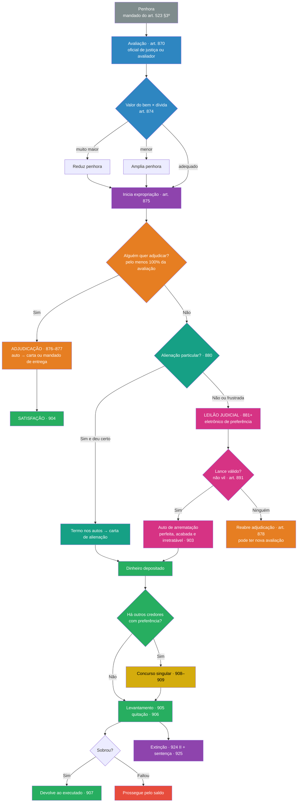

> [!info] Legenda das fontes
> - **[Neves p. X]**: Neves, *Manual de Direito Processual Civil*, cap. 51 (pp. 1288–1327 do arquivo enviado). ⚠️ O TT2 indica a **18ª ed. (2026)**; o arquivo parece ser de uma edição anterior, então **as páginas podem não coincidir**.
> - **[TT2]**: orientações do Trabalho Temático 2 (quatro eixos).
> - **CPC**: arts. 870–875, art. 891, p.u., e arts. 904–909 conferidos no texto legal ([Projuris](https://www.projuris.com.br/novo-cpc/art-870-a-875-do-novo-cpc/); [Aurum](https://www.aurum.com.br/blog/novo-cpc-comentado/art-904-a-909-cpc); [Migalhas](https://www.migalhas.com.br/coluna/jurisprudencia-do-cpc/347149/art-891-do-cpc-e-preco-vil)). Os demais vêm do Neves.
> - 🔎 **conferir**: dado que tirei de memória e não consegui conferir nesta sessão. Confirme no [Planalto](https://www.planalto.gov.br/ccivil_03/_ato2015-2018/2015/lei/l13105.htm).
> - ⚠️ **fora do material**: o que não está nos arquivos da disciplina.
> - Os slides e o material do professor (`2026-enviar-cs.pdf`) **não tratam** desta matéria, que pertence ao TT2.

**Mapa:** [[Avaliação expropriação e satisfação do crédito.canvas]]
**Vem de:** [[Cumprimento de sentença por quantia certa - fluxo do art. 523]]: o art. 523, §3º, manda expedir o **mandado de penhora e avaliação** quando o devedor não paga em 15 dias úteis. **Esta nota começa exatamente aí.**

---

## 1. Resumo rápido

Quando o devedor não paga, o Estado **toma** bens dele em quatro etapas:

1. **Penhora:** separa um bem para a dívida. ⚠️ A penhora **não foi dada em aula** e não é objeto desta nota.
2. **Avaliação (arts. 870–875):** descobre **quanto o bem vale**. É o número que orienta todo o resto.
3. **Expropriação (arts. 876–903):** tira o bem do devedor. A ordem legal de preferência é:
   - **adjudicação:** alguém **fica com o bem** pelo valor da avaliação, no mínimo;
   - **alienação por iniciativa particular:** venda feita pelo próprio credor, por um corretor ou por um leiloeiro;
   - **leilão judicial (arrematação):** venda pública, de preferência eletrônica;
   - **apropriação de frutos e rendimentos:** o credor recebe os aluguéis ou lucros do bem até quitar a dívida.
4. **Satisfação (arts. 904–909):** o credor recebe o **dinheiro** ou **fica com o bem** (adjudicação). Se houver vários credores, o dinheiro é dividido pela ordem de preferência. Se sobrar, a sobra volta ao devedor.

**Se o que foi penhorado já é dinheiro**, não há expropriação: o credor apenas **levanta** o valor [Neves p. 1294].

---

## 2. Explicação aprofundada

### 2.1. Técnica Feynman (versão leiga)

> [!example] Como explicar para um leigo
> Imagine que o devedor tem um carro e não pagou. Primeiro a Justiça **"reserva"** o carro para a dívida (penhora). Depois descobre **quanto o carro vale** (avaliação). Então tenta transformar o carro em pagamento, nesta ordem:
> 1. **"Alguém quer ficar com o carro pelo preço da avaliação?"** Pode ser o próprio credor, ou um parente do devedor que queira manter o carro na família. Isso é a **adjudicação**.
> 2. **"Vamos tentar vender sem leilão",** por meio do credor ou de um corretor. Isso é a **alienação particular**.
> 3. **"Vamos leiloar".** Isso é o **leilão judicial**. O carro pode sair abaixo da avaliação, mas **nunca por um preço ridículo**, o chamado **"preço vil"**.
>
> Com o dinheiro na mão, o juiz paga o credor. Se sobrar, devolve ao devedor. Se faltar, a cobrança continua pelo restante.

### 2.2. Eixo 1: avaliação dos bens penhorados (arts. 870–875)

#### a) Para que serve a avaliação

A avaliação dá um **valor de referência ao bem penhorado**. Esse número é usado em quatro momentos [Neves p. 1291]:

1. **Ajustar a penhora:** se o bem vale muito mais que a dívida, a penhora é **reduzida**. Se vale menos, é **ampliada** (art. 874).
2. **Valor mínimo da adjudicação:** ninguém adjudica por **menos** do que a avaliação (art. 876, caput).
3. **Base do preço vil no leilão:** se o juiz não fixou preço mínimo, é vil o lance **abaixo de 50% da avaliação** (art. 891, p.u.).
4. **Valor mínimo da proposta parcelada** apresentada antes do 1º leilão (art. 895, I).

#### b) Quem avalia (art. 870)

| Regra | Quem | Detalhe |
|---|---|---|
| **Regra** | **Oficial de justiça** | Avalia no próprio ato da penhora: a vistoria e o laudo ficam anexados ao **auto de penhora** (art. 872) |
| **Exceção** (art. 870, p.u.) | **Avaliador nomeado pelo juiz** | Quando for preciso **conhecimento especializado** **e** o valor da execução **comportar o custo**. Prazo para o laudo: **até 10 dias** |

- **Procedimento:** é sumário. Para o STJ e parte da doutrina, **não há quesitos nem assistentes técnicos**; o contraditório é feito intimando as partes para falar sobre o laudo. Neves concorda, para evitar demora (STJ, RMS 10.994/PE) [Neves p. 1291].
- **Conteúdo do laudo (art. 872):** (I) os bens, suas características e estado de conservação; (II) o valor. Se o **imóvel admitir divisão cômoda**, a avaliação é feita **em partes**, e as partes têm **5 dias** para falar sobre a proposta de desmembramento [Neves p. 1291].

#### c) Quando **não** há avaliação (art. 871)

| Inciso | Hipótese |
|---|---|
| I | Uma parte **aceita a estimativa** feita pela outra. Mesmo assim, o juiz pode mandar avaliar se tiver **dúvida fundada** (p.u.) |
| II | Títulos ou mercadorias **com cotação em bolsa**, comprovada por certidão ou publicação oficial |
| III | Títulos da dívida pública, ações e títulos de crédito negociáveis em bolsa: vale a **cotação oficial do dia** |
| IV | **Veículos** e bens cujo **preço médio de mercado** pode ser obtido em pesquisas oficiais ou anúncios (ex.: Tabela Fipe). Quem indicou o bem comprova a cotação |

Neves acrescenta uma hipótese fora do CPC: o **valor do imóvel hipotecado ajustado na escritura** (CC, art. 1.484) [Neves p. 1292].

#### d) Quando há **nova** avaliação (art. 873)

| Inciso | Hipótese | Observações de Neves [p. 1292–1293] |
|---|---|---|
| I | Qualquer parte alega, **de forma fundamentada**, **erro** na avaliação ou **dolo** do avaliador | O juiz pode agir **de ofício**. Não se exige prova pronta, só alegação séria. **Quem impugna adianta os honorários** do avaliador (STJ, REsp 729.712/SP) |
| II | Depois da avaliação, o bem **valorizou ou desvalorizou** | Só se a variação for **significativa**. **Atualizar** o valor não é nova avaliação. **Enunciado 156 da II Jornada do CJF:** o simples passar do tempo **não obriga**, por si só, a nova avaliação |
| III | O juiz tem **dúvida fundada** sobre o valor da primeira avaliação | Aplica-se o art. 480 (segunda perícia): a nova **não substitui** a primeira, e o juiz pondera as duas |

#### e) Depois da avaliação: ajuste da penhora (art. 874)

Ouvida a parte contrária, o juiz pode:
- **(I) reduzir** a penhora, ou trocá-la por outros bens, se o valor dos bens for **consideravelmente superior** ao crédito;
- **(II) ampliar** a penhora, ou trocá-la por bens mais valiosos, se o valor for **inferior** ao crédito.

O texto do art. 874 fala em "requerimento do interessado". Neves defende que o juiz também pode agir **de ofício**, desde que ouça as partes antes (contraditório) [Neves p. 1293].

**Art. 875:** feitas a penhora e a avaliação, o juiz **dá início aos atos de expropriação**.

> [!tip] Relação avaliação × penhora × expropriação (pergunta típica: Q3 do TT2)
> **Penhora** separa o bem → **avaliação** dá o número → esse número decide: (i) se a penhora fica, cresce ou diminui (art. 874); (ii) o **piso da adjudicação** (100% da avaliação); (iii) o **piso do leilão** (preço vil: abaixo do mínimo do edital ou, sem ele, abaixo de 50%); (iv) o piso da proposta parcelada antes do 1º leilão.

---

### 2.3. Eixo 2: expropriação e adjudicação (arts. 876–878)

#### a) As formas de expropriação e a ordem entre elas

**Expropriar** = retirar a propriedade de um bem do executado para satisfazer o exequente. É **execução por sub-rogação**: o Estado age no lugar do devedor [Neves p. 1294].

| Ordem | Forma | Artigos |
|---|---|---|
| 1º | **Adjudicação** | 876–878 |
| 2º | **Alienação por iniciativa particular** | 879, I, e 880 |
| 3º | **Alienação em leilão judicial** (arrematação) | 879, II, e 881–903 |
| — | **Apropriação de frutos e rendimentos** | 867–869 (penhora de frutos e rendimentos) |
| Atípica | **Alienação antecipada** | 852–853 |

- A ordem **não é aleatória**: é uma **preferência legal** [Neves p. 1294].
- **STJ:** se o exequente diz que **não quer** adjudicar nem fazer alienação particular, passa-se **direto ao leilão** (REsp 1.312.509/RN) [Neves p. 1294].
- **Enunciado 106 da I Jornada do CJF:** a apropriação de frutos e rendimentos pode vir **antes** da adjudicação, se **não prejudicar o exequente** e for **mais favorável ao executado** [Neves p. 1296].
- ⚠️ **Fora do material:** o rol das formas de expropriação está no **art. 825** do CPC.

#### b) O que é adjudicação

**Adjudicação** = o bem penhorado (móvel ou imóvel) **sai do patrimônio do executado e vai, como pagamento, para o patrimônio do legitimado** (em regra, o exequente) [Neves p. 1294].

- **Parece dação em pagamento, mas não é:** a dação é **voluntária**, e a adjudicação é **forçada** [Neves p. 1294].
- **Adjudicação × arrematação:** na adjudicação pelo **exequente**, o **próprio bem** paga a dívida. Na arrematação, o bem **vira dinheiro** e o dinheiro paga. Se quem adjudica **não é o exequente** (ex.: um filho do devedor), ele **deposita o valor**, e a figura fica muito parecida com a arrematação. A diferença é procedimental: certos sujeitos ganham o direito de comprar **antes** do leilão [Neves p. 1295].

#### c) Preço da adjudicação e as três situações possíveis

**Preço mínimo = valor da avaliação** (art. 876, caput). Comparando com o valor da dívida:

| Situação | O que acontece | Nome doutrinário |
|---|---|---|
| Avaliação **=** dívida | Entrega do bem; dívida quitada | Adjudicação-satisfativa |
| Avaliação **<** dívida | Entrega do bem; a **execução prossegue pelo saldo** (art. 876, §4º, II 🔎) | Adjudicação-satisfativa |
| Avaliação **>** dívida | O adjudicante **deposita a diferença**, que fica à disposição do executado (art. 876, §4º, I 🔎) | **Adjudicação-venda** |

[Neves p. 1294–1295]

- **Pode adjudicar por menos que a avaliação?** Neves acha razoável aceitar um valor menor **depois de frustradas as tentativas de alienação**, desde que não vil. **Mas a lei, a doutrina majoritária e o STJ dizem que não:** o piso é sempre a avaliação (REsp 1.186.373/MS). Exceção isolada: o STJ admitiu valor menor depois de **8 hastas públicas frustradas** (REsp 435.120/SP) [Neves p. 1298].

#### d) Quando se pode adjudicar

- É a forma **preferencial**: pode acontecer **antes de qualquer outra** [Neves p. 1295].
- **Não há preclusão:** pode-se adjudicar **até depois de publicado o edital do leilão**. Nesse caso, o adjudicante paga as despesas que se tornaram inúteis (STJ, REsp 1.505.399/RS) [Neves p. 1296].
- **Art. 878:** se **todas** as tentativas de alienação fracassarem, **reabre-se a oportunidade de adjudicar**, podendo haver **nova avaliação**.
- Só **não** cabe adjudicação se o bem já foi alienado ou se já está em curso a apropriação de frutos [Neves p. 1296].
- **Opinião de Neves:** no processo de execução, só se deveria adjudicar **depois do prazo dos embargos** e depois de decidido eventual pedido de efeito suspensivo [Neves p. 1297].

#### e) Intimação do executado (art. 876, §§1º–3º)

Feito o pedido de adjudicação, o executado é intimado:
- (I) pelo **Diário da Justiça, na pessoa do advogado**;
- (II) por **carta com AR**, se representado pela Defensoria ou sem advogado;
- (III) por **meio eletrônico**, se for empresa sem advogado (art. 246, §1º).

A intimação é **dispensada** se o devedor foi **citado por edital** e **não tem advogado** nos autos (§3º) [Neves p. 1297]. É a mesma lógica da intimação para o cumprimento (art. 513, §2º): veja [[Disposições gerais do cumprimento de sentença e cumprimento provisório#c) Intimação (art. 513, §§2º–4º)]].

#### f) Quem pode adjudicar (art. 876, §§5º e 7º)

1. o **exequente**;
2. os **credores concorrentes** que **já penhoraram o mesmo bem**;
3. o **credor com garantia real** (hipotecário, pignoratício);
4. o **cônjuge**;
5. o **companheiro**;
6. os **descendentes** do executado;
7. os **ascendentes** do executado;
8. **sócios não devedores**, se o bem penhorado for **quota** de sociedade ou ação de S.A. **fechada** (§7º). A sociedade é intimada e avisa os sócios.

[Neves p. 1298–1299]

- **Familiares não são intimados.** Se quiserem adjudicar, entram por **intervenção voluntária atípica**, e a falta de aviso a eles **não gera nulidade** [Neves p. 1299].
- 🔎 **Conferir:** o §5º também remete aos sujeitos do **art. 889, II a VIII** (como o credor com garantia real e o titular de usufruto).

#### g) Mais de um interessado (art. 876, §6º)

- Faz-se uma **licitação** entre eles: **vence a maior oferta** (a "regra de ouro").
- **Empate:** a preferência é **cônjuge → companheiro → descendente → ascendente**. Neves completa: depois vêm o credor com garantia real e os demais credores; entre credores concorrentes, **quem penhorou primeiro** (*prior tempore, potior jure*).
- Na mesma categoria, prefere o **parente mais próximo** (pai antes do avô). Persistindo o empate, **sorteio**.
- **Sócios** (quotas e ações) preferem **a todos**, inclusive ao cônjuge: a ideia é manter a sociedade entre os sócios originais (*affectio societatis*).
- **Crítica de Neves:** pôr o companheiro **depois** do cônjuge fere a equiparação constitucional entre casamento e união estável.

[Neves p. 1299–1300]

#### h) Formalização (art. 877)

- **§1º:** a adjudicação fica **perfeita e acabada** com a **lavratura e assinatura do auto** pelo juiz, pelo adjudicatário, pelo escrivão e, **se estiver presente**, pelo executado.
- Depois expede-se: **carta de adjudicação** e mandado de imissão na posse, se for **imóvel**; **mandado de entrega**, se for **móvel**.
- **Carta (§2º):** descrição do imóvel com remissão à matrícula, cópia do auto e prova de quitação do **imposto de transmissão**.
- **§3º:** se o bem for **imóvel hipotecado**, o executado pode **remi-lo** (resgatá-lo) **até a assinatura do auto**, pagando valor igual ao da avaliação ou ao do maior lance oferecido.

[Neves p. 1302]

#### i) Adjudicação "provisória"

No processo de execução, os embargos, em regra, **não têm efeito suspensivo**. Então pode haver adjudicação **enquanto os embargos estão pendentes**. Se o executado vencer depois, **o bem lhe é devolvido** [Neves p. 1303].

---

### 2.4. Eixo 3: alienação judicial e apropriação de frutos

#### a) Alienação por iniciativa particular (arts. 879, I, e 880)

- **Para que serve:** evitar o leilão, que é **caro, demorado e complexo** [Neves p. 1303].
- **Quem pede:** o **exequente**, se não houve adjudicação. **Crítica de Neves:** o executado também tem interesse em vender pelo maior preço, mas a lei não lhe deu legitimidade. Mesmo assim, ele pode **indicar comprador** [Neves p. 1304].
- **Quem vende:** o próprio exequente, um **corretor** ou um **leiloeiro** credenciado no tribunal. O corretor precisa de **pelo menos 3 anos de profissão** (§3º). **Onde não houver credenciados, o exequente escolhe livremente (§4º)** [Neves p. 1304–1305].
- **FPPC, Enunciado 192:** venda por corretor **não credenciado** só é nula se houver **prejuízo** [Neves p. 1305].
- **O juiz fixa (§1º):** prazo, forma de publicidade, **preço mínimo**, condições de pagamento, garantias e comissão de corretagem.
  - O preço mínimo **não precisa ser o da avaliação**: a avaliação é só referência. O mínimo pode ficar abaixo dela, desde que **não seja vil** [Neves p. 1306–1307].
  - Se as partes **concordarem** sobre essas condições, prevalece o acordo [Neves p. 1306].
- **Formalização (§2º):** **termo nos autos**, assinado pelo juiz, exequente, adquirente e, se presente, executado. Depois: **carta de alienação** e mandado de imissão na posse (imóvel) ou **ordem de entrega** (móvel) [Neves p. 1307].

#### b) Leilão judicial e arrematação (arts. 879, II, e 881–903)

**Quando:** se não houve adjudicação **nem** alienação particular (art. 881). **Preferencialmente eletrônico** (art. 882). O CPC/2015 acabou com a antiga distinção entre "praça" (imóveis) e "leilão" (móveis): agora tudo é **leilão**, eletrônico ou presencial [Neves p. 1307–1308].

**Edital (art. 886)** [Neves p. 1308–1310]:
- descrição do bem (imóvel: matrícula e registros);
- **valor da avaliação**, **preço mínimo**, condições de pagamento e comissão do leiloeiro;
- local onde estão os bens;
- site e período (eletrônico) ou local, dia e hora (presencial);
- data do **2º leilão**, que só acontece **se não houver interessado no 1º**;
- **ônus, recursos ou processos pendentes** sobre o bem.

> [!important] Já no 1º leilão se aceita lance abaixo da avaliação
> No CPC/73, o 2º leilão existia porque o 1º exigia lance **acima** da avaliação. Hoje o 2º leilão só ocorre **se ninguém aparecer** no 1º. Logo, já no 1º leilão vale lance **abaixo** da avaliação, desde que **não seja vil** [Neves p. 1309].

- **Vício no edital** só anula o leilão se houver **prejuízo**: princípio da **instrumentalidade das formas** [Neves p. 1310].
- **Publicidade (art. 887):** o leiloeiro divulga com antecedência mínima de **5 dias** (§1º), **preferencialmente pela internet** (§2º) [Neves p. 1310].
- 🔎 **Conferir (art. 889):** o executado deve ser intimado do leilão com pelo menos **5 dias** de antecedência.

**Quem NÃO pode arrematar (art. 890)** [Neves p. 1316–1317]:

| Motivo do impedimento | Sujeitos |
|---|---|
| Relação especial **com as partes** | Tutores e curadores; **advogados** de qualquer das partes |
| Relação especial **com o bem** | Testamenteiros, administradores, liquidantes (bens sob sua guarda); mandatários (bens que administram); servidores públicos (bens da pessoa jurídica a que servem) |
| Participação **no processo** | **Juiz, membro do MP e da Defensoria, escrivão** e auxiliares da justiça, na localidade onde servem; **leiloeiros** e prepostos |
| Inadimplência anterior | **Arrematante e fiador remissos**, que não pagaram uma arrematação anterior (art. 897) |

- O **exequente pode arrematar**. Ele escolhe: **adjudicar** logo, pela avaliação, ou **esperar o leilão** e tentar arrematar mais barato, desde que não seja preço vil [Neves p. 1317].

> [!danger] Preço vil (art. 891) — conferido
> **Não se aceita lance vil.** É **vil** o preço:
> 1. **inferior ao mínimo** fixado pelo juiz e que consta do **edital**; ou
> 2. se o juiz **não fixou** mínimo, **inferior a 50% da avaliação**.
>
> - **Imóvel de incapaz (art. 896):** o lance tem de alcançar **pelo menos 80% da avaliação** [Neves p. 1318].
> - **Jurisprudência:**
>   - **STJ, REsp 1.648.020/MT** (3ª T., 09/10/2018): conforme as peculiaridades, **arrematar abaixo de 50% não foi considerado vil** (2º leilão, lance único, no mínimo do edital).
>   - TJSP, AI 2126887-05.2017.8.26.0000 (23/10/2017): abaixo de 50% **foi** vil, e foi mandada nova avaliação porque haviam passado 7 anos.
>   - Fonte: [Migalhas](https://www.migalhas.com.br/coluna/jurisprudencia-do-cpc/347149/art-891-do-cpc-e-preco-vil). ⚠️ **Fora do material**; não conferi no site dos tribunais. Não achei julgado do **TJRJ** nesta busca.
> - **Para que serve a regra:** proteger o executado contra a "liquidação" do seu patrimônio (**menor onerosidade**, art. 805). O lado bom de um percentual fixo é a **segurança jurídica**; o lado ruim é a **rigidez** [Neves p. 1318].

**Pagamento (art. 892)** [Neves p. 1318–1319]:
- **Regra:** **imediato**, por depósito judicial ou meio eletrônico.
- **Exequente arrematante e único credor:** **não precisa depositar** o preço. Se o preço **passar** do valor do crédito, deposita a **diferença em 3 dias**, sob pena de a arrematação ficar sem efeito e haver **novo leilão às custas dele** (§1º). Havendo **concurso de credores**, deposita **tudo**.
- **Empate entre lances (§2º):** prefere cônjuge → companheiro → descendente → ascendente. **Bem tombado (§3º):** União → Estados → Municípios.
- **Imóvel divisível (art. 894):** a pedido do executado, vende-se **só a parte suficiente** para pagar.

**Proposta parcelada (art. 895)** [Neves p. 1317–1320]:

| Momento da proposta | Valor mínimo |
|---|---|
| Até o início do **1º leilão** | **Valor da avaliação** |
| Até o início do **2º leilão** | Qualquer valor **não vil** |

- **Forma (§1º):** **pelo menos 25% à vista** + o resto em **até 30 meses**. Garantia: **caução idônea** (móvel) ou **hipoteca do próprio bem** (imóvel).
- A proposta **não suspende o leilão** (§6º).
- **À vista prefere a parcelada (§7º).** Crítica de Neves: a lei não diz "em igualdade de valores", e uma parcelada de R$ 80 mil é melhor que uma à vista de R$ 40 mil.
- **Entre parceladas (§8º):** prevalece a de maior valor; se forem idênticas, a primeira. Crítica de Neves: o juiz deveria pesar valor, percentual à vista e número de parcelas.
- **Atraso nas parcelas:** o exequente escolhe entre **resolver** a arrematação ou **executar o arrematante** (§5º). 🔎 Conferir a multa do §4º (10% sobre a parcela atrasada somada às vincendas).
- **Art. 897:** quem não paga **perde a caução**, o bem volta a leilão, e esse arrematante e seu fiador **não podem participar**.

**Auto e carta de arrematação (arts. 901 e 903)** [Neves p. 1321]:
- O **auto** é lavrado **de imediato**. Se não houver arrematação, faz-se um "auto negativo".
- **Art. 903, caput:** assinado o auto pelo **juiz, pelo arrematante e pelo leiloeiro**, a arrematação é **perfeita, acabada e irretratável**, mesmo que depois os embargos ou a impugnação do executado sejam julgados procedentes. Nesse caso, o executado recebe **indenização**, mas **não o bem de volta**. É a mesma lógica do art. 520, §4º, no cumprimento provisório: veja [[Disposições gerais do cumprimento de sentença e cumprimento provisório#b) O regime do art. 520]].
- **Auto ≠ carta.** A **carta de arrematação** (imóvel) só é expedida depois do depósito ou das garantias, do pagamento da comissão do leiloeiro e das despesas. Contém a descrição do imóvel com matrícula, cópia do auto, prova de quitação do **ITBI** e eventuais ônus. **Bem móvel:** basta a **ordem de entrega** (art. 901, §§1º e 2º).

**Vícios da arrematação (art. 903, §1º)** [Neves p. 1322–1323]:

| Inciso | Vício | Exemplo |
|---|---|---|
| I | **Invalidada**: **preço vil** ou **qualquer outro vício** | Falta de publicidade, falta de intimação do executado, arrematante impedido |
| II | **Ineficaz**: falta de intimação exigida pelo **art. 804** | Credor hipotecário, pignoratício ou anticrético **não intimado** do leilão |
| III | **Resolvida**: **não pagamento** do preço ou **não prestação** da caução | Arrematante que não deposita |

- Para a doutrina majoritária, é **matéria de ordem pública**: o juiz pode conhecer **de ofício** e a parte pode alegar por **simples petição** [Neves p. 1323].
- 🔎 **Conferir:** pelo §2º, o juiz decide esses vícios se provocado em até **10 dias** depois de aperfeiçoada a arrematação.
- **Depois de expedida a carta** (ou a ordem de entrega), só por **ação autônoma**, com o arrematante como **litisconsorte necessário** (§4º; STJ, REsp 1.313.053/DF) [Neves p. 1321–1323].
- 🔎 **Conferir:** §5º (hipóteses em que o arrematante pode **desistir**) e §6º (alegar vício **infundado** só para provocar a desistência é ato atentatório à dignidade da justiça, com multa de até 20% do valor do bem).

**Alienação antecipada (arts. 852–853):** é uma forma **excepcional**, fora da ordem normal. Cabe para **veículos, semoventes e bens deterioráveis ou sujeitos a depreciação** (ex.: alimentos perecíveis, remédios), ou quando houver **manifesta vantagem**. A parte contrária é ouvida em **3 dias** (art. 853). Pode ser pedida pelas partes ou pelo depositário, ou determinada **de ofício** [Neves p. 1323–1324].

#### c) Apropriação de frutos e rendimentos (arts. 867–869)

- **O que é:** em vez de vender o bem, o credor **recebe os frutos dele** (aluguéis, lucros) até ser pago. O CPC/73 chamava isso de "**usufruto**" judicial. Neves elogia a troca do nome, mas diz que nem "anticrese" seria exato [Neves p. 1288–1289].
- **Quando (art. 867):** quando o juiz considerar a medida **mais eficiente para o credor e menos gravosa para o devedor**. Pressuposto lógico: o bem precisa ser **capaz de gerar frutos** suficientes em **tempo razoável**; senão, o processo vira "eterno" [Neves p. 1289].
- **Administrador-depositário (arts. 868–869):** pode ser o **exequente ou o executado**, **se as partes concordarem**; se não concordarem, um **profissional qualificado**. Ele submete a forma de administração ao juiz e **presta contas periodicamente** [Neves p. 1289].
- **Efeitos:**
  - o executado **perde o uso e o gozo** do bem **até o exequente receber** principal, juros, custas e honorários. A medida é **temporária**;
  - eficácia perante terceiros: com a **publicação** da decisão e, se for imóvel, com a **averbação** no Registro de Imóveis (art. 868, §§1º–2º);
  - se o imóvel estiver alugado, o **inquilino passa a pagar** ao administrador ou ao exequente (art. 869, §3º);
  - o exequente pode alugar o bem, **ouvido o executado**. Se divergirem, o juiz decide, e cabe agravo (art. 869, §4º).

  [Neves p. 1290]

---

### 2.5. Eixo 4: satisfação do crédito (arts. 904–909) — conferido

#### a) As duas formas de satisfação (art. 904)

O credor é satisfeito por:
- **(I) entrega do dinheiro**, vindo de penhora de dinheiro, alienação ou frutos; ou
- **(II) adjudicação** dos bens penhorados.

#### b) Levantamento do dinheiro (art. 905)

O juiz autoriza o exequente a **levantar**, **até a satisfação integral**, o dinheiro depositado, o produto da alienação, o faturamento de empresa ou os frutos e rendimentos, **desde que**:
- **(I)** a execução seja movida **só em benefício do exequente singular**, que tem preferência sobre os bens penhorados; **e**
- **(II)** **não haja outros privilégios ou preferências** sobre os bens, **instituídos antes da penhora**.

Se houver outros credores com preferência, **não se levanta**: abre-se o **concurso** (item d).

- **P.u.:** é **proibido levantar dinheiro ou liberar bens durante o plantão judiciário**. Para Neves, a regra nasce da desconfiança de conluios. Parte da doutrina admite exceção se o exequente provar necessidade e urgência [Neves p. 1325].
- **Provimento 68/2018 do CNJ:** a decisão que defere o levantamento exige **intimar a parte contrária** antes. O levantamento só ocorre depois do prazo para impugnar ou recorrer [Neves p. 1325].

#### c) Quitação e saldo (arts. 906–907)

- **Art. 906:** ao receber o mandado de levantamento, o exequente dá **quitação** ao executado **por termo nos autos**. O mandado pode ser trocado por **transferência eletrônica** para a conta indicada pelo exequente (p.u.).
- **Art. 907:** pagos ao exequente **o principal, os juros, as custas e os honorários**, **o que sobrar volta ao executado**.

#### d) Vários credores: concurso singular (arts. 908–909)

- **Art. 908, caput:** com **mais de um credor**, o dinheiro é distribuído **pela ordem das preferências** de cada um.
- **§1º:** na adjudicação ou alienação, os créditos que recaem sobre o bem, **inclusive os *propter rem*** (ex.: condomínio, IPTU), **passam para o preço**. Ou seja, **o arrematante recebe o bem livre** e os credores são pagos com o dinheiro da venda.
- **§2º:** **sem preferência legal**, divide-se pela **anterioridade da penhora**: quem penhorou primeiro recebe primeiro.
- **Art. 909:** os credores só podem discutir **direito de preferência** e **anterioridade da penhora**. Apresentadas as razões, o juiz decide. Para Neves, é **decisão interlocutória**, impugnável por **agravo de instrumento** (art. 1.015, p.u.) [Neves p. 1326].
- **Concurso singular ≠ concurso universal.** O universal é o da **insolvência civil**, e o singular é só um incidente da execução comum. Ver [[Processo Civil III - Execução#5.2 Insolvência civil]] [Neves p. 1326].

**Ordem de preferência, segundo a "melhor doutrina" citada por Neves** [p. 1326]:

| Ordem | Crédito | Observação |
|---|---|---|
| 1º | **Trabalhista** | — |
| 2º | **Tributário** | — |
| 3º | **Com garantia real** | Até o valor do bem gravado. O STJ já decidiu que o **crédito condominial prefere à garantia real** (REsp 511.003/SP) |
| 4º | Com **privilégio especial** | — |
| 5º | Com **privilégio geral** | — |
| Depois | **Quirografários** (sem preferência) | Pela **anterioridade da penhora** (art. 908, §2º) |

- **Quem precisa ter penhorado o bem para entrar no concurso?** Para Neves, o **titular de direito real** não precisa. Os demais credores com privilégio de direito material **precisam ter penhorado** o bem (STJ, REsp 1.278.545/MG) [Neves p. 1326–1327].
- **Penhora, arresto e hipoteca judiciária** contam igualmente para fixar a anterioridade [Neves p. 1327].

#### e) Imputação do pagamento, satisfação parcial e encerramento

- **Imputação:** o art. 907 fixa a ordem do que precisa ser pago antes de devolver o saldo: **principal, juros, custas e honorários**. ⚠️ **Fora do material:** a regra civil é que, havendo capital e juros, o pagamento se imputa **primeiro nos juros vencidos** (CC, art. 354). Nem o Neves nem o MP tratam da imputação em detalhe; confira na bibliografia do TT2 (Dalla/Pinho ou Donizetti).
- **Satisfação parcial:** se o dinheiro **não basta**, a execução **prossegue pelo saldo**, com nova penhora (art. 874, II, ampliação) ou adjudicação pelo valor da avaliação (art. 876, §4º, II 🔎).
- **Satisfação integral:** quitação (art. 906) → **extinção** da execução por **satisfação da obrigação** (art. 924, II), declarada por **sentença** (art. 925), contra a qual cabe **apelação**. Ver [[Processo Civil III - Execução#11.3 Extinção da execução]].

---

## 3. Mapa mental

Versão visual: [[Avaliação expropriação e satisfação do crédito.canvas]]

- **AVALIAÇÃO → EXPROPRIAÇÃO → SATISFAÇÃO**
	- **Avaliação (870–875)**
		- Quem: oficial de justiça (regra) · avaliador, se precisar de conhecimento técnico e o valor justificar (laudo em até 10 dias)
		- Dispensa (871): parte aceita a estimativa da outra · cotação em bolsa · veículos e bens com preço de mercado
		- Nova avaliação (873): erro/dolo · valorização ou desvalorização relevante · dúvida fundada do juiz
		- Depois: reduzir ou ampliar a penhora (874) → inicia a expropriação (875)
	- **Expropriação: ordem de preferência**
		- 1º **Adjudicação (876–878)**: pelo menos 100% da avaliação · exequente, credores com penhora, credor com garantia real, cônjuge, companheiro, descendentes, ascendentes, sócios · licitação, empate: cônjuge > companheiro > descendente > ascendente · auto + carta (imóvel) ou mandado de entrega (móvel)
		- 2º **Alienação particular (880)**: exequente, corretor ou leiloeiro · juiz fixa prazo, preço mínimo (pode ficar abaixo da avaliação, mas não vil), pagamento, comissão · termo nos autos
		- 3º **Leilão judicial (881–903)**: eletrônico de preferência · edital · **preço vil**: abaixo do mínimo do edital ou, sem ele, abaixo de 50% (incapaz: 80%) · parcelado: 25% à vista + até 30 meses · auto assinado = **irretratável** · vícios: invalidada / ineficaz / resolvida
		- **Apropriação de frutos (867–869)**: administrador-depositário · temporária, até pagar tudo
		- Atípica: **alienação antecipada (852)**
	- **Satisfação (904–909)**
		- Dinheiro ou adjudicação (904)
		- Levantamento só sem outras preferências anteriores à penhora (905) · proibido no plantão
		- Quitação (906) · sobra volta ao executado (907)
		- Concurso singular (908–909): preferências de direito material → depois anterioridade da penhora · créditos *propter rem* passam para o preço
		- Fim: extinção por satisfação (924, II) por sentença (925)

---

## 4. Esquemas visuais
### Fluxo completo: da avaliação à satisfação

### Quadro comparativo: adjudicação × alienação particular × leilão × frutos (Q4 e Q6 do TT2)

| | **Adjudicação** | **Alienação particular** | **Leilão judicial** | **Apropriação de frutos** |
|---|---|---|---|---|
| O que acontece com o bem | **Vai para o adjudicante** | **Vendido** a terceiro | **Arrematado** em público | **Fica com o executado**, mas sem uso: os frutos vão ao credor |
| Quem pode | Exequente, credores, cônjuge, família, sócios (876) | Exequente pede; vende ele, um corretor ou um leiloeiro | Qualquer um, salvo os impedidos (890) | Juiz determina; administrador-depositário |
| Preço mínimo | **100% da avaliação** | **Fixado pelo juiz** (pode ficar abaixo da avaliação, mas não vil) | **Não vil**: mínimo do edital, ou 50% da avaliação (80% para incapaz) | Não se aplica; dura **até pagar tudo** |
| Formalização | **Auto** + carta ou mandado de entrega (877) | **Termo** + carta de alienação ou ordem de entrega (880, §2º) | **Auto** + carta de arrematação ou ordem de entrega (901) | Decisão + averbação, se imóvel (868) |
| Controles | Licitação entre os interessados; preferências familiares | Juiz fixa todas as condições | Edital, publicidade, preço vil, arts. 890 e 903 | Prestação de contas; locação ouvido o executado |
| Ordem legal | **1ª** | **2ª** | **3ª** | Pode ser **priorizada** (Enunciado 106) |

### Os pisos de valor (para decorar)

| Situação | Piso |
|---|---|
| Adjudicação | **100%** da avaliação |
| Proposta parcelada até o 1º leilão | **100%** da avaliação |
| Imóvel de incapaz em leilão | **80%** da avaliação |
| Leilão sem preço mínimo no edital | **50%** da avaliação (abaixo disso = vil) |
| Leilão com preço mínimo no edital | **O mínimo do edital** |
| Proposta parcelada até o 2º leilão | Qualquer valor **não vil** |
| Alienação particular | **O mínimo fixado pelo juiz**, não vil |

---

## 5. Exemplos práticos

> [!example] Caso 1: adjudicação com diferença (ver MC2 do TT2)
> Dívida de **R$ 300.000**. Imóvel penhorado avaliado em **R$ 400.000**. O exequente quer adjudicar.
> - Pode, oferecendo **pelo menos R$ 400.000**, o valor da avaliação (art. 876, caput).
> - Como o bem vale **mais** que a dívida, ele **deposita a diferença de R$ 100.000**, que fica para o executado. É a adjudicação-venda.
> - O filho do executado também quer o imóvel → **licitação**. Se ambos oferecerem R$ 400.000, **o filho tem preferência** sobre o credor (art. 876, §6º).
> - Se ninguém quisesse adjudicar: alienação particular e, depois, leilão. Num leilão sem preço mínimo no edital, o lance de R$ 190.000 seria **vil** (abaixo de 50% de R$ 400.000 = R$ 200.000).

> [!example] Caso 2: valorização do bem (ver MC1 do TT2)
> Bens móveis avaliados em **R$ 80.000**. O executado traz elementos objetivos de que o valor **mudou muito**, e o credor pede leilão imediato.
> - Cabe **nova avaliação** (art. 873, II), porque a variação é **significativa** e está provada nos autos. Só o tempo passar não bastaria (Enunciado 156 da II Jornada do CJF).
> - O juiz deve **ouvir o credor** antes de decidir (contraditório).
> - Se a nova avaliação confirmar um valor muito diferente, a penhora pode ser **reduzida ou ampliada** (art. 874). Só depois segue-se a expropriação.

> [!example] Caso 3: arrematação e embargos procedentes
> O imóvel foi arrematado e o auto foi assinado. Meses depois, os embargos do executado são julgados procedentes.
> - **O arrematante fica com o imóvel**: a arrematação é perfeita, acabada e **irretratável** (art. 903, caput).
> - O executado recebe **indenização** do exequente, e não o bem.

> [!example] Caso 4: dois credores
> A penhorou o bem em março e B em maio. Nenhum dos dois tem preferência legal. O bem é vendido por R$ 100.000. A tem crédito de R$ 70.000 e B, de R$ 50.000.
> - A recebe **R$ 70.000**, porque penhorou primeiro (art. 908, §2º). B recebe os **R$ 30.000** restantes e continua executando o saldo de R$ 20.000.
> - Se B tivesse **crédito trabalhista**, receberia **antes** de A, independentemente da data da penhora (art. 908, caput).

---

## 6. Pontos de atenção

> [!danger] Pegadinhas
> 1. **Adjudicação abaixo da avaliação:** a regra é **não** (art. 876, caput). Isso vale mesmo depois de leilões frustrados (posição majoritária e do STJ).
> 2. **Alienação particular:** o preço mínimo **não é necessariamente** o da avaliação (Neves).
> 3. **Preço vil:** primeiro olhe o **mínimo do edital**. Os **50%** só valem **se não houver** mínimo fixado.
> 4. **Já no 1º leilão** se aceita lance abaixo da avaliação, desde que não vil.
> 5. **Auto ≠ carta.** O **auto** torna a arrematação irretratável. A **carta** é o documento para registrar o imóvel.
> 6. **Depois da carta**, o vício só se ataca por **ação autônoma**, com o arrematante como **litisconsorte necessário**.
> 7. **Credor hipotecário não intimado** → arrematação **ineficaz** perante ele (art. 804), e não nula.
> 8. **Penhora de dinheiro** dispensa a expropriação: basta **levantar**.
> 9. **Levantamento proibido no plantão judiciário** (art. 905, p.u.).
> 10. **Concurso singular** (execução comum) ≠ **concurso universal** (insolvência).
> 11. **O advogado** da parte **não pode** arrematar. **O exequente pode.**
> 12. **Cônjuge, companheiro, descendente, ascendente:** a preferência funciona **em igualdade de oferta**. A maior oferta vence sempre.

> [!tip] Números para decorar
> - **10** dias: laudo do avaliador (art. 870, p.u.)
> - **5** dias: falar sobre o desmembramento do imóvel (art. 872, §2º) · antecedência do edital (art. 887, §1º) · intimação do executado sobre o leilão (art. 889 🔎)
> - **3** dias: exequente arrematante deposita a diferença (art. 892, §1º) · falar sobre alienação antecipada (art. 853)
> - **3** anos: experiência mínima do corretor (art. 880, §3º)
> - **25%** à vista + **30** meses: proposta parcelada (art. 895, §1º)
> - **50%**: preço vil sem mínimo no edital (art. 891, p.u.) · **80%**: imóvel de incapaz (art. 896)
> - **10** dias para alegar vício da arrematação (art. 903, §2º 🔎) · multa de até **20%** por alegação infundada (art. 903, §6º 🔎)

> [!tip] Mnemônicos
> - **Ordem da expropriação → "A-P-L":** **A**djudica → **P**articular → **L**eilão
> - **Preferência no empate → "Casa, Companheiro, Criança, Coroa":** cônjuge (**casa**mento) → **companheiro** → descendente (**criança**) → ascendente (**coroa**)
> - **Vícios do art. 903, §1º → "I-I-R":** **I**nvalidada (preço vil/vício) · **I**neficaz (art. 804) · **R**esolvida (não pagou)

---

## 7. Jurisprudência

> [!note] Origem e verificação
> - Os julgados marcados com **[Neves]** foram citados no manual e **não foram verificados online**.
> - Os de preço vil vieram do [Migalhas](https://www.migalhas.com.br/coluna/jurisprudencia-do-cpc/347149/art-891-do-cpc-e-preco-vil).
> - **STJ:** <https://scon.stj.jus.br> (pesquisar pelo número) · **TJRJ:** <https://www3.tjrj.jus.br/ejuris> (nenhum julgado do TJRJ sobre estes temas apareceu nas fontes desta sessão).

| Tribunal / número | Tese | Fonte |
|---|---|---|
| STJ, RMS 10.994/PE (5ª T., 21/10/2004) | Avaliação dispensa quesitos e assistentes técnicos | [Neves] p. 1291 |
| STJ, REsp 729.712/SP (2ª T., 26/06/2007) | Quem impugna a avaliação adianta os honorários da nova | [Neves] p. 1292 |
| STJ, REsp 1.312.509/RN (1ª T., 07/12/2017) | Sem interesse em adjudicar ou em alienação particular → leilão imediato | [Neves] p. 1294 |
| STJ, REsp 1.505.399/RS (4ª T., 12/04/2016) | Adjudicação possível até depois do edital; o adjudicante paga as despesas inúteis | [Neves] p. 1296 |
| STJ, REsp 1.186.373/MS (4ª T., 24/03/2015) | Adjudicação **não** pode ser abaixo da avaliação | [Neves] p. 1298 |
| STJ, REsp 435.120/SP (3ª T., 07/03/2006) | Exceção: abaixo da avaliação depois de 8 hastas frustradas | [Neves] p. 1298 |
| STJ, REsp 1.313.053/DF (4ª T., 04/12/2012) | Ação anulatória da arrematação: o arrematante é litisconsorte necessário | [Neves] p. 1321–1322 |
| STJ, REsp 1.648.020/MT (3ª T., 09/10/2018) | Abaixo de 50% pode **não** ser vil, conforme o caso | Migalhas |
| TJSP, AI 2126887-05.2017.8.26.0000 (23/10/2017) | Abaixo de 50% foi vil; nova avaliação depois de 7 anos | Migalhas |
| STJ, REsp 511.003/SP (4ª T., 18/05/2010) | Crédito condominial prefere ao hipotecário | [Neves] p. 1326 |
| STJ, REsp 1.278.545/MG (3ª T., 02/08/2016) | Credor com privilégio (não real) precisa ter penhorado o bem para o concurso | [Neves] p. 1327 |

---

## 8. Fixação

> [!question] Q1 (objetiva)
> Bem avaliado em R$ 100.000. O edital **não** fixou preço mínimo. Qual lance pode ser aceito no 1º leilão?
> A) apenas a partir de R$ 100.000, porque no 1º leilão o lance deve igualar a avaliação
> B) a partir de R$ 50.000
> C) qualquer valor, se não houver outros interessados
> D) a partir de R$ 80.000

> [!question] Q2 (objetiva)
> Assinale a correta sobre adjudicação:
> A) só o exequente pode adjudicar
> B) havendo empate entre o credor com garantia real e o filho do executado, prefere o credor
> C) o preço mínimo é o valor da avaliação
> D) a adjudicação só cabe depois de frustrado o leilão

> [!question] Q3 (discursiva curta)
> Diferencie arrematação **invalidada**, **ineficaz** e **resolvida**, com um exemplo de cada (art. 903, §1º).

> [!question] Q4 (discursiva)
> Por que a arrematação é "irretratável" mesmo que os embargos do executado sejam julgados procedentes depois? Relacione com a proteção de terceiros no cumprimento provisório.

> [!question] Q5 (microcaso)
> Execução de R$ 60.000. Penhorado um imóvel avaliado em R$ 200.000, com hipoteca em favor do Banco X, que **não foi intimado** do leilão. No 2º leilão, o imóvel é arrematado por R$ 90.000; o edital não fixou preço mínimo. Depois de pago o exequente, sobram R$ 30.000. Analise: (a) o preço; (b) a situação do Banco X; (c) o destino da sobra; (d) o meio de impugnação depois de expedida a carta de arrematação.

> [!question] Recordação ativa (de cabeça)
> 1. Qual é a ordem legal das formas de expropriação?
> 2. Quais são os dois critérios do preço vil?
> 3. Quando o exequente pode levantar o dinheiro sozinho (art. 905)?

> [!success]- Gabarito comentado (clique para abrir)
> **Q1: B.** Sem mínimo no edital, é vil o lance abaixo de 50% da avaliação (art. 891, p.u.).
> - A está errada: no CPC/2015, já no 1º leilão se aceita lance abaixo da avaliação, desde que não vil [Neves p. 1309].
> - D seria o piso do imóvel de **incapaz** (80%, art. 896).
>
> **Q2: C.** Art. 876, caput.
> - A está errada: o §5º lista outros legitimados.
> - B está errada: no empate, a ordem é cônjuge, companheiro, **descendente**, ascendente; a família vem **antes** dos credores.
> - D está errada: a adjudicação é a **primeira** forma.
>
> **Q3:**
> - **Invalidada**: preço vil ou outro vício. Ex.: lance abaixo de 50% sem mínimo no edital; falta de intimação do executado.
> - **Ineficaz**: falta da intimação do art. 804. Ex.: credor hipotecário não intimado; a arrematação vale entre as partes, mas não produz efeitos contra ele.
> - **Resolvida**: falta de pagamento do preço ou da caução. Ex.: arrematante que não deposita.
>
> **Q4:** Pelo art. 903, caput, assinado o auto, a arrematação é perfeita, acabada e irretratável. O executado vencedor recebe **indenização**, não o bem. O fundamento é a **segurança jurídica** do arrematante: sem ela, ninguém daria lances e a expropriação perderia a utilidade. É a mesma lógica do art. 520, §4º: no cumprimento provisório, a reforma da decisão **não desfaz** a alienação feita a terceiro, e a reposição é econômica. Veja [[Disposições gerais do cumprimento de sentença e cumprimento provisório]].
>
> **Q5:**
> - (a) Sem mínimo no edital, é vil o lance abaixo de **R$ 100.000** (50% de R$ 200.000). R$ 90.000 é **preço vil** → arrematação **invalidável** (art. 891, p.u.; art. 903, §1º, I).
> - (b) O Banco X não foi intimado → a arrematação é **ineficaz perante ele** (art. 804; art. 903, §1º, II). Na prática, para o banco é como se a venda não tivesse acontecido: a **hipoteca continua gravando o imóvel**, agora nas mãos do arrematante.
>   - **Compare:** se o banco **tivesse sido intimado**, seu crédito passaria para o **preço** (art. 908, §1º), e ele receberia o dinheiro **antes** do exequente sem garantia (preferência do crédito com garantia real).
> - (c) Se houvesse sobra legítima, ela **volta ao executado** (art. 907), mas só **depois** de pagos os credores com preferência.
> - (d) Depois de expedida a carta: **ação autônoma**, com o arrematante como **litisconsorte necessário** (art. 903, §4º; REsp 1.313.053/DF). Antes dela: simples petição, por ser matéria de ordem pública (Neves).
>
> **Recordação ativa:**
> 1. Adjudicação → alienação por iniciativa particular → leilão judicial. A apropriação de frutos pode ser priorizada (Enunciado 106).
> 2. Abaixo do mínimo fixado no edital; se não houver mínimo, abaixo de 50% da avaliação.
> 3. Quando a execução é só em seu benefício (credor singular) e não há outros privilégios ou preferências sobre os bens instituídos antes da penhora.

---

## 9. Flashcards

#flashcards/CPCIII/expropriacao

Quem faz a avaliação em regra?::O oficial de justiça (art. 870); o avaliador só se precisar de conhecimento especializado e o valor da execução comportar (laudo em até 10 dias)
Hipóteses de dispensa da avaliação (871)?::Uma parte aceita a estimativa da outra; títulos/mercadorias com cotação em bolsa; títulos da dívida pública e ações cotados; veículos e bens com preço médio de mercado
Hipóteses de nova avaliação (873)?::Erro ou dolo alegado de forma fundamentada; valorização ou desvalorização posterior; dúvida fundada do juiz
O passar do tempo, sozinho, obriga nova avaliação?::Não (Enunciado 156 da II Jornada do CJF); só se houver nos autos prova de variação no valor
O que o juiz faz após a avaliação se o bem vale muito mais que a dívida?::Reduz a penhora ou a transfere para outros bens (874, I)
Ordem legal das formas de expropriação?::Adjudicação → alienação por iniciativa particular → leilão judicial
Preço mínimo da adjudicação?::O valor da avaliação (876, caput)
Adjudicação com bem valendo mais que a dívida?::O adjudicante deposita a diferença, que vai para o executado (adjudicação-venda)
Legitimados a adjudicar?::Exequente, credores que penhoraram o mesmo bem, credor com garantia real, cônjuge, companheiro, descendentes, ascendentes, sócios (quotas/ações)
Empate de ofertas na adjudicação: ordem?::Cônjuge → companheiro → descendente → ascendente (876, §6º)
Quando a adjudicação fica perfeita e acabada?::Com a lavratura e a assinatura do auto (877, §1º)
Quem pode vender na alienação particular?::O próprio exequente, um corretor ou um leiloeiro credenciado (sem credenciados: livre escolha do exequente)
Preço mínimo da alienação particular é a avaliação?::Não necessariamente; o juiz fixa, sem chegar a preço vil (Neves)
O que é preço vil?::Abaixo do mínimo do edital; sem mínimo fixado, abaixo de 50% da avaliação (891, p.u.)
Piso do imóvel de incapaz no leilão?::80% da avaliação (896)
No 1º leilão pode haver lance abaixo da avaliação?::Sim, desde que não seja vil
Proposta parcelada: forma?::Pelo menos 25% à vista e o resto em até 30 meses; caução (móvel) ou hipoteca (imóvel)
À vista × parcelada?::A à vista prevalece (895, §7º)
O advogado da parte pode arrematar?::Não (890, VI)
Quando a arrematação fica irretratável?::Com o auto assinado pelo juiz, arrematante e leiloeiro (903)
Arrematação invalidada / ineficaz / resolvida?::Preço vil ou vício / falta da intimação do art. 804 / não pagamento do preço ou da caução
Impugnar a arrematação depois da carta?::Ação autônoma, com o arrematante como litisconsorte necessário (903, §4º)
O que é apropriação de frutos e rendimentos?::O credor recebe os frutos/rendimentos do bem (ex.: aluguéis) até ser pago, por meio de administrador-depositário (867–869)
Formas de satisfação (904)?::Entrega do dinheiro; adjudicação
Quando o exequente levanta o dinheiro sozinho (905)?::Execução só em seu benefício e sem outros privilégios/preferências anteriores à penhora
Pode levantar dinheiro no plantão?::Não (905, p.u.)
O que acontece com a sobra?::Pagos principal, juros, custas e honorários, volta ao executado (907)
Concurso de credores sem preferência legal?::Prevalece a anterioridade da penhora (908, §2º)
Créditos propter rem na alienação?::Passam para o preço (908, §1º)
O que se discute no concurso (909)?::Só direito de preferência e anterioridade da penhora

---

## 10. Conexões

- **Visão geral:** [[Processo Civil III - Execução]] (meios executórios: §4.1 expropriação; menor onerosidade: §6.3; responsabilidade patrimonial: §9; extinção: §11.3)
- **Antes:** [[Cumprimento de sentença por quantia certa - fluxo do art. 523]] (o §3º manda expedir o mandado de penhora e avaliação)
- **Paralelo:** [[Disposições gerais do cumprimento de sentença e cumprimento provisório]] (caução do art. 520, IV, para alienar no provisório; proteção do arrematante no art. 520, §4º)
- **Defesa do executado:** [[Impugnação ao cumprimento de sentença]] (art. 525, §1º, IV: penhora incorreta ou **avaliação errônea**)
- **Mapa:** [[Avaliação expropriação e satisfação do crédito.canvas]]

## 11. Minhas anotações

- 
