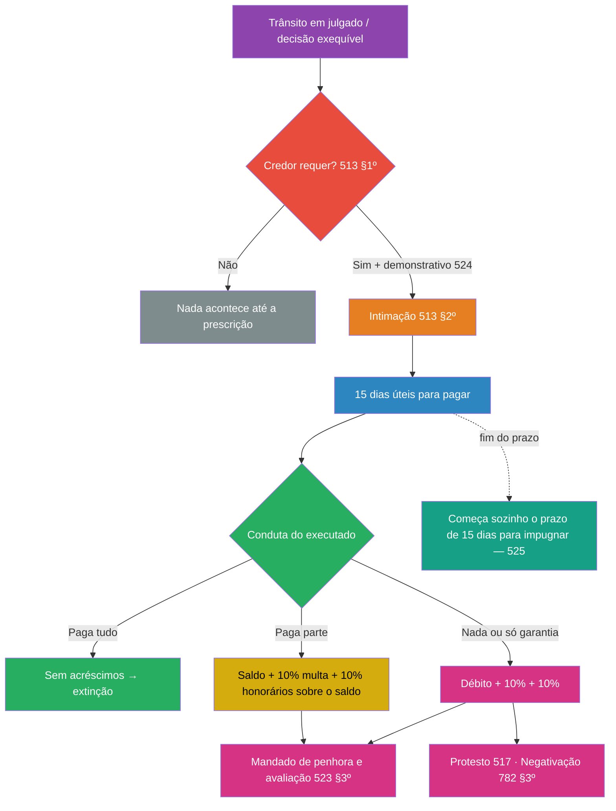
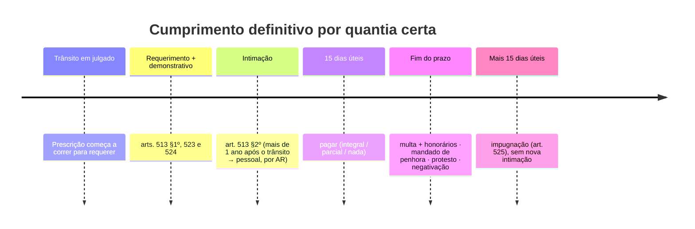

> [!info] Legenda das fontes
> - **[MP p. X]** — material do professor (`2026-enviar-cs.pdf`), pp. 28–55
> - **[Slide N]** — slides "CPC-III Cumprimento de Sentença" (OCR)
> - **[Neves p. X]** — páginas do Neves citadas pelo próprio MP
> - **[ASD A/B]** — orientações das ASDs Finais A e B
> - **CPC** — conferido na reprodução do texto legal (Aurum) e nas transcrições do MP; ✅ conferir no [Planalto](https://www.planalto.gov.br/ccivil_03/_ato2015-2018/2015/lei/l13105.htm)
> - ⚠️ **fora do material** — o que não está nos arquivos da disciplina

Mapa mental: [[Mapa - Cumprimento de sentença por quantia certa.canvas]]

---

## 1. Resumo rápido

Transitada em julgado a condenação em quantia certa, **nada acontece sozinho**. O **credor precisa requerer** o cumprimento (art. 513, §1º; art. 523), juntando um **demonstrativo discriminado e atualizado** do crédito (art. 524). O devedor é **intimado** (não citado), em regra na pessoa do advogado (art. 513, §2º, I), para **pagar em 15 dias úteis**.

Três cenários:
- **Pagou tudo:** encerra-se, sem acréscimos.
- **Pagou parte:** **multa de 10% + honorários de 10% sobre o restante** (§2º).
- **Não pagou:** **10% + 10% sobre o débito** (§1º).

Depois do prazo vêm o **mandado de penhora e avaliação** (§3º), o protesto e a negativação, e corre automaticamente o **prazo de 15 dias para impugnar** (art. 525).

---

## 2. Explicação aprofundada

### 2.1. Técnica Feynman (versão leiga)

> [!example] Como explicar para um leigo
> Pense numa conta que **você já perdeu na Justiça**: o juiz disse "deve R$ 10 mil". Mas a cobrança só começa quando o credor **pede**: "juiz, avisa ele que é hora de pagar; aqui está a conta detalhada". O devedor recebe o aviso e ganha **um último prazo amigável de 15 dias**, como o vencimento de um boleto. Pagou até o vencimento? Sem acréscimos. Passou? Entram **dois acréscimos de 10%**: a multa (o "castigo" pelo atraso) e os honorários do advogado do credor (que agora vai ter de trabalhar para cobrar). E isso só **sobre o que ficou faltando**. Depois disso, a Justiça para de pedir e passa a **tomar**: o oficial de justiça vem penhorar bens.

### 2.2. Versão técnica

#### a) Natureza e cabimento

O cumprimento por quantia certa é **atividade jurisdicional expropriatória**: o Estado transforma bens do executado em dinheiro, ou os entrega ao credor por adjudicação (art. 824) [MP p. 29–30; Slide 31].

A obrigação de pagar pode ter duas origens [MP p. 29–30; Slide 37]:
- **dívida originária** (mútuo, compra e venda);
- **equivalente econômico** de outra obrigação (ato ilícito, descumprimento de fazer ou de entregar).

**Cabimento** [MP p. 30; Slide 34]:
1. condenação em quantia certa;
2. quantia já fixada em liquidação;
3. decisão sobre **parcela incontroversa** (art. 356): pode ser executada desde logo, sem caução (§2º), e a execução é definitiva com o trânsito (§3º).

#### b) Requerimento do credor (art. 513, §1º; art. 523)

- É o **princípio da inércia** [MP p. 31; Neves p. 1218].
- **Por que existe:** cabe ao credor avaliar se compensa executar diante do patrimônio do devedor [MP p. 32, nota 105].
- **CPC/73:** o art. 475-J gerava divergência sobre a intimação de ofício. O art. 523 encerrou a discussão, e o STJ já exigia o requerimento (REsp 940.274/MS, Corte Especial) [MP p. 31–32].
- **Prazo para requerer:** até a prescrição, que é a mesma da pretensão de conhecimento e corre do dia seguinte ao trânsito [MP p. 32, citando Donizetti].

> [!important] Instaurar ≠ impulsionar (ASD A, questão A1)
> O requerimento **instaura** a fase. Os atos **seguintes** andam por impulso oficial: o mandado de penhora sai "desde logo", **sem novo pedido** (art. 523, §3º) [MP p. 52].

**Precisa de requerimento?** [Slide 27]

| Espécie | Requerimento? | Fundamento |
|---|---|---|
| Quantia — provisório | Sim | 513, §1º |
| Quantia — definitivo | Sim | 513, §1º + 523 |
| Alimentos | Sim | 528 |
| Fazenda Pública | Sim | 534 |
| Dar coisa | **Não** | 538 |
| Fazer / não fazer | **Não** (de ofício ou a requerimento) | 536 |

#### c) Demonstrativo do crédito (art. 524)

O credor não precisa juntar um memorial completo de cálculos, mas **precisa mostrar como chegou ao valor** (Neves) [MP p. 33]. O fundamento é o **contraditório**: o devedor só consegue pagar, ou contestar, se souber de onde vem cada valor.

> [!quote] Art. 524 — conteúdo da petição (paráfrase fiel)
> I – nome completo e CPF/CNPJ do exequente e do executado
> II – índice de correção monetária
> III – juros aplicados e taxas
> IV – termos inicial e final dos juros e da correção
> V – periodicidade da capitalização, se houver
> VI – descontos obrigatórios
> VII – bens penhoráveis, **sempre que possível** (mera faculdade) [MP p. 33]

**Excesso executivo; Parágrafos do art. 524:**
- **§1º — excesso aparente:** a execução começa pelo valor pedido, mas a **penhora** se baseia no valor que o juiz entender adequado. Só vale para erro perceptível *prima facie* [MP p. 35].
  - **§2º:** o juiz pode usar o contabilista do juízo para verificar os cálculos, que tem até **30 dias** de prazo.
  - **Crítica de Neves:** a solução gera agravo de instrumento contra a decisão sobre o valor e, depois, outro recurso contra a decisão da defesa [MP p. 35].
- **§§3º–5º — dados em poder de terceiros ou do executado:** requisição sob pena de desobediência, com prazo de até **30 dias**. Se não houver entrega injustificada, os cálculos do credor se reputam corretos. É **presunção relativa**, que pode ser afastada na impugnação [MP p. 34–35].
  
|                             | **Art. 524, §1º**                                           | **Art. 525, §1º, V, e §§4º–5º**                                                                                                                                                                    |
| --------------------------- | ----------------------------------------------------------- | -------------------------------------------------------------------------------------------------------------------------------------------------------------------------------------------------- |
| Quem age                    | O juiz, ao receber o requerimento                           | O executado, na impugnação                                                                                                                                                                         |
| Quando                      | No início do cumprimento                                    | Depois do prazo de pagamento                                                                                                                                                                       |
| Exagero                     | Só o **aparente**, visível _prima facie_                    | Qualquer excesso                                                                                                                                                                                   |
| Efeito                      | Limita só a **penhora**; a execução segue pelo valor pedido | Pode **reduzir a própria execução**                                                                                                                                                                |
| Ônus                        | Nenhum para o executado                                     | O executado tem de **declarar o valor correto** e juntar **demonstrativo**. Se não fizer, a impugnação é rejeitada de plano (se o excesso for o único fundamento) ou o juiz não examina esse ponto |
| Quantos recursos possíveis? |  Um, apenas                                              | **Dois** agravos de instrumento (a do §1º e depois a da impugnação)                                                                                                                             |

#### d) Intimação (art. 513, §§2º–5º)

| Situação do devedor                                                     | Forma de intimação                                       |
| ----------------------------------------------------------------------- | -------------------------------------------------------- |
| Tem **advogado constituído**                                            | **I — Diário da Justiça, na pessoa do advogado** (regra) |
| Defensoria Pública, ou sem procurador nos autos                         | II — carta com AR                                        |
| Sem procurador, com cadastro eletrônico (art. 246, §1º) (para Empresas) | III — meio eletrônico                                    |
| **Citado por edital (art. 256) e revel**                                | IV — edital                                              |
| Requerimento feito **mais de 1 ano após o trânsito**                    | **§4º — pessoal, por carta com AR**                      |

- **§3º:** se o devedor mudou de endereço sem avisar o juízo, a intimação dos incisos II e III considera-se feita.
- **§5º:** **fiador, coobrigado ou corresponsável que não participou da fase de conhecimento não pode ser executado.**

> [!warning] 🎯 Ênfase do professor — "Indagações" [Slides 20–25] (respondidas no MP p. 12–14)
> Detalhamento completo em [[Disposições gerais do cumprimento de sentença e cumprimento provisório#Intimação do revel — Indagações do professor]].
> 
> *A ideia aqui é*: O réu foi devidamente intimado e encontra-se revel por seu próprio discernimento, assim após a conclusão dos atos cognitivos, faz-se necessário a renovação da citação ou intimação, agora para execução.
> 
> - **Revel citado pessoalmente, sem advogado** → **carta com AR (inciso II)**: REsp 1.760.914/SP (3ª T., 2020), REsp 1.967.425/GO (4ª T., 2023) e REsp 2.053.868/RS (4ª T., 2023), em que a falta de intimação gera nulidade. Antes: REsp 1.241.749 e Neves dispensavam a intimação (art. 346).
> - **Citado por edital, com curador especial** → **divergência**: Donizetti diz edital (IV); Neves diz carta com AR (II).
> - **Citado por hora certa** → carta (II) (Didier; Neves).

#### e) O prazo de 15 dias no exceção de execução [MP p. 36–38; Slides 40–44]

| Questão               | Posição                                                                                                                                             | Fonte                                                 |
| --------------------- | --------------------------------------------------------------------------------------------------------------------------------------------------- | ----------------------------------------------------- |
| Natureza              | **Processual → dias úteis** (art. 219). Minoria: prazo material, em dias corridos (Shimura; Neves, em posição antiga)                               | STJ, REsp 1.708.348/2019; Enunciado 89 CJF [MP p. 37] |
| Início                | Art. 523 c/c 513 c/c **art. 231, §3º** (ato da própria parte)                                                                                       | Slide 40; Didier [MP p. 37]                           |
| Prazo em dobro        | Defensoria: sim. Litisconsortes com advogados de escritórios distintos, **em autos físicos**: sim (30 dias úteis). Theodoro e Didier: prazo simples | REsp 1.261.856; REsp 1.693.784/DF [MP p. 38]          |
| O juiz pode suprimir? | **Não** (cabem medidas cautelares)                                                                                                                  | REsp 1.395.281/2013 [MP p. 36]                        |
| Negócio processual    | Pode alterar o prazo                                                                                                                                | Didier — art. 190 [MP p. 36]                          |

> [!question] 1. Dias úteis ou corridos?
> **Dias úteis** → é prazo **processual** (art. 219). STJ, REsp 1.708.348/2019; Enunciado 89 CJF [MP p. 37].
> Minoria: prazo **material** (pagar é ato da parte, não do advogado) → dias corridos (Shimura; Neves, que reconhece a posição do STJ).

> [!question] 2. Quando começa?
> Da **própria comunicação** ao devedor, e não da juntada do comprovante. Pagar é ato da parte → **art. 231, §3º** [Slide 40; Didier, MP p. 37].

> [!question] 3. O prazo pode ser em dobro? (15 dias úteis → 30 dias úteis)
> - **Defensoria Pública:** sim (REsp 1.261.856).
> - **Litisconsortes com advogados de escritórios diferentes, em autos FÍSICOS:** sim (art. 229; REsp 1.693.784/DF).
> - **Autos eletrônicos:** não dobra (art. 229, §2º).
> - Divergência: Theodoro e Didier → prazo simples (pagar é ato material; cada devedor é autônomo) [MP p. 38].

> [!question] 4. O juiz pode suprimir?
> **Não.** Não pode penhorar antes de acabarem os 15 dias (REsp 1.395.281/2013). Mas cabem **medidas cautelares** se houver risco [MP p. 36; Slide 44].

> [!question] 5. As partes podem mudar?
> **Sim**, por **negócio jurídico processual** (art. 190; Didier) [MP p. 36; Slide 41].
#### f) Comportamentos do executado

| Comportamento | Efeito | Base |
|---|---|---|
| Paga **tudo** no prazo | Sem multa e sem honorários do §1º; o credor se manifesta; extinção | 523 caput e §1º [MP p. 36, 46] |
| Paga **parte** no prazo | 10% + 10% **sobre o restante** | **523, §2º**; REsp 1.693.784, item 6 [MP p. 38] |
| **Não paga**, ou paga fora do prazo | 10% + 10% sobre o débito | 523, §1º [MP p. 46] |
| **Deposita para garantir o juízo** e impugna | **Não é pagamento: a multa incide** | REsp 2.007.874/DF; AgInt no AREsp 1.271.636/SP [MP p. 47] |
| Deposita **sem ressalva** | Só vira pagamento depois que o prazo de impugnação passa em branco | REsp 1.880.591/SP [MP p. 39] |
| Oferece bens à penhora ou seguro-garantia | Não afasta a multa | AgInt no REsp 1.863.214/SP [MP p. 47–48; Slide 50] |
| Dação em pagamento | **Divergência:** Neves entende que afasta a multa; o STJ só afasta se o **credor aceitar** | REsp 1.942.671/2021 [MP p. 49] |
| Paga **antes** de ser intimado | **Art. 526 — "execução às avessas"** (consignação incidental): o autor fala em 5 dias; se o depósito for insuficiente, 10% + 10% **sobre a diferença** | [MP p. 39–40; Slide 46] |

#### g) Multa e honorários

- **Mesma base:** débito + custas, **sem a multa** na base dos honorários (STJ, REsp 1.757.033/DF) [MP p. 42–43; Slides 50 e 52]. No Slide 31: "Mesma base de cálculo".
- **Percentuais fixos:** não podem ser reduzidos nem majorados (REsp 1.701.824/RJ) [MP p. 41–42].
- **Natureza da multa:** coerção indireta + sanção (Didier); sanção processual (Abelha) [MP p. 48].
- **É disponível:** o credor pode deixar de pedi-la, e o juiz não a inclui de ofício (Theodoro) [MP p. 49–50].
- **Não incide:**
  - enquanto a sentença for ilíquida (REsp 1.691.748, citado em Theodoro) [MP p. 46, nota 162];
  - sobre crédito sujeito a recuperação judicial (REsp 1.937.516/SP) [MP p. 49].

> [!caution] Não confundir (ASD B, item 10 e questão B2)
> Os **honorários do §1º do art. 523** remuneram o trabalho de executar. **Não se confundem** com os honorários sucumbenciais fixados na sentença da fase de conhecimento. Não some verba de fase anterior sem dado expresso no enunciado.

#### h) Efeitos do inadimplemento [MP p. 40; Slide 49]

**Materiais:** multa e honorários.

**Processuais:**
1. **Mandado de penhora e avaliação desde logo** (§3º). Antes do fim do prazo não cabem atos executivos. Na prática, o mandado pode ser dispensado se houver penhora on-line pelo Sisbajud [MP p. 52–53; Slide 57].
2. **Protesto** (art. 517): só de decisão **transitada em julgado**, depois do prazo do art. 523. A certidão é fornecida em 3 dias [MP p. 50–51; Slide 61].
3. **Negativação** (art. 782, §§3º e 5º): **a requerimento** e só em execução **definitiva**. Exceção: alimentos (art. 528, §1º) [MP p. 52; Slide 59].
4. **Prazo de impugnação** (art. 525): começa **automaticamente**, sem penhora e sem nova intimação. Neves diverge: para ele, a intimação para pagar já deveria advertir sobre a impugnação [MP p. 53–54].

**Parcelamento do art. 916:** não se aplica ao cumprimento de sentença (§7º) [MP p. 54].

#### i) Ponte com o cumprimento provisório (art. 520)

- **§2º:** multa e honorários **também são devidos** no cumprimento provisório. Isso superou o entendimento do STJ sob o CPC/73 [MP p. 45].
- **§3º:** depositar para se isentar da multa **não é incompatível** com o recurso interposto.

---

## 3. Mapa mental

Versão visual: [[Mapa - Cumprimento de sentença por quantia certa.canvas]]

- **FLUXO DO ART. 523**
	- **1. Instauração**
		- Requerimento do exequente (513, §1º; 523): exceção ao impulso oficial
		- Cabimento: quantia certa | liquidada | parcela incontroversa (356)
		- Prazo para requerer: até a prescrição
		- Demonstrativo (524, I–VII)
			- §1º excesso aparente: penhora pelo valor que o juiz entender adequado
			- §§3º–5º dados com terceiro/executado: presunção relativa
	- **2. Intimação (513, §2º)**
		- I advogado/DJ (regra) · II AR · III eletrônico · IV edital (citado por edital + revel)
		- §3º mudança de endereço · §4º mais de 1 ano: pessoal, por AR
		- §5º fiador/coobrigado fora da fase de conhecimento: não
	- **3. Prazo de 15 dias úteis**
		- Início: art. 231, §3º
		- Em dobro: Defensoria; litisconsortes em autos físicos
		- Juiz não suprime · negócio processual pode alterar
	- **4. Conduta do executado**
		- Total: nada · Parcial: 10% + 10% sobre o **saldo** · Nada: 10% + 10% sobre o débito
		- Depósito em garantia / seguro / bens ≠ pagamento
		- Art. 526 (antes da intimação)
	- **5. Pós-prazo**
		- Mandado de penhora e avaliação (de ofício) → expropriação
		- Protesto (517) · negativação (782, §3º)
		- Prazo de impugnação (525) corre automaticamente

---

## 4. Esquemas visuais

### Fluxograma

### Linha do tempo

### Quadro comparativo (ASD B, parte II)

| Acréscimo / efeito | Pagamento integral | Pagamento parcial | Sem pagamento |
|---|---|---|---|
| Multa de 10% | não | sobre o **saldo** | sobre o débito |
| Honorários de 10% | não | sobre o **saldo** | sobre o débito |
| Mandado de penhora | não | sim (pelo saldo) | sim |
| Dispositivo | 523, caput | 523, §2º | 523, §1º |

---

## 5. Exemplos práticos

> [!example] Caso 1 — cálculo
> Sentença transitada: **R$ 40.000,00**. A ré paga **R$ 16.000,00** no 10º dia útil e nada mais.
> - Saldo: 40.000 − 16.000 = **24.000**
> - Multa: 10% × 24.000 = **2.400**
> - Honorários: 10% × 24.000 = **2.400** (base = saldo, sem a multa)
> - **Remanescente: R$ 28.800,00**, e o mandado de penhora sai sobre esse valor.

> [!example] Caso 2 — depósito "estratégico"
> A executada deposita os R$ 40.000,00 no prazo, mas declara que é **garantia do juízo** e impugna. A impugnação é rejeitada.
> → **Incidem multa e honorários de 10%.** Garantir o juízo não é pagar (REsp 2.007.874/DF).

> [!example] Caso 3 — intimação
> O credor requer o cumprimento 14 meses após o trânsito. O réu tinha advogado.
> → A intimação **não é pelo DJ**: é **pessoal, por carta com AR** (art. 513, §4º).

---

## 6. Pontos de atenção

> [!danger] Pegadinhas
> 1. "O juiz inicia de ofício" → ❌ para quantia (513, §1º). Mas o **mandado de penhora** sai de ofício (§3º).
> 2. **Intimação ≠ citação.** Exceção: títulos do art. 515, VI a IX (sentença penal, arbitral, estrangeira), em que há **citação** (515, §1º).
> 3. A regra do advogado **não é universal**: veja o §4º e os incisos II–IV (alerta da ASD A, item 10).
> 4. Pagamento parcial: a base é o **saldo**, nunca o total.
> 5. A base dos honorários **não inclui a multa**.
> 6. Pagou fora do prazo → a multa incide.
> 7. Honorários do §1º ≠ honorários da sentença.
> 8. Percentuais fixos: nada de 20%, nem de redução "por equidade".
> 9. Protesto e negativação: só no definitivo (salvo alimentos). Negativação **depende de requerimento**.
> 10. Art. 916 (parcelamento): **não se aplica**.

> [!tip] Números para decorar
> **15** dias úteis para pagar → mais **15** para impugnar · **10% + 10%** · **1 ano** → intimação pessoal · contabilista: até **30** dias · dados do executado: até **30** dias · art. 526: autor fala em **5** dias · certidão de protesto: **3** dias

> [!tip] Mnemônico do art. 524
> "**N**unca **I**nvente **J**uros: **T**udo **C**alculado, **D**escontado e com **B**ens"
> **N**omes/CPF · **Í**ndice · **J**uros · **T**ermos · **C**apitalização · **D**escontos · **B**ens

---

## 7. Jurisprudência

> [!note] Origem e verificação
> Todos os julgados abaixo foram **citados no material do professor** e **ainda não foram verificados online**.
> Conferir no **STJ:** <https://scon.stj.jus.br> (pesquisar pelo número) · no **TJRJ:** <https://www3.tjrj.jus.br/ejuris>

| Tribunal / número | Tese | Onde está |
|---|---|---|
| STJ, REsp 1.757.033/DF, 3ª T., 09/10/2018 | Honorários sobre o débito, sem a multa | MP p. 42; Slides 50 e 52 |
| STJ, REsp 1.701.824/RJ, 3ª T., 09/06/2020 | 10% não pode ser reduzido | MP p. 41 |
| STJ, REsp 1.693.784/DF, 4ª T., 28/11/2017 | Prazo em dobro (autos físicos); parcial → acréscimos sobre o restante | MP p. 37–38 |
| STJ, REsp 2.007.874/DF, 3ª T., 04/10/2022 | Depósito em garantia não afasta a multa | MP p. 47 |
| STJ, REsp 1.880.591/SP, 3ª T., 03/08/2021 | Depósito sem ressalva só vira pagamento após o prazo de impugnação | MP p. 39 |
| STJ, REsp 1.395.281/2013 | Prazo não pode ser suprimido | MP p. 36; Slide 44 |
| STJ, REsp 940.274/MS, Corte Especial, 07/04/2010 | Cumprimento não é automático; depende do credor | MP p. 31–32 |
| **TJRJ**, AI 0046435-42.2014.8.19.0000 (25ª Câm. Cív., 07/01/2015) | Cumulação da multa do art. 523 com a multa de acordo homologado (**divergente**: Didier vê *bis in idem*) | MP p. 50 |
| **TJRJ**, AI 0019679-59.2015.8.19.0000 (5ª Câm. Cív., 05/05/2015) | Idem | MP p. 50 |

---

## 8. Fixação

> [!question] Q1 (objetiva)
> O credor requer o cumprimento 18 meses após o trânsito. O devedor tem advogado constituído. A intimação será:
> A) pelo DJ, na pessoa do advogado · B) por edital · C) pessoal, por carta com AR · D) dispensada

> [!question] Q2 (objetiva)
> No prazo do art. 523, o executado deposita o valor integral, declara que é garantia do juízo e impugna. A impugnação é rejeitada.
> A) não incide nada, porque o depósito foi tempestivo · B) incidem multa e honorários de 10% · C) incide só a multa · D) honorários de 20%

> [!question] Q3 (cálculo)
> Débito de R$ 30.000,00. Pagamento tempestivo de R$ 12.000,00. Calcule o saldo, a multa, os honorários e o total remanescente.

> [!question] Q4 (discursiva curta)
> Explique por que a exigência de requerimento do credor não contradiz a expedição do mandado de penhora sem novo pedido.

> [!question] Q5 (microcaso)
> Duas sociedades rés, com advogados de escritórios distintos, em **autos físicos**. Débito de R$ 20.000,00. No **22º dia útil** após a intimação, uma delas deposita R$ 8.000,00 como pagamento, e nada mais é pago. O credor pede multa e honorários sobre R$ 20.000,00. Analise.

> [!question] Recordação ativa (de cabeça)
> 1. Quais são as 4 formas de intimação do art. 513, §2º?
> 2. Quais são os três cenários de pagamento e a base dos acréscimos em cada um?
> 3. Por que o depósito para garantia não afasta a multa?

> [!success]- Gabarito comentado (clique para abrir)
> **Q1 — C.** Pelo art. 513, §4º, depois de 1 ano a intimação é pessoal, por AR, mesmo havendo advogado. A alternativa A é a pegadinha da "regra universal do advogado".
>
> **Q2 — B.** Só o pagamento voluntário, ou o depósito sem condicionar o levantamento, afasta os acréscimos. Garantia não é pagamento (REsp 2.007.874/DF) [MP p. 47–48].
>
> **Q3 —** Saldo = 18.000 · Multa = 1.800 · Honorários = 1.800 (sobre o saldo, sem a multa) · **Total = R$ 21.600,00** (art. 523, §2º).
>
> **Q4 —** O requerimento **instaura** a fase (princípio dispositivo, art. 513, §1º). Instaurada a fase, os atos seguintes seguem o **impulso oficial**, e o §3º manda expedir o mandado "desde logo" [MP p. 31 e 52].
>
> **Q5 —** Em autos físicos, com litisconsortes de advogados distintos, o prazo é **em dobro (30 dias úteis)** (REsp 1.693.784/DF). Logo, o pagamento no 22º dia útil foi **tempestivo e parcial**. Os acréscimos incidem só sobre o restante: 12.000 + 1.200 + 1.200 = **R$ 14.400,00**. O pedido do credor deve ser rejeitado nessa parte.
> Mencionar a divergência: para Theodoro e Didier o prazo seria simples, e o pagamento seria intempestivo. Em autos eletrônicos, não há dobra (art. 229, §2º).
>
> **Recordação ativa:**
> 1. DJ/advogado · carta com AR · meio eletrônico · edital.
> 2. Integral: nada · Parcial: 10% + 10% sobre o saldo · Nenhum: 10% + 10% sobre o débito.
> 3. Porque a garantia prolonga a execução (o executado vai impugnar) em vez de extingui-la. Só o ato que leva à satisfação afasta a sanção.

---

## 9. Flashcards

> [!tip] Formato compatível com o plugin *Spaced Repetition* do Obsidian (`pergunta::resposta`)

#flashcards/CPCIII/quantia-certa

Quem instaura o cumprimento de sentença por quantia?::O exequente, por requerimento (513, §1º; 523)
Prazo para pagamento voluntário no art. 523?::15 dias **úteis** (STJ; Enunciado 89 do CJF)
Forma de intimação em regra?::Pelo DJ, na pessoa do advogado constituído (513, §2º, I)
Requerimento feito mais de 1 ano após o trânsito: como se intima?::Pessoalmente, por carta com AR (513, §4º)
Fiador que não participou da fase de conhecimento pode ser executado?::Não (513, §5º)
Pagamento parcial: qual a base da multa e dos honorários?::O saldo/restante (523, §2º)
A multa entra na base de cálculo dos honorários do §1º?::Não (REsp 1.757.033/DF)
Depósito para garantia do juízo afasta a multa?::Não (REsp 2.007.874/DF)
O mandado de penhora e avaliação depende de novo pedido?::Não, é expedido "desde logo" (523, §3º)
Quando começa o prazo de impugnação?::Automaticamente, ao fim dos 15 dias, independentemente de penhora ou nova intimação (525)
O parcelamento do art. 916 se aplica ao cumprimento de sentença?::Não (916, §7º)
Multa e honorários do art. 523 incidem no cumprimento provisório?::Sim (520, §2º)
Pagamento antes da intimação para cumprir?::Art. 526 — "execução às avessas" (consignação incidental)
Protesto da decisão judicial: requisitos?::Trânsito em julgado + decurso do prazo do art. 523 (517)
Negativação do executado: de ofício?::Não, só a requerimento e só na execução definitiva (782, §§3º e 5º)

---

## 10. Conexões

- **Visão geral da disciplina:** [[Processo Civil III - Execução]]
- **Antes:** [[Títulos executivos]] (certeza, liquidez e exigibilidade — A1 / ASD4) · [[Liquidação de sentença]]
- **Regras comuns a todo cumprimento:** [[Disposições gerais do cumprimento de sentença e cumprimento provisório]] (intimação, competência, protesto, cumprimento provisório e caução)
- **Depois:** [[Avaliação, expropriação e satisfação do crédito]] (TT2; o mandado de penhora e avaliação do art. 523, §3º, é a porta de entrada) · [[Impugnação ao cumprimento de sentença]] (art. 525)
- **Mapa:** [[Mapa - Cumprimento de sentença por quantia certa.canvas]]

## 11. Minhas anotações

- 
