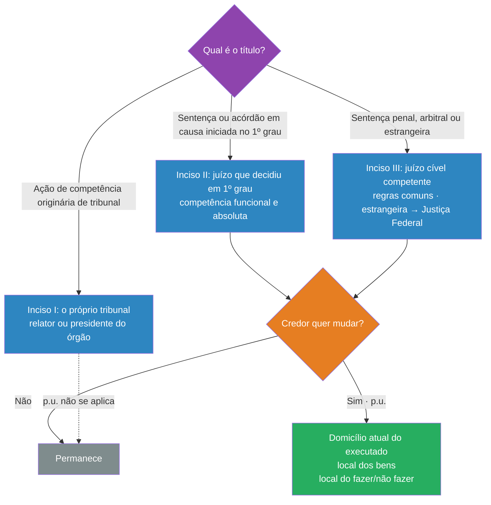
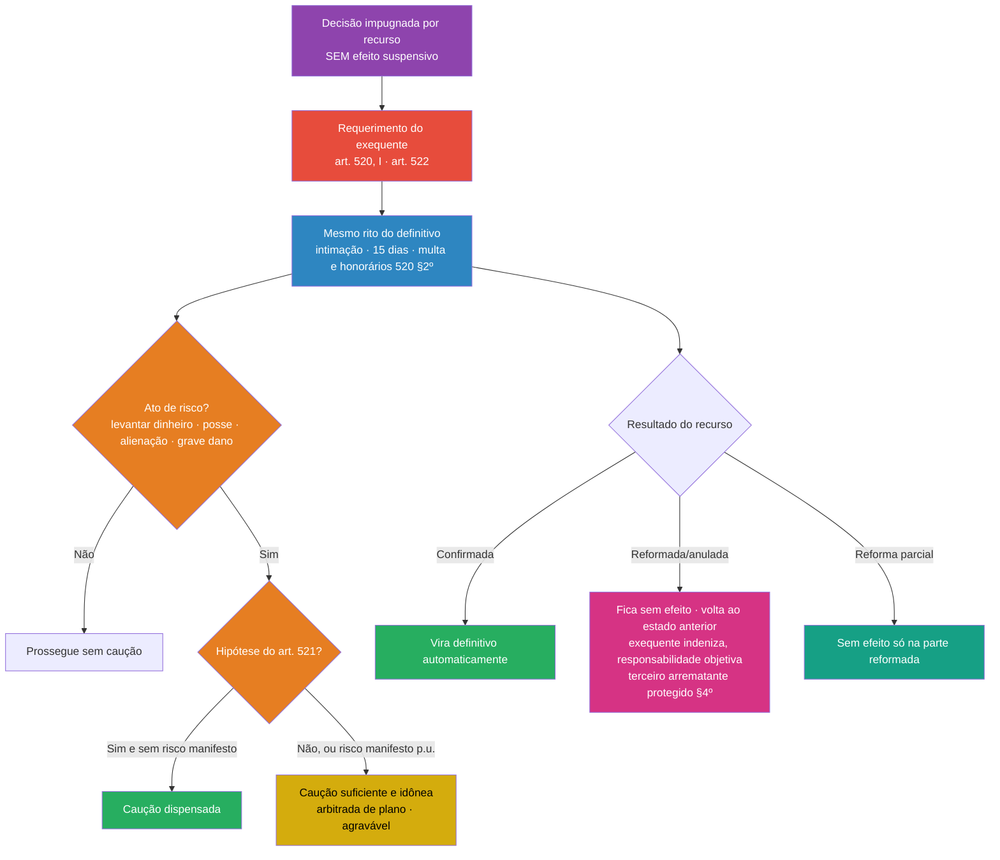

> [!info] Legenda das fontes
> - **[MP p. X]**: material do professor (`2026-enviar-cs.pdf`): disposições gerais pp. 6–28; cumprimento provisório pp. 55–61
> - **[Slide N]**: slides "CPC-III Cumprimento de Sentença" (OCR): disposições gerais 1–28
> - **[LOA 6]**: leitura do encontro de 25/09 (fiador/coobrigado, protesto, negativação, subsidiariedade, cumprimento provisório)
> - **CPC**: conferido no texto reproduzido pelo MP e no Aurum. ✅ Conferir no [Planalto](https://www.planalto.gov.br/ccivil_03/_ato2015-2018/2015/lei/l13105.htm)
> - ⚠️ **fora do material**: o que não está nos arquivos da disciplina
> - Os slides **não têm** parte própria sobre o cumprimento provisório. Para esse tema, a base é o MP pp. 55–61.

**Mapa:** [[Mapa - Disposições gerais e cumprimento provisório.canvas]]
**Nota anterior:** [[Cumprimento de sentença por quantia certa - fluxo do art. 523]] · **Visão geral:** [[Processo Civil III - Execução]]

---

## 1. Resumo rápido

Os arts. 513 a 519 são o **"tronco comum"** de **todo** cumprimento de sentença (pagar, fazer, não fazer, entregar). Eles respondem a seis perguntas:

1. **Quem inicia?** O credor, por requerimento (expresso para quantia, art. 513, §1º).
2. **Como o devedor é chamado?** Por **intimação**, em regra na pessoa do advogado (art. 513, §2º).
3. **Contra quem?** Só contra quem participou da fase de conhecimento (art. 513, §5º).
4. **Onde?** No juízo da causa, com opções de foro para o credor (art. 516).
5. **Quando a obrigação é exigível?** Depois de provados a condição ou o termo (art. 514).
6. **Com que pressões indiretas?** Protesto (art. 517) e negativação (art. 782, §3º).

O **cumprimento provisório** (arts. 520–522) é a execução de decisão ainda **sem trânsito em julgado**, impugnada por recurso **sem efeito suspensivo**. Segue o mesmo rito do definitivo, mas:
- corre **por conta e risco do exequente** (responsabilidade objetiva);
- **desfaz-se se a decisão for reformada**;
- exige **caução** para levantar dinheiro ou alienar bens, salvo as dispensas do art. 521.

---

## 2. Explicação aprofundada

### 2.1. Técnica Feynman (versão leiga)

> [!example] Como explicar para um leigo
> **Disposições gerais** são as "regras da casa" que valem para qualquer cobrança feita a partir de uma decisão judicial. Quem toca a campainha é o credor (o juiz não sai cobrando por conta própria). O aviso chega pelo advogado do devedor, porque ele já está "dentro do processo". Só pode ser cobrado quem foi parte desde o começo: o fiador que nunca foi ouvido fica de fora. A cobrança acontece, em regra, no mesmo juízo que julgou a causa, mas o credor pode "mudar de endereço" e cobrar onde o devedor mora ou onde estão os bens.
>
> **Cumprimento provisório** é cobrar **antes da decisão final**, enquanto ainda corre um recurso que não trava a decisão. É como receber um adiantamento: pode, mas **por sua conta e risco**. Se a decisão cair, você devolve tudo e indeniza o prejuízo, mesmo sem ter agido de má-fé. E para mexer em dinheiro ou vender bens, você precisa deixar uma **garantia (caução)**, salvo em alguns casos de quem precisa muito ou tem um direito muito provável.

### 2.2. Versão técnica

#### a) Alcance das disposições gerais e subsidiariedade

- **"Cumprimento de sentença"** abrange a execução de **qualquer título judicial**, de **qualquer** prestação (pagar, fazer, não fazer, entregar). "Sentença" está em sentido amplo: inclui decisões interlocutórias de tutela provisória (art. 297, p.u.), julgamento parcial de mérito (art. 356, §2º), decisões monocráticas (art. 932), acórdãos (art. 204) e os demais títulos do art. 515 [MP p. 6].
- **Art. 513, caput:** aplicam-se as regras do Título II e, **no que couber**, o Livro II da Parte Especial (processo de execução). É a **subsidiariedade recíproca** com o art. 771, p.u. 
	- Ver [[Processo Civil III - Execução#8.4 Aplicação subsidiária das regras do processo de conhecimento]].
- Os arts. 513–519 valem para **todas** as obrigações. Só os **parágrafos do art. 513** se voltam mais diretamente à quantia (Theodoro) [MP p. 7].
- **Duas fases** da dinâmica executiva: **cumprimento voluntário** → **execução forçada** [MP p. 9; Slide 16]. 
	- Detalhes em [[Cumprimento de sentença por quantia certa - fluxo do art. 523]].

#### b) Requerimento: quem inicia o cumprimento

> [!quote] Art. 513, §1º
> O cumprimento da sentença que reconhece o dever de **pagar quantia, provisório ou definitivo**, far-se-á **a requerimento do exequente**.

**O requerimento é exigido também para fazer, não fazer e entregar coisa?** [MP p. 7–8]

| Corrente | Tese | Quem defende |
|---|---|---|
| **Restritiva** | O §1º vale só para quantia. Para fazer/não fazer (art. 536: "de ofício ou a requerimento") e entregar coisa (art. 538: expede-se o mandado) prevalecem as regras especiais. | Leitura literal + especialidade |
| **Ampliativa** | Qualquer cumprimento, provisório ou definitivo, depende de requerimento, por contraditório, cooperação e responsabilidade do exequente. | Bueno; Paulo Cezar Pinheiro Carneiro |

> [!important] O quadro do professor [Slide 27]
> Requerimento?
> **Sim** para quantia provisória, quantia definitiva, alimentos e Fazenda Pública.
> **Não** para dar coisa e para fazer/não fazer.
> O slide segue, portanto, a corrente **restritiva** para o **definitivo**.

**Ponto pacífico:** o *cumprimento provisório* de *qualquer* obrigação depende *sempre* de requerimento (art. 520, I) (Câmara; Theodoro) [MP p. 58].

**Conteúdo do requerimento:** é *desformalizado*, mas parecido com uma petição inicial, e aplica-se o que couber dos arts. 798 e 799 (Theodoro; Bueno) [MP p. 9–10]. 
	- Para quantia, o demonstrativo do art. 524 está detalhado em [[Cumprimento de sentença por quantia certa - fluxo do art. 523#c) Demonstrativo do crédito (art. 524)]].

Bueno descreve um **triplo exame de admissibilidade** [MP p. 15, nota 45]:
- **positivo** → intimação do executado;
- **neutro** → emenda em 15 dias (arts. 801 e 321);
- **negativo** → a etapa de cumprimento não começa.

**Natureza do pronunciamento que manda intimar** [MP p. 14–15]:

| Posição | Consequência | Fonte |
|---|---|---|
| **Despacho** de mero expediente | **Irrecorrível** | STJ: REsp 1.837.211/MG (3ª T., 2021); AgInt no REsp 1.812.134/AM (3ª T., 2023); REsp 1.725.612/RS (3ª T., 2020); Donizetti |
| **Decisão interlocutória** | Recorrível, porque o juiz pode indeferir ou mandar emendar | Neves (embora veja falta de interesse, já que há a impugnação) |
| **Exceção no próprio STJ** | Se o ato pode causar prejuízo (ex.: intimar o advogado, e não a parte, para obrigação de fazer sob multa) → **recorrível** | REsp 1.758.800/MG (3ª T., 2020) |

#### c) Intimação (art. 513, §§2º–4º)

O quadro das quatro formas está em [[Cumprimento de sentença por quantia certa - fluxo do art. 523#d) Intimação (art. 513, §§2º–5º)]]. Aqui ficam os detalhes **das disposições gerais** [MP p. 10–17]:

- **Procuração:** a procuração da fase de conhecimento vale para o cumprimento, salvo disposição em contrário (art. 105, §4º). Se o mandato tinha prazo certo que já se esgotou, aplica-se o inciso II (carta) (Theodoro) [MP p. 11].
- **Inciso III (meio eletrônico):** empresas públicas e privadas obrigadas ao cadastro (art. 246, §1º). ME e EPP só quando **não** tiverem endereço eletrônico na Redesim (art. 246, §5º, Lei 14.195/2021) [MP p. 11–12].
- **§3º (mudança de endereço sem aviso):** a intimação considera-se feita (art. 274, p.u.). Theodoro chama de **intimação presumida** [MP p. 12].
- **O juiz deve fixar o prazo e explicitar as sanções** na intimação (Theodoro) [MP p. 17].
- **Citação, e não intimação:** nos títulos do art. 515, VI–IX (sentença penal, arbitral, estrangeira e decisão estrangeira com exequatur), o devedor é **citado pessoalmente** no juízo cível (art. 515, §1º) [MP p. 17]. É uma **nova relação processual**: sobrevive aqui a lógica da *actio iudicati*.

##### Intimação do revel — Indagações do professor

> [!warning] 🎯 Ênfase do professor [Slides 20–25] (respostas no MP p. 12–14)
> | Situação | Solução | Fonte |
> |---|---|---|
> | **a) Revel citado pessoalmente, sem advogado** | **Carta com AR (inciso II).** Sem ela, há **nulidade** dos atos posteriores. | STJ: **REsp 1.760.914/SP** (3ª T., 02/06/2020); **REsp 1.967.425/GO** (4ª T., 16/05/2023); **REsp 2.053.868/RS** (4ª T., 06/06/2023) |
> | (entendimento anterior) | Desnecessária a intimação; o prazo corre do trânsito (art. 346) | REsp 1.241.749 (6ª T., 2011); Neves; **TJRJ, AI 0006859-37.2017.8.19.0000**, 15ª Câm. Cív., 25/04/2017 |
> | **b) Citado fictamente (edital), com curador especial** | **Divergência:** edital (IV) para Donizetti; carta com AR (II) para Neves, que diz que o citado fictamente **nunca é revel**, porque o curador contesta | Donizetti; Neves p. 1223 |
> | **c) Revel citado por hora certa** | **Carta (inciso II)** | Didier (2022, p. 490); Neves |
> | **d) Revel citado de forma real** | Mesma solução de (a): hoje prevalece a carta com AR | STJ, julgados de 2020–2023 acima |
> | **e) Intimação por oficial de justiça?** | Não resolvida no MP. Fica em aberto. | (incerto) |
>
> **Para a prova:** para o revel citado de forma real e sem advogado, a posição **atual do STJ é a carta com AR**. Nos casos de citação ficta, **mostre a divergência**.

##### Intimação nas obrigações de fazer e não fazer (Súmula 410/STJ)

> [!quote] Súmula 410/STJ
> "A prévia intimação pessoal do devedor constitui condição necessária para a cobrança de multa pelo descumprimento de obrigação de fazer ou não fazer."

- **STJ:** a súmula **continua válida** sob o CPC/2015 (Corte Especial, **EREsp 1.360.577/MG**, 19/12/2018) [MP p. 16; Slide 25].
- **Doutrina crítica:** o art. 513, §2º, I, teria superado a súmula (Theodoro; Rizzo Amaral, citado por Pinho) [MP p. 16].
- **Distinção de Theodoro:** a intimação pessoal vale para cumprir o *facere*. Já a **cobrança da multa** liquidada é execução de quantia, com intimação **na pessoa do advogado** [MP p. 17].
- **Didier:** se o devedor for empresa ou ente público, a intimação pessoal da Súmula 410 se faz por **meio eletrônico** (art. 513, §2º, III, c/c art. 246) [MP p. 17].
- Obrigações específicas só caem na prova se houver comunicado. Ver [[Obrigações de fazer, não fazer e entregar coisa]].

#### d) Sujeitos: fiador, coobrigado e corresponsável (art. 513, §5º)

> [!quote] Art. 513, §5º
> O cumprimento da sentença **não poderá** ser promovido em face do fiador, do coobrigado ou do corresponsável **que não tiver participado da fase de conhecimento**.

- **Por quê:** **contraditório** e **limites subjetivos da coisa julgada**. O título judicial só alcança quem teve a chance de se defender.
- **Súmula 268/STJ:** "O fiador que não integrou a relação processual na ação de despejo não responde pela execução do julgado" [MP p. 18].
- **STJ, REsp 1.423.083/SP (2014):** a **solidariedade** de direito material **não basta**. Bens de quem não foi réu não podem ser atingidos [MP p. 18].
- **Conexão:** isso é diferente da responsabilidade patrimonial **secundária** (art. 790), que alcança bens de terceiros em hipóteses legais. 
	1. Ver [[Processo Civil III - Execução#9.2 Responsabilidade secundária (art. 790)]].

#### e) Competência (art. 516)

> [!quote] Art. 516
> I – **tribunais**, nas causas de sua competência originária;
> II – **juízo que decidiu a causa em 1º grau**;
> III – **juízo cível competente**: sentença penal condenatória, sentença arbitral, sentença estrangeira, acórdão do Tribunal Marítimo.
> **P.u.** – nos casos dos incisos **II e III**, o exequente pode optar pelo juízo do **atual domicílio do executado**, do **local dos bens** ou do **local onde deva ser cumprida a obrigação de fazer/não fazer**, solicitando a remessa dos autos ao juízo de origem.

| Inciso | Natureza | Pontos-chave | Fonte |
|---|---|---|---|
| **I. Tribunais** | **Funcional, absoluta** | Ex.: MS, ação rescisória. Quem conduz os atos é o relator ou o presidente do órgão (RISTJ art. 301; **RITJRJ arts. 14 e 139-A**) | MP p. 18–20 |
| **II. Juízo da causa** | **Funcional, absoluta** (STJ, CC 62.083/SP) | Competência do **órgão**, não da pessoa do juiz. Mesmo que o título seja acórdão do TJ ou do STF, executa-se no juízo onde a causa começou | MP p. 18–20 |
| **III. Juízo cível** | **Territorial, relativa**: regras comuns (arts. 46 e 53, IV "a" e V) | Penal **com** valor → petição inicial + citação. Penal **sem** valor → liquidação primeiro, e depois o cumprimento segue o **inciso II**. Execução cível da sentença penal: Justiça **Estadual**, salvo União ou ente federal exequente. Sentença estrangeira → **Justiça Federal** (CF, art. 109, X). Tribunal Marítimo → sem efeito (veto ao art. 515, X) | MP p. 22–24 |

**Parágrafo único: as opções do exequente** [MP p. 20–22; Slides 13–14]
- É um **direito potestativo do credor**, que **quebra a *perpetuatio jurisdictionis*** (Donizetti; Câmara fala em "cisão de competência funcional"). Não vale para o inciso I, porque o tribunal tem sede fixa.
- O **juiz não pode indeferir** se o credor provar o domicílio, os bens ou o local da obrigação, e o pedido pode ser feito **mesmo depois de iniciado** o cumprimento (**STJ, REsp 1.776.382/MT**, 3ª T., 03/12/2019; também CC 159.326/2018).
- Para Theodoro, a opção prevalece **até sobre o foro de eleição** e pode ser exercida no curso do cumprimento [MP p. 20–22].
- **Momento de uso (divergência):**
  1. uma única vez, na petição inicial do cumprimento (P. C. Pinheiro Carneiro);
  2. também depois de iniciado (STJ);
  3. várias vezes, sem *perpetuatio*.
- O juiz **não pode mudar de ofício** [MP p. 21, nota 64].

#### f) Relação jurídica sujeita a condição ou termo (art. 514)

> [!quote] Art. 514
> Quando o juiz decidir relação jurídica sujeita a **condição ou termo**, o cumprimento dependerá de **demonstração** de que se realizou a condição ou ocorreu o termo.

- **Por quê:** sem condição implementada ou termo vencido, falta **exigibilidade**, e a execução é **nula** (arts. 783 e 803, III). O juiz pronuncia essa nulidade **de ofício**, sem precisar de embargos (art. 803, p.u.) [MP p. 24].
- **"Título executivo misto"** (Abelha; Theodoro): uma parte judicial (a sentença) e uma parte extrajudicial (a prova do implemento) [MP p. 24].
- Só a condição **suspensiva** (evento futuro e **incerto**) interessa. A resolutiva é incompatível com a execução. **Termo** = evento futuro e **certo** [MP p. 24].
- **Theodoro:** o que fica condicionado é a **prestação**, nunca a existência da relação obrigacional, que tem de estar provada antes da condenação. Ex.: despejo que só se executa depois de indenizadas as benfeitorias; compra e venda em que a entrega depende do pagamento do preço [MP p. 25].
- **Exemplo legal:** a sucumbência do beneficiário da **gratuidade** fica sob condição suspensiva por **5 anos** (art. 98, §3º) [MP p. 24–25].
- Ver também [[Títulos executivos]] (certeza, liquidez e exigibilidade; arts. 783, 786–788).

#### g) Protesto da decisão judicial (art. 517) e negativação (art. 782, §§3º–5º)

**A ideia geral.** São duas formas de **pressionar** o devedor a pagar, sem tirar nada dele à força. É isso que o material chama de “medida coercitiva indireta”. O nome dele fica “sujo” e ele passa a ter dificuldade para conseguir crédito, financiamento ou cartão. Muitas vezes isso faz o devedor pagar mais rápido que uma penhora.

A diferença entre as duas está em **onde** o nome fica sujo:
- **Protesto:** num **cartório de protesto**, com registro público.
- **Negativação:** nos **cadastros de inadimplentes**, como Serasa e SPC.
##### Protesto (art. 517)
- **Quando pode.** Precisa de duas coisas ao mesmo tempo:
	1. a decisão já **transitou em julgado**, ou seja, não cabe mais recurso;
	2. o devedor foi intimado e **deixou passar os 15 dias úteis para pagar** do art. 523.

Por isso **não cabe no cumprimento provisório**, que é justamente o caso em que ainda há recurso pendente. A exceção é a **pensão alimentícia**. Se o devedor não paga nem justifica em 3 dias, o juiz manda protestar até de ofício, e isso vale até no provisório (art. 528, §1º) [MP p. 51].

- **Passo a passo:**
	1. O credor pede ao juízo uma **certidão de teor da decisão**, que é um “resumo oficial” com as partes, o número do processo, o valor da dívida e a data em que venceu o prazo de 15 dias. O juízo entrega em **3 dias** (§2º).
	2. O credor leva essa certidão ao **cartório de protesto**. Ele mesmo faz isso, sem precisar de nova ordem do juiz.
	3. O cartório intima o devedor. Se ele não pagar em **3 dias úteis**, o protesto é registrado (Lei 9.492/97, arts. 12 e 14) [MP p. 27].

**Valor protestado:** a dívida principal, mais juros, correção e custas, **mais a multa de 10% e os honorários de 10%** do art. 523, que já incidiram porque o devedor não pagou [MP p. 26].

**§3º, ação rescisória.** É a ação que tenta desfazer uma sentença já transitada em julgado. O devedor que entrou com ela pode pedir que se anote **ao lado do protesto** algo como “atenção: esta decisão está sendo questionada em ação rescisória”. Quem paga essa anotação é ele.

**§4º, como “limpar” o protesto.** O devedor tem de provar que **pagou tudo**, não só uma parte. Aí o juiz manda um ofício ao cartório em **3 dias**, contados do pedido.

**Divergência sobre o tipo de obrigação:**

- **Donizetti:** só cabe para dívida em **dinheiro**, ou para obrigação de fazer/entregar que virou perdas e danos (isto é, virou dinheiro) [MP p. 26, nota 87].
- **Didier:** cabe em qualquer cumprimento [MP p. 52].

#### Negativação (art. 782, §§3º–5º)

- **Só se o credor pedir** (§3º). O juiz não negativa sozinho, e quem faz a inclusão é o **juiz**, não o credor direto no Serasa. Na prática, o pedido tramita pelo sistema **Serasajud**.
- **A “limpeza” é bem mais fácil que a do protesto** (§4º). O nome sai **imediatamente** em qualquer destas três situações:
    - o devedor **pagou**;
    - **garantiu a execução** (por exemplo, com penhora ou depósito);
    - a execução **foi extinta** por qualquer motivo.
- **§5º:** permite usar a negativação também no **cumprimento definitivo de sentença**, mas **não no provisório**, salvo alimentos.

#### Comparando lado a lado

| |**Protesto (517)**|**Negativação (782 §§3º–5º)**|
|---|---|---|
|Onde o nome fica sujo|Cartório de protesto|Serasa, SPC (cadastros de inadimplentes)|
|Quem providencia|O **credor**, com a certidão|O **juiz**, a pedido do credor|
|Precisa do fim dos 15 dias do 523?|Sim, expressamente|O §5º exige execução **definitiva**|
|Cabe no provisório?|Não (salvo alimentos)|Não (salvo alimentos)|
|Como sai|Só com o pagamento **integral** + ofício do juiz em 3 dias|**Imediatamente**, com pagamento, **garantia** ou extinção|

**Regra para não confundir:** o protesto só sai **pagando tudo**. A negativação sai até se o devedor **só garantir** a execução.

#### h) Validade do procedimento (art. 518) e tutela provisória (art. 519)

- **Art. 518:** questões sobre a **validade** do procedimento e dos atos executivos seguintes podem ser arguidas **nos próprios autos**, por simples petição.
- **Didier** propõe compatibilizar com a impugnação: o art. 518 serve para **fatos supervenientes à impugnação** e para **questões que não precluem** [Slide 6].
- O STJ admitiu arguir **iliquidez** do título por simples petição com base no art. 518 (REsp 1.725.612/RS) [MP p. 15].
- Ver [[Impugnação ao cumprimento de sentença]].
- **Art. 519:** as regras do cumprimento (provisório ou definitivo) e da liquidação aplicam-se, no que couber, às decisões que **concedem tutela provisória** [MP p. 7].

---

### 2.3. Cumprimento provisório (arts. 520–522)

#### a) Conceito e cabimento

> [!quote] Art. 520, caput
> O cumprimento provisório da sentença impugnada por recurso **desprovido de efeito suspensivo** será realizado **da mesma forma que o cumprimento definitivo**, sujeitando-se ao seguinte regime: […]

##### O que é

- **Cumprimento provisório** é executar uma decisão que **ainda pode mudar**: houve recurso, e o processo **ainda não transitou em julgado** (ainda cabe ou está pendente recurso).

- **Definitivo × provisório:**
	  1. **definitivo:** a decisão transitou em julgado e não muda mais (salvo ação rescisória);
	  2. **provisório:** a decisão está sob recurso, mas esse recurso **não tem efeito suspensivo**.

- **Efeito suspensivo** é a qualidade de um recurso que **impede a decisão de produzir efeitos** enquanto o recurso não é julgado.
	1.  Recurso **com** efeito suspensivo → a decisão fica "congelada" → **não dá para executar**.
	2. Recurso **sem** efeito suspensivo → a decisão já vale → **dá para executar provisoriamente**.

- **Por que "provisório"?** Quem é provisório é o **título** (a decisão), e não a execução.
	1. Por isso Câmara prefere o nome "execução fundada em **título provisório**".
	2. O título é provisório porque, quando o tribunal julgar o recurso, **o acórdão substitui a decisão recorrida** (art. 1.008, o chamado efeito substitutivo). A execução passa a se apoiar no acórdão, que pode manter, mudar ou derrubar a condenação. [MP p. 56]

- **Por que o CPC permite isso?** O CPC separa:
	  1. **eficácia:** a decisão já produz efeitos;
	  2. **imutabilidade:** a decisão não pode mais mudar.

  Em certos casos, fazer o credor esperar o trânsito em julgado causaria **mais dano** do que o risco de a decisão ser reformada depois [MP p. 56–57]. Esse risco fica com o exequente (ver item b).
- **Só existe para título judicial.** Execução de título **extrajudicial** (cheque, contrato com 2 testemunhas…) é **sempre definitiva**: não há decisão sob recurso a ser substituída (Theodoro) [MP p. 56–57]. Ver [[Títulos executivos]].
  - ⚠️ fora do material: mesmo que o executado tenha perdido os embargos e apelado, a execução do título extrajudicial **continua definitiva** (Súmula 317/STJ; conferir em <https://scon.stj.jus.br>).

##### Quando cabe: quais recursos NÃO têm efeito suspensivo [MP p. 57]

> [!tip] Lógica para não decorar no escuro
> ⚠️ fora do material: a **regra geral** dos recursos é **não** suspender (art. 995). A **apelação** é a grande exceção: ela **suspende** (art. 1.012, caput). Mas há casos em que **nem a apelação suspende** (§1º).

| Recurso | Tem efeito suspensivo? | Cabe cumprimento provisório? |
|---|---|---|
| **Apelação**, regra geral | **Sim** (art. 1.012, caput) | **Não** |
| **Apelação** contra as sentenças do **art. 1.012, §1º** (lista abaixo) | **Não** | **Sim** |
| **Recurso ordinário** | Em regra, não | Sim |
| **Recurso especial (STJ)** e **recurso extraordinário (STF)** | Não | Sim |
| **Agravo de instrumento** (contra decisão interlocutória) | Não | Sim |

**Sentenças cuja apelação NÃO suspende (art. 1.012, §1º).** Começam a produzir efeitos assim que publicadas:
1. a que **homologa divisão ou demarcação** de terras;
2. a que **condena a pagar alimentos**;
3. a que **extingue sem mérito ou julga improcedentes os embargos do executado**;
4. a que **julga procedente o pedido de instituição de arbitragem**;
5. a que **confirma, concede ou revoga tutela provisória**;
6. a que **decreta a interdição**.

##### Como e quando começa

- **Momento:** nos casos do art. 1.012, §1º, o credor pode pedir o cumprimento provisório **logo depois da publicação da sentença**, sem esperar a apelação ser julgada (art. 1.012, §2º) [MP p. 57].
- **Qualquer tipo de obrigação:** pagar quantia, **fazer, não fazer ou entregar coisa** (art. 520, §5º) [MP p. 58].
- **Sempre a requerimento do exequente** (art. 520, I): **nunca de ofício**, nem nas obrigações de fazer, não fazer e entregar coisa [MP p. 58; Câmara; Theodoro].
  - Motivo: o exequente **responde pelos prejuízos** se a decisão for reformada. Então só ele pode decidir se quer correr esse risco.
  - ⚠️ Não confunda: no cumprimento **definitivo** de fazer, não fazer e entregar coisa, o juiz **pode** agir de ofício (slide 27). No **provisório**, nunca.

#### b) O regime do art. 520

| Inciso / § | Regra | Por quê | Fonte |
|---|---|---|---|
| **I** | Corre por **iniciativa e responsabilidade** do exequente, que repara os danos se a sentença for reformada | **Responsabilidade objetiva** (sem culpa): quem quis antecipar assume o risco | MP p. 58 |
| **II** | Sobrevindo decisão que modifique ou anule a sentença, **fica sem efeito**: as partes voltam ao estado anterior e os prejuízos são liquidados **nos mesmos autos** (por arbitramento) | Se a decisão for **confirmada**, o provisório **vira definitivo automaticamente** | MP p. 58 |
| **III** | Reforma **parcial** → a execução fica sem efeito **só nessa parte** | Ex.: cai o dano moral e fica o dano material (Câmara) | MP p. 59 |
| **IV** | **Caução suficiente e idônea**, arbitrada de plano e prestada nos próprios autos, para: (a) **levantar dinheiro**; (b) atos que **transfiram posse** ou **alienem** propriedade/direito real; (c) atos que possam causar **grave dano** | **Contracautela** que protege o executado. A decisão é **agravável** | MP p. 59 |
| **§1º** | O executado **pode** impugnar (art. 525) | É faculdade: pode esperar o definitivo, se o tema já estiver no recurso (Câmara) | MP p. 60 |
| **§2º** | **Multa e honorários de 10%** (art. 523, §1º) **são devidos** no provisório | Superou o entendimento do STJ sob o CPC/73 | MP p. 45 e 61 |
| **§3º** | Depositar no prazo **para se isentar da multa** **não é incompatível** com o recurso interposto | Não gera preclusão lógica. O depósito é tratado como **garantia**, não pagamento (P. C. P. Carneiro) | MP p. 61 |
| **§4º** | A volta ao estado anterior **não desfaz** a alienação ou a transferência já feitas: a reposição é **econômica**, não real | Protege o **terceiro de boa-fé** (ex.: arrematante). Sem isso, ninguém arremataria em execução provisória | MP p. 58–59 |
| **§5º** | Aplica-se ao fazer, não fazer e dar coisa | — | MP p. 58 |

> [!tip] Caução "idônea" × "suficiente" (Theodoro) [MP p. 59]
> - **Idônea** = realizável na prática (ex.: fiança de quem tem patrimônio).
> - **Suficiente** = cobre todo o prejuízo possível (ex.: hipoteca de bem de valor igual ou maior).
> - O juiz deve ser rigoroso: nada de título cambial assinado pelo próprio exequente, nem de fiador sem bens.

#### c) Dispensa de caução (art. 521)

> [!quote] Art. 521: a caução pode ser dispensada quando
> I – o crédito for de **natureza alimentar**, qualquer que seja a origem;
> II – o credor demonstrar **situação de necessidade**;
> III – **pender o agravo do art. 1.042** (contra a inadmissão de REsp/RE). **Não** se estende ao agravo interno (Theodoro);
> IV – a sentença estiver de acordo com **súmula do STF ou do STJ** ou com **acórdão em julgamento de casos repetitivos**.
> **P.u.:** a caução **é mantida** se a dispensa puder causar **manifesto risco de grave dano de difícil ou incerta reparação**.

- "Situação de necessidade" é conceito vago. O exequente deve provar a premência, de forma parecida com a gratuidade ou a tutela de urgência (Theodoro) [MP p. 60].
- Sem caução, a volta ao estado anterior só acontece "se possível na prática" (P. C. P. Carneiro) [MP p. 60].

#### d) Procedimento (art. 522)

- **Petição dirigida ao juízo competente.**
- **Autos não eletrônicos:** cópias de (I) decisão exequenda; (II) certidão de interposição do recurso sem efeito suspensivo; (III) procurações; (IV) habilitação, se houver; (V) outras peças, facultativamente. O advogado pode certificar a autenticidade **sob sua responsabilidade pessoal** [MP p. 60].
- Corre em **autos apartados**, formados por iniciativa do exequente (Theodoro) [MP p. 60].
- **Honorários:** são devidos no cumprimento provisório (art. 85, §1º). Em quantia, 10% se não houver pagamento. Nas demais obrigações, arbitrados pelo art. 85 [MP p. 61].

#### e) Parcela incontroversa (art. 356, §§2º–3º): um caso à parte

- A decisão que julga **parcialmente o mérito** pode ser liquidada ou executada **desde logo, sem caução, mesmo com recurso pendente** (§2º).
- Com o trânsito em julgado, a execução é **definitiva** (§3º) [MP p. 30; Slide 34].

---

## 3. Mapa mental

Versão visual: [[Mapa - Disposições gerais e cumprimento provisório.canvas]]

- **DISPOSIÇÕES GERAIS + CUMPRIMENTO PROVISÓRIO**
	- **Alcance (513, caput)**
		- Todo título judicial, toda obrigação
		- Subsidiariedade do Livro II (513 / 771 p.u.)
		- Fases: voluntário → forçado
	- **Requerimento**
		- Quantia: expresso (513, §1º)
		- Fazer/dar: divergência (slide 27 = não precisa no definitivo)
		- Provisório: sempre (520, I)
		- Pronunciamento que manda intimar: despacho irrecorrível (STJ) × interlocutória (Neves)
	- **Intimação (513, §§2º–4º)**
		- Procuração vale (105, §4º) · eletrônico (246) · presumida (274 p.u.)
		- Revel: carta com AR (STJ 2020–2023) · ficta: divergência
		- Súmula 410 (fazer/não fazer): mantida pelo STJ
		- 515, §1º (penal, arbitral, estrangeira): **citação**
	- **Sujeitos (513, §5º)**
		- Fiador/coobrigado fora do conhecimento: não · Súmula 268
	- **Competência (516)**
		- I tribunal · II juízo da causa (funcional, absoluta) · III juízo cível (territorial)
		- P.u.: domicílio do executado / bens / local do fazer: direito potestativo, a qualquer tempo
	- **Condição/termo (514)**
		- Prova do implemento · título misto · nulidade de ofício (803, III)
	- **Protesto (517) e negativação (782)**
		- Só definitivo, após 15 dias · certidão em 3 dias · cancelamento com satisfação integral
		- Negativação a requerimento · só definitivo
	- **518 / 519**
		- Validade por simples petição · tutela provisória
	- **CUMPRIMENTO PROVISÓRIO (520–522)**
		- Recurso sem efeito suspensivo (1.012, §1º; REsp/RE; AI)
		- I responsabilidade objetiva · II volta ao estado anterior · III reforma parcial
		- IV caução: dinheiro / posse / alienação / grave dano
		- 521: alimentar · necessidade · agravo do 1.042 · súmula/repetitivo (salvo risco grave)
		- §2º multa e honorários devidos · §3º depósito compatível com o recurso · §4º terceiros protegidos

---

## 4. Esquemas visuais

### Onde executar? (art. 516)

### Cumprimento provisório: fluxo e caução

### Quadro comparativo: definitivo × provisório (quantia certa)

| Aspecto | Definitivo | Provisório |
|---|---|---|
| Base | Trânsito em julgado (ou parcela incontroversa transitada) | Decisão impugnada por recurso **sem** efeito suspensivo |
| Requerimento | Sim (513, §1º) | **Sempre** (520, I), para qualquer obrigação |
| Rito | Arts. 523 e seguintes | "Da mesma forma que o definitivo" (520, caput) |
| Multa e honorários de 10% | Sim (523, §1º) | **Sim** (520, §2º) |
| Depósito para evitar a multa | Só afasta se for pagamento | **Compatível com o recurso** (520, §3º) e tratado como garantia |
| Responsabilidade do exequente | Regra geral (art. 776) | **Objetiva**: indeniza se houver reforma (520, I) |
| Caução para levantar ou alienar | Não | **Sim**, salvo art. 521 |
| Protesto (517) | Sim | **Não** (salvo alimentos) |
| Negativação (782, §3º) | Sim | **Não** (§5º; salvo alimentos) |
| Impugnação (525) | Sim | Sim, **facultativa** (520, §1º) |
| Autos | Principais | Apartados (cópias se forem físicos, art. 522) |

### Quadro: dispensa de caução (art. 521)

| Hipótese | Exemplo | Atenção |
|---|---|---|
| I. Crédito alimentar | Pensão por ato ilícito, verba salarial | "Independentemente da origem" |
| II. Necessidade do credor | Credor doente, sem renda | Precisa ser **provada** |
| III. Agravo do art. 1.042 pendente | REsp inadmitido e agravado ao STJ | **Não** vale para o agravo interno |
| IV. Súmula do STF/STJ ou repetitivo | Sentença alinhada a tema repetitivo | — |
| **P.u.** | Mantém a caução se houver **manifesto risco de grave dano** | Vale para todas as hipóteses |

---

## 5. Exemplos práticos

> [!example] Caso 1: o fiador "esquecido"
> A locadora ajuizou despejo com cobrança **só contra o locatário** e venceu. No cumprimento, pede a penhora de bens do **fiador**.
> → **Indeferir.** Art. 513, §5º + Súmula 268/STJ. A solidariedade do contrato não basta (REsp 1.423.083/SP). Para atingir o fiador, a locadora precisa de **título contra ele** (ex.: execução do contrato de locação como título extrajudicial).

> [!example] Caso 2: mudar o foro
> A sentença foi proferida em Niterói. O devedor mudou-se para Campos, onde tem imóveis. Seis meses depois de começar o cumprimento em Niterói, o credor pede a remessa a Campos.
> → **Cabe.** Art. 516, p.u. É direito potestativo e pode ser exercido **depois** de iniciado o cumprimento (REsp 1.776.382/MT). O juiz não pode indeferir se houver prova do domicílio ou dos bens.

> [!example] Caso 3: provisório com caução
> Sentença condena a pagar R$ 200.000 por danos materiais. Há apelação, que **tem** efeito suspensivo.
> → **Não cabe** cumprimento provisório: a apelação, em regra, tem efeito suspensivo (art. 1.012, caput).
>
> **Variação:** acórdão confirma a condenação e o réu interpõe **REsp** (sem efeito suspensivo).
> → Cabe o provisório, mediante requerimento. Para **levantar** o dinheiro penhorado, o credor precisa de **caução**, salvo se demonstrar necessidade ou se o acórdão seguir súmula do STJ (art. 521, II e IV).
> Se o REsp for provido depois, o credor **devolve e indeniza**, mesmo de boa-fé (responsabilidade objetiva). Um eventual **arrematante** fica com o bem (§4º).

> [!example] Caso 4: revel citado pessoalmente
> O réu foi citado por oficial de justiça, não contestou e não tem advogado. O credor pede o cumprimento e o juiz manda "publicar no DJ".
> → **Nulidade.** Revel sem advogado, citado de forma real, é intimado por **carta com AR** (art. 513, §2º, II; REsp 1.760.914/SP; REsp 2.053.868/RS).

---

## 6. Pontos de atenção

> [!danger] Pegadinhas
> 1. **Provisório de qualquer obrigação = sempre requerimento.** A dispensa de requerimento no fazer e no dar (slide 27) vale só para o **definitivo**.
> 2. **Protesto e negativação não cabem no provisório** (517, caput: "transitada em julgado"; 782, §5º), **salvo alimentos**.
> 3. **Multa e honorários de 10% incidem no provisório** (520, §2º). Não confunda com o CPC/73.
> 4. **O depósito para evitar a multa no provisório não implica desistir do recurso** (520, §3º).
> 5. **Caução** só para **atos de risco** (levantar dinheiro, transferir, alienar, grave dano), não para iniciar o provisório.
> 6. **Agravo do art. 1.042 ≠ agravo interno** (só o primeiro dispensa caução).
> 7. **Art. 516, p.u.:** vale para os incisos **II e III**, **não** para o I. É escolha do **credor**, e o juiz não muda de ofício.
> 8. **Incisos I e II: competência funcional, absoluta.** Inciso III: **territorial, relativa**.
> 9. **Art. 515, §1º:** títulos VI–IX geram **citação**, não intimação.
> 10. **Condição resolutiva** não impede a execução. O art. 514 trata da **suspensiva**.
> 11. **Reforma da sentença no provisório não desfaz a arrematação** feita por terceiro: o executado recebe **indenização** (§4º).
> 12. **Fiador e coobrigado:** a solidariedade de direito material **não** supre a falta de participação na fase de conhecimento.

> [!tip] Números para decorar
> **3** dias: certidão de protesto (517, §2º) · **3** dias: ofício de cancelamento (517, §4º) · **3** dias úteis: prazo do tabelião (Lei 9.492) · **1** ano: intimação pessoal (513, §4º) · **5** anos: condição suspensiva da gratuidade (98, §3º) · **15** dias: emenda do requerimento (Bueno; 801)

> [!tip] Mnemônicos
> - **Art. 516, p.u. → "D-B-L"**: **D**omicílio do executado · **B**ens · **L**ocal do fazer/não fazer
> - **Art. 521 → "A-N-A-S"**: **A**limentar · **N**ecessidade · **A**gravo do 1.042 · **S**úmula/repetitivo
> - **Art. 520, IV → caução quando o credor quer "Levantar, Transferir, Alienar ou causar Dano"**

---

## 7. Jurisprudência

> [!note] Origem e verificação
> Todos os julgados abaixo foram **citados no material do professor** e **não foram verificados online** por mim.
> Conferir no **STJ:** <https://scon.stj.jus.br> (pesquisar pelo número) · no **TJRJ:** <https://www3.tjrj.jus.br/ejuris>

| Tribunal / número | Tese | Onde está |
|---|---|---|
| STJ, REsp 1.760.914/SP, 3ª T., 02/06/2020 | Revel citado pessoalmente, sem advogado → intimação por carta com AR | MP p. 14 |
| STJ, REsp 1.967.425/GO, 4ª T., 16/05/2023 | Idem (citação por AR ou oficial de justiça) | MP p. 14 |
| STJ, REsp 2.053.868/RS, 4ª T., 06/06/2023 | A falta de intimação do revel gera nulidade | MP p. 14 |
| **TJRJ**, AI 0006859-37.2017.8.19.0000, 15ª Câm. Cív., 25/04/2017 | (entendimento **anterior**) Revel citado pessoalmente: intimação desnecessária | MP p. 13 |
| STJ, REsp 1.837.211/MG, 3ª T., 09/03/2021 | O ato que manda intimar para pagar é despacho irrecorrível | MP p. 14–15 |
| STJ, REsp 1.725.612/RS, 3ª T., 02/06/2020 | Idem; iliquidez pode ser arguida por petição (art. 518) | MP p. 15 |
| STJ, REsp 1.758.800/MG, 3ª T., 18/02/2020 | Intimar o advogado para fazer sob multa pode causar prejuízo → recorrível | MP p. 17 |
| STJ, EREsp 1.360.577/MG, Corte Especial, 19/12/2018 | Súmula 410 continua válida no CPC/2015 | MP p. 16 |
| STJ, Súmula 268 | Fiador que não integrou o despejo não responde pela execução | MP p. 18 |
| STJ, REsp 1.423.083/SP, 06/05/2014 | Solidariedade não permite atingir bens de quem não foi parte | MP p. 18 |
| STJ, CC 62.083/SP, 1ª Seção, 24/06/2009 | Competência do cumprimento é funcional e absoluta | MP p. 18 |
| STJ, REsp 1.776.382/MT, 3ª T., 03/12/2019 | Opção do art. 516, p.u., mesmo depois de iniciado o cumprimento; o juiz não pode indeferir | MP p. 21–22 |

---

## 8. Fixação

> [!question] Q1 (objetiva)
> Sobre o cumprimento provisório, assinale a correta:
> A) pode ser iniciado de ofício nas obrigações de fazer, como no definitivo
> B) não comporta multa nem honorários do art. 523, §1º, porque não houve trânsito
> C) depende de caução para levantar depósito em dinheiro, salvo hipóteses do art. 521
> D) admite o protesto da decisão após 15 dias sem pagamento

> [!question] Q2 (objetiva)
> Uma sentença foi proferida pela 3ª Vara Cível de Niterói. O executado mora hoje em Petrópolis, onde estão seus bens. O credor:
> A) deve executar obrigatoriamente em Niterói, pela competência funcional absoluta
> B) pode optar por Petrópolis, solicitando a remessa dos autos
> C) só pode optar por Petrópolis se o juiz concordar, por conveniência
> D) deve propor nova ação de execução em Petrópolis

> [!question] Q3 (discursiva curta)
> Explique por que o art. 513, §5º, impede o cumprimento contra o fiador que não participou da fase de conhecimento, mesmo que ele seja devedor solidário no contrato.

> [!question] Q4 (discursiva)
> Diferencie a responsabilidade do exequente no cumprimento provisório da proteção dada ao terceiro arrematante. Por que o CPC fez essa escolha?

> [!question] Q5 (microcaso)
> Acórdão do TJRJ condena uma empresa a pagar R$ 80.000 a título de **pensão por ato ilícito**. A empresa interpõe REsp. O credor requer o cumprimento provisório e, penhorado o dinheiro, pede o levantamento **sem caução**. A empresa alega que (i) o cumprimento provisório não admite multa de 10%, (ii) o levantamento exige caução e (iii) o credor deveria protestar a decisão antes de levantar. Analise cada alegação.

> [!question] Recordação ativa (de cabeça)
> 1. Quais são as 3 opções de foro do art. 516, p.u.? Para quais incisos valem?
> 2. Quais são as 4 hipóteses de dispensa de caução? Quando a caução volta?
> 3. Qual é a posição atual do STJ sobre a intimação do revel citado pessoalmente?

> [!success]- Gabarito comentado (clique para abrir)
> **Q1: C.** Art. 520, IV + art. 521.
> - A está errada: o provisório **sempre** depende de requerimento (520, I).
> - B está errada: o art. 520, §2º, manda aplicar a multa e os honorários.
> - D está errada: o protesto exige trânsito em julgado (517).
>
> **Q2: B.** Art. 516, p.u.: direito potestativo do credor, com remessa solicitada ao juízo de origem (REsp 1.776.382/MT). A alternativa A é a pegadinha: a competência funcional do inciso II é **excepcionada** pelo próprio p.u.
>
> **Q3:** O título judicial só alcança quem participou do contraditório (limites subjetivos da coisa julgada). A solidariedade de direito material não substitui a participação processual. Súmula 268/STJ; REsp 1.423.083/SP [MP p. 18]. Para atingir o fiador, o credor precisa de título próprio contra ele.
>
> **Q4:** O exequente responde **objetivamente**: se a decisão for reformada, repara os danos sem precisar de culpa (520, I e II), porque escolheu antecipar a execução e assumiu o risco. Já a alienação feita a terceiro **não é desfeita** (520, §4º): a reposição é **econômica** (indenização), não real. A escolha protege a **segurança jurídica** e a utilidade do provisório: sem isso, ninguém arremataria bens e o instituto seria inútil (Câmara; Theodoro) [MP p. 58–59].
>
> **Q5:**
> - (i) **Improcede:** multa e honorários são devidos no provisório (520, §2º).
> - (ii) **Improcede, em regra:** o crédito é **alimentar** (pensão por ato ilícito: "independentemente de sua origem", art. 521, I), então a caução pode ser dispensada. **Ressalva:** a caução volta se houver **manifesto risco de grave dano** de difícil reparação (521, p.u.). Cabe à empresa demonstrar esse risco.
> - (iii) **Improcede:** o protesto exige **trânsito em julgado** (517) e é **faculdade** do credor, não condição para levantar. Atenção: no **rito especial de alimentos** (art. 528, §1º) o protesto cabe até no provisório. Mas pensão por ato ilícito no rito comum de quantia segue o art. 517. Se o professor tratar isso como "alimentos" para fins do art. 528, pode haver divergência. ⚠️ Esse cruzamento não é tratado no MP: fica como ponto a confirmar.
>
> **Recordação ativa:**
> 1. Domicílio atual do executado · local dos bens · local do fazer/não fazer. Valem para os incisos II e III.
> 2. Alimentar · necessidade · agravo do art. 1.042 · súmula/repetitivo. A caução volta com **manifesto risco de grave dano** (p.u.).
> 3. Carta com AR (art. 513, §2º, II): REsp 1.760.914/SP; REsp 1.967.425/GO; REsp 2.053.868/RS.

---

## 9. Flashcards

#flashcards/CPCIII/disposicoes-gerais

Os arts. 513–519 valem para quais obrigações?::Para todas (pagar, fazer, não fazer, entregar); só os parágrafos do 513 são mais voltados à quantia
Cumprimento provisório pode começar de ofício?::Não, sempre depende de requerimento (520, I), para qualquer obrigação
Natureza do ato que manda intimar para pagar (STJ)?::Despacho de mero expediente, irrecorrível (REsp 1.837.211/MG)
Revel citado pessoalmente e sem advogado: como se intima?::Por carta com AR (513, §2º, II; REsp 1.760.914/SP; REsp 2.053.868/RS)
A Súmula 410/STJ ainda vale?::Sim, para o STJ (EREsp 1.360.577/MG, Corte Especial); parte da doutrina a considera superada
Títulos do art. 515, VI–IX: intimação ou citação?::Citação (515, §1º)
Fiador que não participou da fase de conhecimento?::Não pode ser executado (513, §5º; Súmula 268)
Natureza da competência dos incisos I e II do art. 516?::Funcional, absoluta
Opções do art. 516, p.u.?::Domicílio atual do executado, local dos bens, local do fazer/não fazer; só incisos II e III
A opção do 516, p.u., pode ser feita depois de iniciado o cumprimento?::Sim (REsp 1.776.382/MT)
Art. 514 trata de qual condição?::Suspensiva (e termo); exige prova do implemento
Execução antes do implemento da condição?::Nula (803, III), reconhecível de ofício
Requisitos do protesto da decisão (517)?::Trânsito em julgado + decurso dos 15 dias do art. 523
Protesto e negativação cabem no provisório?::Não (salvo alimentos)
Negativação pode ser de ofício?::Não, só a requerimento (782, §3º)
Para que serve o art. 518?::Arguir nos próprios autos questões de validade do procedimento (fatos supervenientes, matérias que não precluem)
Responsabilidade do exequente no provisório?::Objetiva (520, I)
Quando o provisório exige caução?::Levantar dinheiro, transferir posse, alienar, ou risco de grave dano (520, IV)
Hipóteses de dispensa de caução (521)?::Alimentar; necessidade; agravo do 1.042; súmula STF/STJ ou repetitivo
Quando a caução volta mesmo nas hipóteses do 521?::Manifesto risco de grave dano de difícil ou incerta reparação (p.u.)
Reforma da decisão desfaz a arrematação feita por terceiro?::Não; a reposição é econômica (520, §4º)
Multa e honorários no provisório?::Devidos (520, §2º)
Depósito para isentar-se da multa no provisório é incompatível com o recurso?::Não (520, §3º)
Execução de título extrajudicial pode ser provisória?::Não, é sempre definitiva

---

## 10. Conexões

- **Visão geral da disciplina:** [[Processo Civil III - Execução]] (princípios, classificações, responsabilidade patrimonial, liquidação)
- **Antes:** [[Títulos executivos]] (art. 515; exigibilidade → art. 514) · [[Liquidação de sentença]]
- **Aplicação na quantia certa:** [[Cumprimento de sentença por quantia certa - fluxo do art. 523]] (requerimento, demonstrativo, prazo, multa e honorários)
- **Depois:** [[Avaliação, expropriação e satisfação do crédito]] (TT2; a caução do 520, IV, protege justamente a expropriação no provisório) · [[Impugnação ao cumprimento de sentença]] (art. 525; art. 518) · [[Obrigações de fazer, não fazer e entregar coisa]] (Súmula 410; arts. 536–538)
- **Mapa:** [[Mapa - Disposições gerais e cumprimento provisório.canvas]]

## 11. Minhas anotações

- 
