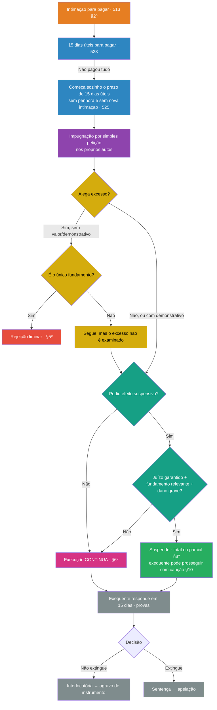

# Impugnação ao cumprimento de sentença

> [!warning] Fora da Prova 2
> A LOA Final B diz que este tema **só comporia a prova de 06/11 se houvesse comunicado expresso** do professor, e não houve. Esta nota é para **guardar e estudar depois** (Prova 3, OAB, prática).

> [!info] Legenda das fontes
> - **[MP p. X]**: material do professor (`2026-enviar-cs.pdf`): impugnação pp. 61–84; objeção de pré-executividade pp. 84–88
> - **[LOA B]**: LOA Final B, "Impugnação ao cumprimento de sentença" (núcleo introdutório escolhido pelo professor)
> - **[Slides 118–140]**: slides "CPC-III Cumprimento de Sentença" (OCR)
> - **CPC**: o art. 525 está transcrito **por inteiro** no MP (pp. 61–64), e as citações dele aqui seguem o texto legal
> - ⚠️ **fora do material**: o que não está nos arquivos da disciplina

**Mapa:** [[Impugnação ao cumprimento de sentença.canvas]]
**Vem de:** [[Cumprimento de sentença por quantia certa - fluxo do art. 523]]: o prazo de impugnação começa **sozinho** quando terminam os **15 dias úteis para pagar**.

---

## 1. Resumo rápido

A **impugnação** é a **defesa típica do executado no cumprimento de sentença**, e o **art. 525** a regula.

- **Prazo:** **15 dias** (úteis), que começam **automaticamente** quando terminam os 15 dias para pagar do art. 523, **sem penhora** e **sem nova intimação**.
- **Forma:** **simples petição, nos próprios autos**. Não é uma ação nova (posição majoritária).
- **Matérias:** **limitadas** ao rol do art. 525, §1º: falta de citação do revel, ilegitimidade, inexigibilidade, penhora ou avaliação erradas, excesso de execução, incompetência e fatos que extinguem a obrigação **posteriores à sentença**. **Não é uma segunda contestação.**
- **Excesso de execução:** o executado **tem de dizer o valor certo e juntar a conta** (§4º). Se não fizer, perde esse argumento (§5º).
- **Impugnar não suspende nada** (§6º). Efeito suspensivo exige **pedido + juízo garantido + fundamento relevante + risco de dano grave**.

Ao lado dela existe a **objeção (ou exceção) de pré-executividade**: defesa **atípica**, por simples petição, só para **matérias que o juiz conhece de ofício** e que se provam **por documento**.

---

## 2. Explicação aprofundada

### 2.1. Técnica Feynman (versão leiga)

> [!example] Como explicar para um leigo
> Você perdeu o processo e a sentença já é definitiva. Agora o credor está cobrando. Você **não pode** rediscutir se devia ou não: isso já foi decidido, e o processo inteiro existiu para isso.
>
> O que você **pode** é apontar **problemas da cobrança em si**:
> - "nunca fui citado no processo";
> - "você está cobrando a pessoa errada";
> - "está cobrando a mais";
> - "penhoraram um bem que não podia";
> - "eu já paguei **depois** da sentença".
>
> Isso é a **impugnação**. Ela tem prazo (15 dias depois de acabar o prazo para pagar) e **não para a cobrança sozinha**. Para parar, você precisa pedir, dar uma garantia e mostrar que o argumento é forte e que o prejuízo seria grave.

### 2.2. Prazo e momento (art. 525, caput)

> [!quote] Art. 525, caput
> Transcorrido o prazo previsto no art. 523 **sem o pagamento voluntário**, inicia-se o prazo de **15 dias** para que o executado, **independentemente de penhora ou nova intimação**, apresente, **nos próprios autos**, sua impugnação.

**Linha do tempo:**

```
Intimação (513 §2º) → [15 dias úteis para PAGAR] → [15 dias úteis para IMPUGNAR]
                                                      ↑ começa sozinho, sem nova intimação
```

| Questão | Resposta | Fonte |
|---|---|---|
| Precisa de penhora antes? | **Não**. No CPC/73 era preciso garantir o juízo; hoje a garantia só importa para o **efeito suspensivo** | Art. 525, caput; MP p. 68; LOA B, pergunta 1 |
| Precisa de nova intimação? | **Não**. O prazo começa automaticamente | MP p. 68 |
| Comparecimento espontâneo? | Conta como início dos prazos para pagar e, em seguida, para impugnar (Enunciado 84 da I Jornada do CJF), **se** o processo estava justamente aguardando a intimação | MP p. 69 |
| **Depositou para garantir o juízo durante o prazo de pagamento.** O prazo de impugnação começa no depósito? | **STJ atual: não.** O prazo de impugnação só começa **depois** dos 15 dias de pagamento, com ou sem depósito: REsp 1.761.068/RS (3ª T., 15/12/2020); AgInt no REsp 1.927.815/RS (4ª T., 2021); REsp 1.814.871/SP (3ª T., 2022); AgInt no REsp 1.988.345/DF (4ª T., 2023). **Neves discorda**: quem deposita para garantir mostra que não vai pagar, e o prazo deveria começar já | MP p. 70–73 |
| E o **TJRJ**? | Segue o STJ: **AI 0031041-77.2023.8.19.0000**, 13ª Câm. de Dir. Privado, Des. Mônica Sardas, 17/08/2023 (impugnação tempestiva contada depois dos 15 dias de pagamento, apesar do depósito) | MP p. 71, nota 248 |
| Prazo em dobro? | **Sim**: MP (art. 180), **Defensoria** (art. 186), **núcleos de prática jurídica** (art. 186, §3º) e **litisconsortes com advogados de escritórios diferentes em autos físicos** (art. 229; art. 525, §3º). Diferente dos embargos à execução, onde a dobra não se aplica | MP p. 73–75; STJ, REsp 1.964.438/SP (3ª T., 07/12/2021) |
| **Sentença arbitral** | A nulidade da sentença arbitral (Lei 9.307/96, art. 32) pode ser pedida na impugnação, mas **dentro do prazo decadencial de 90 dias** da ação de nulidade (art. 33). Esgotado esse prazo, não cabe mais nem por impugnação (STJ, REsp 1.928.951/TO, 2022; REsp 2.001.912/GO, 2022). Se a mesma nulidade foi pedida nas duas vias, há **litispendência**, e extingue-se a mais recente (REsp 2.105.872/RJ, 2024) | MP p. 69–70 |

### 2.3. Natureza jurídica

| Corrente | Tese | Quem |
|---|---|---|
| Ação incidental | Igual aos embargos: pede tutela jurisdicional | — |
| Depende da matéria | **Incidente** se aponta vício de procedimento; **ação** se busca um bem jurídico (ex.: extinção da obrigação) | — |
| **Incidente processual de defesa** | **Majoritária**. Simples petição, sem citação do credor, decidida por interlocutória | **Neves, Didier, Theodoro** |
| Defesa **e** ação | Defesa porque resiste à execução; ação porque pede declaração ou desconstituição | Donizetti |

[MP p. 62–63]

**Consequência prática:** como é **incidente** e não ação autônoma, a impugnação corre **nos mesmos autos** e admite **prazo em dobro**. Já os **embargos** são **ação** e formam processo novo (STJ, REsp 1.964.438/SP) [MP p. 75]. Compare em [[Processo Civil III - Execução#13.2 Embargabilidade da execução]].

### 2.4. Matérias que podem ser alegadas (art. 525, §1º)

> [!important] Cognição limitada
> Na impugnação, o juiz **não reexamina a causa**. A **coisa julgada** já resolveu a dívida, e só se discutem **as matérias do §1º**. Didier chama isso de cognição **limitada** (no que se pode alegar) e **exauriente *secundum eventum defensionis*** (aprofundada, se o executado alegar). Para a doutrina, o **rol é taxativo**, mas admite **matérias de ordem pública** que não estejam cobertas pela eficácia preclusiva da coisa julgada [MP p. 64].
> **Neves:** uma impugnação **fora do rol** deve ser **rejeitada de plano**; repetir matéria já decidida pode gerar **litigância de má-fé** [MP p. 64]. É o **Caso C** da LOA B: a impugnação **não é uma segunda contestação**.

| Inciso | Matéria | O que significa, por extenso | Fonte |
|---|---|---|---|
| **I** | Falta ou nulidade da **citação**, **se o processo correu à revelia** | Precisa dos **dois**: citação defeituosa **e** revelia. Se o réu compareceu, o defeito ficou sanado. É nulidade **absoluta** e de ordem pública, que também cabe em objeção de pré-executividade e em ***querela nullitatis***. Se acolhida, o processo **volta à fase de conhecimento**, e o réu, já intimado na pessoa do advogado, **contesta** (STJ, REsp 1.930.225/2021) | MP p. 65 |
| **II** | **Ilegitimidade** de parte | Ilegitimidade **na execução**: o exequente não é o vencedor nem seu sucessor; o executado não é o vencido nem seu sucessor. Pode ser *ad causam* ou *ad processum*. Ex.: executar o fiador que não participou da fase de conhecimento (art. 513, §5º) | MP p. 65; Theodoro |
| **III** | **Inexequibilidade do título** ou **inexigibilidade da obrigação** | **Inexequível:** falta título, ou o título não preenche os requisitos (ex.: sentença estrangeira **sem** homologação do STJ). **Inexigível:** há **termo, condição ou contraprestação** pendentes (ex.: a sentença manda entregar a coisa **depois** que o autor pagar o resto do preço, e ele não pagou). Inclui a **"coisa julgada inconstitucional"** (§§12–15, item 2.7) | MP p. 65–66; Donizetti. Ver [[Títulos executivos]] |
| **IV** | **Penhora incorreta** ou **avaliação errônea** | **Penhora:** bem de família (Lei 8.009/90), bem impenhorável (art. 833), ordem de penhora desrespeitada (art. 835), falta de intimação do cônjuge ou do credor hipotecário. **Avaliação:** valor **manifestamente** acima ou abaixo do mercado, demonstrado com avaliações idôneas, e não com simples discordância | MP p. 66 (Donizetti). Ver [[Avaliação, expropriação e satisfação do crédito]] |
| **V** | **Excesso de execução** ou **cumulação indevida** de execuções | **Excesso** (art. 917, §2º, usado como referência): cobrar **mais** do que o título; coisa diversa; modo diferente; exigir sem ter cumprido a própria prestação; não provar a condição. **Cumulação indevida:** juntar execuções sem mesmo executado, mesmo juízo competente e mesmo procedimento (art. 780) | MP p. 66–67 |
| **VI** | **Incompetência** absoluta ou relativa do **juízo da execução** | Ver o art. 516 (juízo da causa = competência funcional, absoluta; opções do p.u. = territorial) | MP p. 67; ver [[Disposições gerais do cumprimento de sentença e cumprimento provisório#e) Competência (art. 516)]] |
| **VII** | Causa **modificativa ou extintiva** da obrigação **posterior à sentença** (pagamento, novação, compensação, transação, prescrição) | **Tem de ser posterior à sentença**: tudo o que podia ter sido alegado antes está coberto pela **eficácia preclusiva da coisa julgada** (art. 508). O rol é **exemplificativo** (também renúncia, remissão, confusão…). **Prescrição:** só a **superveniente** à formação do título (STJ, **REsp 1.931.969/SP**, 3ª T., 08/02/2022) | MP p. 67–68 |

- **§2º:** impedimento e suspeição **não** se alegam na impugnação, e sim pelo procedimento próprio (arts. 146 e 148).
- **Preclusão:** em regra, o executado deve alegar tudo na impugnação. Mas a maioria das matérias é de **ordem pública** e não preclui. **Precluem**, por exemplo, o **excesso de execução** e a **incompetência relativa** [MP p. 68].

### 2.5. Excesso de execução: o ônus do executado (art. 525, §§4º–5º)

> [!quote] Art. 525, §§4º e 5º
> **§4º:** quem alega que o exequente cobra **quantia superior à da sentença** deve **declarar de imediato o valor que entende correto**, apresentando **demonstrativo discriminado e atualizado** do cálculo.
> **§5º:** se não apontar o valor correto ou não apresentar o demonstrativo:
> - **excesso é o único fundamento** → a impugnação é **rejeitada liminarmente**;
> - **há outros fundamentos** → a impugnação segue, mas o juiz **não examina o excesso**.

- **Por quê:** evitar a impugnação genérica e protelatória ("está errado" sem dizer onde). É o espelho do demonstrativo que o **credor** deve juntar no art. 524. Ver [[Cumprimento de sentença por quantia certa - fluxo do art. 523#c) Demonstrativo do crédito (art. 524)]].
- **Sem emenda:** o juiz **não dá prazo para emendar**. É preciso apontar a parcela incontroversa e os erros já na petição (STJ, **REsp 1.387.248/SC**, repetitivo, 07/05/2014) [MP p. 78].
- **A parte que o executado reconhece** como devida segue sendo cobrada normalmente, mesmo que se dê efeito suspensivo à impugnação (Donizetti) [MP p. 66–67].
- **Dalla:** se o executado não alegar o excesso, há **preclusão** quanto ao valor, salvo erro de cálculo ou valor absurdo. E o valor fixado na **liquidação** não pode ser rediscutido [MP p. 67].
- **Não confundir com o art. 524, §1º.** Lá, o **juiz**, de ofício, limita a **penhora** quando o excesso é **aparente**. Aqui, o **executado** alega excesso e pode reduzir **a própria execução**.

### 2.6. Efeito suspensivo (art. 525, §§6º–10)

> [!quote] Art. 525, §6º
> A apresentação de impugnação **não impede** a prática dos atos executivos, **inclusive os de expropriação**. O juiz pode atribuir-lhe **efeito suspensivo**, **a requerimento** do executado e **desde que garantido o juízo** com penhora, caução ou depósito suficientes, **se** os fundamentos forem **relevantes** e se o prosseguimento for **manifestamente suscetível de causar grave dano de difícil ou incerta reparação**.

**Os quatro requisitos, todos cumulativos** [MP p. 77]:
1. **requerimento** expresso do executado (o juiz não concede de ofício);
2. **juízo garantido** (penhora, caução ou depósito **suficientes**);
3. **fundamentos relevantes** (probabilidade de êxito);
4. **risco de dano grave**, de difícil ou incerta reparação.

| § | Regra |
|---|---|
| **§7º** | Mesmo com efeito suspensivo, continuam possíveis **substituir, reforçar ou reduzir a penhora** e **avaliar** os bens |
| **§8º** | Efeito suspensivo **parcial** → a execução **continua no resto** |
| **§9º** | Efeito suspensivo dado a **um** executado **não** suspende contra os outros, se o fundamento for **só dele** |
| **§10** | Mesmo com efeito suspensivo, o **exequente** pode pedir para **prosseguir**, prestando **caução** suficiente e idônea |

- **Impugnação × embargos:** nos embargos (art. 919, §1º), o efeito suspensivo exige os requisitos da **tutela provisória** além da garantia. Na impugnação, a lei fala em "fundamentos relevantes" + "dano grave", que lembram a tutela de **urgência**. Por isso, parte da doutrina admite efeito suspensivo também por **tutela de evidência** (Neves) [MP p. 77].
- **Recurso:** a decisão que concede ou nega o efeito suspensivo é **interlocutória** → **agravo de instrumento** [MP p. 78].
- **Caso B da LOA B:** "ofereci impugnação, então tudo está suspenso" → **errado**. **Impugnar** é diferente de **obter efeito suspensivo**.

### 2.7. "Coisa julgada inconstitucional" (art. 525, §§12–15)

> [!quote] Art. 525, §§12–15 (síntese)
> - **§12:** também é **inexigível** (inciso III) a obrigação fundada em lei ou ato normativo que o **STF** considerou **inconstitucional**, ou em interpretação que o STF considerou incompatível com a Constituição, em controle **concentrado ou difuso**.
> - **§13:** o STF pode **modular** os efeitos no tempo.
> - **§14:** a decisão do STF tem de ser **anterior ao trânsito em julgado** da decisão exequenda.
> - **§15:** se a decisão do STF vier **depois** do trânsito, cabe **ação rescisória**, com prazo contado do **trânsito da decisão do STF**.
> - Regra idêntica para a Fazenda Pública: art. 535, §§5º–8º.

- **STF, Tema 360 (RE 611.503, Pleno, 20/09/2018):** esses dispositivos são **constitucionais**. São um "mecanismo com eficácia rescisória" para sentenças com **vício de inconstitucionalidade qualificado**: sentença fundada em norma reconhecidamente inconstitucional, ou que deixou de aplicar norma reconhecidamente constitucional, **desde que** o julgamento do STF seja **anterior ao trânsito** [MP p. 83].
- **FPPC, Enunciado 58:** a decisão de inconstitucionalidade deve ser do **Plenário** do STF [MP p. 80].
- **Neves sobre o §13:** se a modulação já foi feita pelo STF, o juiz só a respeita. Se o dispositivo quiser dar ao **juiz da execução** o poder de modular, é **inconstitucional**, porque modular é tarefa **exclusiva** do STF [MP p. 80].
- **Outras vias para atacar a coisa julgada inconstitucional:** ação rescisória; ação declaratória autônoma; ação anulatória (*querela nullitatis*), mas com os mesmos limites do §12 (STJ, **REsp 1.782.867/MS**, 3ª T., 06/08/2019) [MP p. 81–82].
- A LOA B **excluiu** este ponto do núcleo introdutório.

### 2.8. Procedimento, recursos e honorários

- **Contraditório:** o exequente é ouvido em **15 dias**, por analogia ao art. 920, I [MP p. 75].
- **Provas:** todos os meios de prova são admitidos (por analogia ao art. 920, II). A limitação da cognição é **horizontal** (que matérias podem ser alegadas), e não **vertical** (profundidade da análise) [MP p. 75].
- **Rejeição liminar:** parte da doutrina aplica à impugnação os incisos I (intempestiva) e III (manifestamente protelatória) do art. 918, além do §5º do art. 525 (excesso sem demonstrativo) [MP p. 78].
- **Recurso cabível** [MP p. 76; Slides 118–140]:

| A decisão que julga a impugnação... | Natureza | Recurso |
|---|---|---|
| **Não extingue** o cumprimento (rejeita, ou acolhe em parte) | Interlocutória | **Agravo de instrumento** (art. 1.015, p.u.) |
| **Extingue** o cumprimento | Sentença | **Apelação** (art. 1.009) |
| Acolhe a **falta de citação** (inciso I): extingue a execução, mas **o processo volta** ao conhecimento | Para Neves, **interlocutória** pela lógica do sistema (pela letra do art. 203, seria sentença) | **Agravo de instrumento**, admitida a **fungibilidade** |

- **Honorários da impugnação:**
  - **STJ:** só há honorários se a impugnação for **acolhida**, mesmo que em parte, salvo se o acolhimento só levantar uma penhora (AgInt no REsp 1.790.594/2019; Súmula 519/STJ: "na hipótese de rejeição da impugnação ao cumprimento de sentença, não são cabíveis honorários advocatícios").
  - **Doutrina (Câmara; FPPC, Enunciado 450):** se a impugnação for **rejeitada**, os honorários de 10% do art. 523 podem ser **elevados até 20%**, por analogia ao art. 827, §2º. A Súmula 519 estaria superada.
  - [MP p. 76]
- **Theodoro:** se a impugnação dispensa garantia e quase tudo é de ordem pública, o prazo de 15 dias "se torna irrelevante" na prática [MP p. 77].

### 2.9. Fazer, não fazer e entregar coisa

- **Aplica-se a impugnação:** art. 536, §4º (fazer/não fazer) e art. 538, §3º (entregar coisa), que mandam aplicar o art. 525 "no que couber". Também no **cumprimento provisório** (art. 520, §1º) [MP p. 84].
- **Donizetti diverge:** essas obrigações **não admitem impugnação**. O executado deve usar **recursos**, como o agravo de instrumento contra as decisões da fase de cumprimento [MP p. 84].
- **Benfeitorias:** o direito de **retenção** deve ser alegado na **contestação**, na fase de conhecimento (art. 538, §§1º–2º). Não pode ser alegado pela primeira vez na impugnação (STJ, REsp 1.278.094/2012) [MP p. 64–65].

### 2.10. Depois do prazo: simples petição (art. 525, §11, e art. 518)

> [!quote] Art. 525, §11
> **Fato superveniente** ao fim do prazo de impugnação, e questões sobre **validade e adequação da penhora, da avaliação e dos atos executivos seguintes**, podem ser alegados por **simples petição**, no prazo de **15 dias** contados da **ciência do fato** ou da **intimação do ato**.

- Liga-se ao **art. 518** (validade do procedimento por simples petição). Ver [[Disposições gerais do cumprimento de sentença e cumprimento provisório#h) Validade do procedimento (art. 518) e tutela provisória (art. 519)]].
- **Donizetti:** passados os 15 dias, a questão **preclui**. A regra busca **simplicidade** e, ao mesmo tempo, **barrar manobras protelatórias** [MP p. 85].

---

### 2.11. Objeção (exceção) de pré-executividade

**Conceito:** "alegação incidental à execução por meio de mera petição, feita pelo executado, contendo como objeto **matérias conhecíveis de ofício**" (Neves) [MP p. 84].

| Aspecto | Regra | Fonte |
|---|---|---|
| Base legal | **Atípica**: o CPC não a prevê expressamente. Parte da doutrina a vê nos arts. **518** e **803**, p.u. (nulidade declarável de ofício, "independentemente de embargos") | MP p. 85 |
| Forma | **Simples petição** | MP p. 85 |
| Quando | Antes, durante ou depois da defesa típica (Neves) | MP p. 85 |
| **Requisitos (STJ)** | (a) matéria **conhecível de ofício**; (b) **prova pré-constituída** (documental); (c) **sem necessidade de produzir provas**. Juntar documentos complementares não conta como "dilação probatória" | MP p. 86; **Súmula 393/STJ** (execução fiscal) |
| Precisa de prova? | O juiz **remete a questão aos embargos ou à impugnação**. Não é declarar *non liquet*: é indicar a via própria | MP p. 86 |
| Prazo final | **Divergência no STJ**: só até a penhora (REsp 1.031.759/2011, porque serve para evitar a constrição) × também depois dela (EREsp 905.416/2013) | MP p. 86 |
| Matérias típicas | **Prescrição** (o juiz pode conhecer de ofício: arts. 332, §1º, e 487, p.u.); **pagamento**, só excepcionalmente; **excesso de execução**, só se for **evidente**, sem prova a produzir | MP p. 86–87 |
| Contraditório | O exequente é **ouvido** (art. 10), salvo se a objeção for **manifestamente inadmissível** | MP p. 87 |

**Possíveis decisões** [MP p. 87]:

| Resultado | Natureza | Recurso | Honorários |
|---|---|---|---|
| **Acolhe e extingue** a execução | Sentença | Apelação | **Sim**, mesmo se a extinção for parcial (REsp 1.185.036/2010) |
| Acolhe e **exclui um sócio** do polo passivo; execução continua | Interlocutória | Agravo | **Sim** (REsp 1.764.405/2021) |
| **Rejeita**; execução continua | Interlocutória | Agravo de instrumento | **Não** (REsp 1.256.724/2012) |
| **Não decide** por precisar de prova → remete aos embargos | Interlocutória | Agravo de instrumento | — |

- **Coisa julgada:** se a objeção foi decidida com cognição exauriente, a mesma matéria **não pode ser renovada nos embargos**. Para Neves, o fundamento é a **coisa julgada material** da decisão interlocutória de mérito, e não a preclusão [MP p. 87].

---

## 3. Mapa mental

Versão visual: [[Impugnação ao cumprimento de sentença.canvas]]

- **IMPUGNAÇÃO (art. 525)**
	- **Prazo:** 15 dias úteis depois dos 15 para pagar · sem penhora · sem nova intimação
		- Depósito para garantia **não** antecipa o prazo (STJ, REsp 1.761.068; TJRJ, AI 0031041-77.2023) × Neves
		- Em dobro: MP, Defensoria, núcleos de prática, litisconsortes em autos físicos
	- **Natureza:** incidente processual de defesa (maioria) · simples petição · nos próprios autos
	- **Matérias (§1º, rol taxativo + ordem pública)**
		- I citação + revelia · II ilegitimidade · III título inexequível / obrigação inexigível (+ §§12–15)
		- IV penhora/avaliação · V excesso/cumulação · VI incompetência · VII fato extintivo **posterior** à sentença
	- **Excesso (§§4º–5º):** valor correto + demonstrativo, senão rejeição (único fundamento) ou não exame
	- **Efeito suspensivo (§6º):** pedido + juízo garantido + relevância + dano grave
		- §7º penhora/avaliação continuam · §8º parcial · §9º só para quem impugnou · §10 caução do exequente
	- **Recursos:** não extingue → agravo · extingue → apelação
	- **Honorários:** STJ só se acolhida × FPPC 450: elevar até 20% se rejeitada
	- **Depois do prazo:** §11, simples petição em 15 dias
- **OBJEÇÃO DE PRÉ-EXECUTIVIDADE**
	- Atípica · simples petição · matéria de ofício + prova documental · sem dilação probatória
	- Acolhida e extinta → apelação + honorários · rejeitada → agravo, sem honorários

---

## 4. Esquemas visuais

### Fluxo da impugnação



### Quadro comparativo: impugnação × embargos à execução × objeção de pré-executividade

| | **Impugnação (525)** | **Embargos (914+)** | **Objeção de pré-executividade** |
|---|---|---|---|
| Onde cabe | Cumprimento de sentença (título **judicial**) | Processo de execução (título **extrajudicial**) | Em ambos |
| Natureza | **Incidente** de defesa (maioria) | **Ação autônoma** | Defesa **atípica** |
| Forma | Simples petição, nos autos | Petição inicial, em apenso | Simples petição |
| Prazo | 15 dias depois do prazo de pagamento | 15 dias da juntada do mandado de citação ⚠️ (fora do material: art. 915) | Sem prazo fixo (divergência quanto à penhora) |
| Matérias | **Restritas** (§1º) | **Amplas** (art. 917, VI: qualquer defesa do processo de conhecimento) | Só matéria **de ofício**, com **prova documental** |
| Garantia do juízo | Só para efeito suspensivo | Só para efeito suspensivo | Não |
| Prazo em dobro | **Sim** (art. 229) | **Não** | — |
| Decisão | Interlocutória (agravo) ou sentença (apelação) | **Sentença** (apelação) | Interlocutória ou sentença |

Ver também [[Processo Civil III - Execução#13. Embargos à execução]].

---

## 5. Exemplos práticos

> [!example] Caso A (LOA B): excesso de execução
> Credor cobra R$ 120.000. O executado acha que o certo é R$ 80.000, porque o credor aplicou juros de 2% ao mês e a sentença fixou 1%.
> - Meio: **impugnação** (art. 525, §1º, V).
> - Ele **tem de declarar** os **R$ 80.000** e juntar **demonstrativo discriminado e atualizado** (§4º).
> - Se disser só "está errado", e esse for o único argumento → **rejeição liminar** (§5º), sem chance de emenda (REsp 1.387.248/SC).
> - Os **R$ 80.000** reconhecidos continuam sendo cobrados normalmente.

> [!example] Caso B (LOA B): "estou suspenso"
> O executado impugna e para de se preocupar, achando que tudo está suspenso.
> → **Errado.** A impugnação **não suspende** (§6º). Para suspender, ele precisa **pedir**, **garantir o juízo** e mostrar **fundamento relevante** e **risco de dano grave**. Sem isso, a penhora e até a **expropriação** seguem.

> [!example] Caso C (LOA B): "quero rediscutir tudo"
> Sentença transitada em julgado. O executado impugna dizendo que nunca deveu, com os mesmos argumentos da contestação.
> → **Rejeição.** A impugnação **não é segunda contestação**: o rol do §1º é taxativo, e a matéria está coberta pela **coisa julgada** e pela **eficácia preclusiva** (art. 508). Neves: pode haver **litigância de má-fé** [MP p. 64].

> [!example] Caso D: depósito em garantia e prazo
> Intimado em 10/11, o executado **deposita** o valor no 5º dia útil "para garantir o juízo" e impugna no 25º dia útil.
> → **Tempestivo**, pelo STJ atual: o prazo de impugnação só começou depois do 15º dia útil (REsp 1.761.068/RS; no TJRJ, AI 0031041-77.2023.8.19.0000). Para **Neves**, o prazo teria começado no depósito, e a impugnação seria intempestiva.
> E a **multa de 10%** incide, porque depósito em garantia **não é pagamento**. Ver [[Cumprimento de sentença por quantia certa - fluxo do art. 523]].

---

## 6. Pontos de atenção

> [!danger] Pegadinhas
> 1. **Não precisa de penhora** para impugnar.
> 2. **Não precisa de nova intimação**: o prazo começa sozinho.
> 3. **Impugnar ≠ suspender.**
> 4. **Excesso sem valor e sem demonstrativo** → perde o argumento (e a impugnação inteira, se for o único fundamento).
> 5. **Fato extintivo anterior à sentença** (pagamento, prescrição) **não** pode ser alegado: só o **posterior**.
> 6. **Falta de citação** só vale **se houve revelia**.
> 7. **Prazo em dobro vale na impugnação**, mas **não nos embargos**.
> 8. **Impedimento e suspeição** não vão na impugnação (§2º).
> 9. **Depósito em garantia não antecipa o prazo** da impugnação (STJ atual).
> 10. **Objeção de pré-executividade** sem prova documental pronta → **remete aos embargos ou à impugnação**.

> [!tip] Mnemônico do §1º → "CIIPECE"
> **C**itação (com revelia) · **I**legitimidade · **I**nexigibilidade/inexequibilidade · **P**enhora/avaliação · **E**xcesso/cumulação · **C**ompetência · **E**xtinção posterior (pagamento, prescrição…)

---

## 7. Jurisprudência

> [!note] Origem e verificação
> - Todos os julgados abaixo foram **citados no material do professor** e **não foram verificados online** por mim.
> - **STJ:** <https://scon.stj.jus.br> · **TJRJ:** <https://www3.tjrj.jus.br/ejuris> · **STF:** <https://portal.stf.jus.br> (Tema 360)

| Tribunal / número | Tese | Onde |
|---|---|---|
| **TJRJ, AI 0031041-77.2023.8.19.0000** (13ª Câm. Dir. Priv., Des. Mônica Sardas, 17/08/2023) | Depósito em garantia no prazo do 523 não antecipa o prazo do 525 | MP p. 71 |
| STJ, REsp 1.761.068/RS (3ª T., 15/12/2020) | O prazo de impugnação só começa depois dos 15 dias de pagamento, mesmo com depósito | MP p. 72 |
| STJ, AgInt no REsp 1.988.345/DF (4ª T., 17/04/2023) | Idem (posição atual das duas turmas) | MP p. 73 |
| STJ, REsp 1.964.438/SP (3ª T., 07/12/2021) | Impugnação é incidente; admite prazo em dobro para litisconsortes | MP p. 75 |
| STJ, REsp 1.931.969/SP (3ª T., 08/02/2022) | Só a prescrição posterior ao título pode ser alegada na impugnação | MP p. 68 |
| STJ, REsp 1.387.248/SC (repetitivo, 07/05/2014) | Excesso sem demonstrativo → rejeição liminar, sem emenda | MP p. 78 |
| STJ, REsp 1.928.951/TO (3ª T., 15/02/2022) | Nulidade de sentença arbitral na impugnação respeita os 90 dias da Lei de Arbitragem | MP p. 70 |
| STJ, REsp 2.105.872/RJ (3ª T., 06/02/2024) | Litispendência entre ação de nulidade e impugnação com o mesmo pedido | MP p. 69 |
| STF, Tema 360 – RE 611.503 (Pleno, 20/09/2018) | Os §§12 e 14 do art. 525 são constitucionais (vício de inconstitucionalidade qualificado) | MP p. 83 |
| STJ, REsp 1.782.867/MS (3ª T., 06/08/2019) | *Querela nullitatis* por inconstitucionalidade segue os mesmos limites do §12 | MP p. 81–82 |
| STJ, AgInt no REsp 1.790.594 (2019); Súmula 519 | Sem honorários na rejeição da impugnação | MP p. 76 |
| STJ, Súmula 393 | Exceção de pré-executividade na execução fiscal: matérias de ofício, sem dilação probatória | MP p. 86 |

---

## 8. Fixação

> [!question] Q1 (objetiva)
> Sobre a impugnação ao cumprimento de sentença:
> A) depende de prévia penhora
> B) suspende automaticamente os atos executivos
> C) pode alegar pagamento feito antes da sentença
> D) começa automaticamente após o prazo de pagamento, sem nova intimação

> [!question] Q2 (objetiva)
> O executado alega apenas excesso de execução, sem indicar o valor correto. O juiz deve:
> A) intimá-lo para emendar
> B) rejeitar liminarmente a impugnação
> C) nomear contador
> D) processar a impugnação normalmente

> [!question] Q3 (discursiva curta)
> Diferencie "apresentar impugnação" de "obter efeito suspensivo" (LOA B, Caso B).

> [!question] Q4 (discursiva)
> Por que a impugnação não é uma "segunda contestação"? Relacione com o art. 525, §1º, VII, e com a eficácia preclusiva da coisa julgada.

> [!question] Q5 (microcaso)
> Dois executados, com advogados de escritórios diferentes, **autos físicos**. Um deles depositou o valor em garantia no 3º dia do prazo de pagamento. Ambos impugnam no 40º dia útil depois da intimação; um alega prescrição consumada **antes** da sentença e o outro alega excesso, com demonstrativo. Analise tempestividade e matérias.

> [!question] Recordação ativa (de cabeça)
> 1. Quais são os 4 requisitos do efeito suspensivo?
> 2. Quais são os 3 requisitos da objeção de pré-executividade?
> 3. Qual recurso cabe da decisão que rejeita a impugnação?

> [!success]- Gabarito comentado (clique para abrir)
> **Q1: D.** Art. 525, caput.
> - A está errada: a penhora não é requisito.
> - B está errada: §6º.
> - C está errada: só fatos **posteriores** à sentença (§1º, VII).
>
> **Q2: B.** §5º: se o excesso é o único fundamento, há rejeição liminar, sem emenda (REsp 1.387.248/SC).
>
> **Q3:** Apresentar é **exercer a defesa**, o que não paralisa nada (§6º). Obter efeito suspensivo é uma **decisão do juiz**, que depende de **pedido**, **garantia do juízo**, **fundamento relevante** e **risco de dano grave**. Sem ela, os atos executivos, inclusive a expropriação, continuam.
>
> **Q4:** A causa já foi julgada com coisa julgada. O que podia ser alegado no processo de conhecimento considera-se repelido (eficácia preclusiva, art. 508). Por isso o §1º limita as matérias, e o inciso VII só admite fatos modificativos ou extintivos **posteriores** à sentença. Rediscutir o mérito leva à rejeição (e, para Neves, a possível litigância de má-fé).
>
> **Q5:**
> - **Prazo:** autos físicos + litisconsortes com advogados distintos → prazos **em dobro**: 30 dias úteis para pagar (REsp 1.693.784/DF) e **30 dias úteis para impugnar** (art. 229; REsp 1.964.438/SP).
> - O **depósito** não antecipa o prazo (REsp 1.761.068/RS). A impugnação **só começa a correr no 31º dia útil**. Logo, no 40º dia útil, **ambas são tempestivas**.
> - **Prescrição anterior à sentença:** **não pode** ser alegada, porque está coberta pela coisa julgada (REsp 1.931.969/SP). Esse ponto é rejeitado.
> - **Excesso com demonstrativo:** atende ao §4º e deve ser examinado.
>
> **Recordação ativa:**
> 1. Requerimento, juízo garantido, fundamentos relevantes, risco de dano grave.
> 2. Matéria conhecível de ofício, prova pré-constituída, desnecessidade de dilação probatória.
> 3. Agravo de instrumento (decisão interlocutória, que não extingue o cumprimento).

---

## 9. Flashcards

#flashcards/CPCIII/impugnacao

Prazo da impugnação?::15 dias úteis, que começam automaticamente ao fim do prazo de pagamento do art. 523 (art. 525)
Impugnação depende de penhora?::Não (art. 525, caput)
Precisa de nova intimação para impugnar?::Não
Depósito em garantia no prazo de pagamento antecipa o prazo de impugnação?::Não, segundo o STJ atual (REsp 1.761.068/RS); Neves discorda
Natureza da impugnação (maioria)?::Incidente processual de defesa (Neves, Didier, Theodoro)
Impugnação admite prazo em dobro para litisconsortes?::Sim, em autos físicos com advogados de escritórios distintos (art. 229; REsp 1.964.438/SP); embargos não
O rol do art. 525, §1º, é taxativo?::Sim, para a doutrina, ressalvadas matérias de ordem pública não cobertas pela coisa julgada
Quando cabe alegar falta de citação na impugnação?::Se houve falta ou nulidade da citação E o processo correu à revelia (inciso I)
Fato extintivo que pode ser alegado (inciso VII)?::Só o posterior à sentença (pagamento, novação, compensação, transação, prescrição)
Ônus de quem alega excesso de execução?::Declarar o valor correto e juntar demonstrativo discriminado e atualizado (§4º)
Excesso sem demonstrativo, como único fundamento?::Rejeição liminar, sem emenda (§5º; REsp 1.387.248/SC)
A impugnação suspende a execução?::Não (§6º)
Requisitos do efeito suspensivo?::Requerimento + juízo garantido + fundamentos relevantes + risco de dano grave
Mesmo com efeito suspensivo, o que continua?::Substituição, reforço ou redução da penhora e avaliação (§7º); o exequente pode prosseguir com caução (§10)
Coisa julgada inconstitucional na impugnação: requisito temporal?::A decisão do STF deve ser anterior ao trânsito da decisão exequenda (§14); se posterior → ação rescisória (§15)
Recurso contra a decisão que não extingue o cumprimento?::Agravo de instrumento
Recurso contra a decisão que extingue o cumprimento?::Apelação
Honorários na rejeição da impugnação (STJ)?::Não são devidos (Súmula 519; AgInt no REsp 1.790.594)
Fato superveniente depois do prazo de impugnação?::Simples petição em 15 dias da ciência (art. 525, §11)
Requisitos da objeção de pré-executividade?::Matéria conhecível de ofício, prova pré-constituída, sem dilação probatória

---

## 10. Conexões

- **Visão geral:** [[Processo Civil III - Execução]] (§13 embargos à execução; §6.5 contraditório eventual)
- **Antes:** [[Cumprimento de sentença por quantia certa - fluxo do art. 523]] (fim do prazo de pagamento = início do prazo de impugnação; demonstrativo do art. 524)
- **Matérias ligadas:** [[Títulos executivos]] (inciso III: inexequibilidade/inexigibilidade) · [[Avaliação, expropriação e satisfação do crédito]] (inciso IV: penhora e avaliação) · [[Disposições gerais do cumprimento de sentença e cumprimento provisório]] (inciso VI: competência do art. 516; art. 518; impugnação no provisório, art. 520, §1º)
- **Mapa:** [[Impugnação ao cumprimento de sentença.canvas]]

## 11. Minhas anotações

- 
