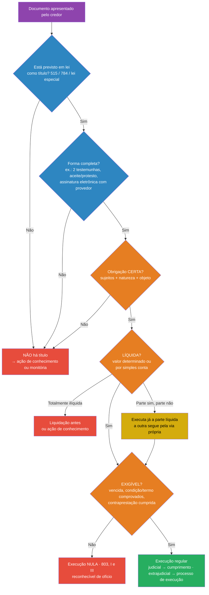

> [!note] Ligações
> **Tópico:** [[Processo Civil III - Execução]] · **Ver também:** [[Disposições gerais do cumprimento de sentença e cumprimento provisório]], [[Cumprimento de sentença por quantia certa - fluxo do art. 523]] · **Termos:** [[Coisa julgada]]

# Títulos executivos

> [!info] Legenda das fontes
> - **[ASD4]**: orientações da ASD 4, "Auditoria de títulos e requisitos executivos" (Ponto 2, Aula 4 + LOA 4). É o retrato mais fiel do que o professor cobra neste tema.
> - **[Cronograma]**: Ponto 2, Aulas 4 e 5, LOA 4 e LOA 5 (pp. 20–21).
> - **[Neves p. X]**: Neves, *Manual*, cap. 43, "Título executivo" (pp. 1113–1150 do arquivo enviado).
> - **[MP p. X]**: material do professor (`2026-enviar-cs.pdf`).
> - **[Notas]**: suas anotações em [[Processo Civil III - Execução]].
> - 🔎 **conferir**: tirado de memória, sem conferência nesta sessão. Confirme no [Planalto](https://www.planalto.gov.br/ccivil_03/_ato2015-2018/2015/lei/l13105.htm).
> - ⚠️ **fora do material**: o que não está nos arquivos da disciplina.

> [!warning] Por que este tema está na Prova 2
> O Comunicado da A2 inclui "títulos executivos e disposições gerais do cumprimento, **na extensão trabalhada**". Títulos foram dados **antes** da A1 (aulas de 04/09 e 11/09), então esta nota é **revisão**. O mais provável é que caiam: o **art. 515** (títulos **judiciais**, base do cumprimento de sentença) e os **requisitos de certeza, liquidez e exigibilidade**, porque se ligam ao art. 514 e ao art. 523. Isso é uma inferência minha, não uma informação do professor.

**Mapa:** [[Títulos executivos.canvas]]
**Liga-se a:** [[Disposições gerais do cumprimento de sentença e cumprimento provisório]] (art. 514: condição/termo; art. 515, §1º: citação) · [[Cumprimento de sentença por quantia certa - fluxo do art. 523]]

---

## 1. Resumo rápido

**Título executivo** é o **documento ou ato a que a lei dá força executiva**. Sem ele **não existe execução**: é o princípio *nulla executio sine titulo* (art. 786). É o "bilhete de ingresso" na via executiva (Araken de Assis) [Notas §8.1].

- **Só a lei cria título.** As partes **não podem** inventar um título por contrato (**taxatividade**: *nullus titulus sine lege*) [ASD4; Neves p. 1114].
- **O título não é a obrigação.** O título é o **documento** (continente); a obrigação é o **direito material** (conteúdo) que está dentro dele [ASD4].
- **A obrigação precisa ser:**
  - **certa:** sabe-se **quem** deve, **a quem** e **o quê**;
  - **líquida:** sabe-se **quanto**, nem que seja por **simples conta**;
  - **exigível:** já **venceu** e não depende de condição, termo ou contraprestação pendentes.

  (Arts. 783 e 786.)
- **Duas espécies:**

| Espécie | Onde está | Como se executa |
|---|---|---|
| **Judicial** | Art. 515 | **Cumprimento de sentença**, em regra no mesmo processo |
| **Extrajudicial** | Art. 784 | **Processo autônomo de execução** |

---

## 2. Explicação aprofundada

### 2.1. Técnica Feynman (versão leiga)

> [!example] Como explicar para um leigo
> O título executivo é como um **ingresso** para um show: sem ingresso, você não entra, por mais que diga que pagou. Para entrar na execução, onde o juiz pode **tomar bens** do devedor, o credor precisa de um **documento que a lei reconheça como ingresso**: uma sentença, um cheque, uma nota promissória, um contrato com duas testemunhas.
> - E **só a lei imprime ingressos**: não adianta credor e devedor escreverem no contrato "isto vale como título executivo".
> - O ingresso também precisa estar **preenchido corretamente**: dizer quem deve, quanto deve e já estar vencido. Se faltar algum desses dados, o credor terá de entrar "pela porta lateral": a **ação de conhecimento** ou a **monitória**.

### 2.2. Conceito, função e natureza

- **Função:** o título é o **pressuposto indispensável** da execução. Ele dá ao credor acesso direto aos atos que invadem o patrimônio do devedor, **sem precisar provar de novo** o crédito [ASD4; Notas §8.1].
- **Título ≠ obrigação** [ASD4]:
  - **Pode haver título sem obrigação:** a sentença condenatória continua sendo título mesmo se o devedor já pagou antes do cumprimento. O título existe, mas a obrigação acabou [Neves p. 1115].
  - **A nulidade formal do título não extingue o crédito:** o credor só perde o **atalho executivo**. Ainda pode cobrar por ação de conhecimento ou monitória [ASD4, questão 1-D].
  - O título **não é presunção absoluta** de que o crédito existe: o executado pode se defender por **impugnação** ou **embargos** [ASD4, questão 1-A; Neves p. 1115].
- **Natureza jurídica (três teorias)** [Neves p. 1114]:

| Teoria | Autor | O título é... |
|---|---|---|
| **Documento** | Carnelutti | Uma **prova legal** do crédito |
| **Ato jurídico** | Liebman | O **ato** que abre a via executiva. O documento só o materializa. Crítica de Liebman a Carnelutti: se o título provasse o crédito, não poderia haver execução de crédito inexistente, e há |
| **Mista** | Zavascki, Shimura, Theodoro | **Ato e documento ao mesmo tempo**: um fato complexo, com forma e conteúdo exigidos pela lei |

### 2.3. Taxatividade e tipicidade

- **Só a lei federal cria títulos.** A razão é a **gravidade** dos atos executivos: penhora, expropriação, restrições [Neves p. 1114 e 1130].
- **Exemplo de Neves:** um contrato **sem as duas testemunhas** exigidas pelo art. 784, III, **não vira título** só porque as partes escreveram que ele "é título executivo". Serve, no máximo, para uma **ação monitória** [Neves p. 1130].
- **Art. 190 (negócio processual atípico)** **não** serve para criar título [ASD4, questão 5-A e B3].

> [!warning] Divergência entre os seus materiais
> | Fonte | Posição |
> |---|---|
> | **ASD4 (professor)** | As partes **não podem**, por convenção ou negócio processual atípico, criar título não previsto em lei. Uma cláusula que diga "e-mails de cobrança valem como título" é **inválida** (microcaso da ASD4, cláusula 15) |
> | **Didier et al.**, nas suas anotações ([[Processo Civil III - Execução#6.12 Autorregramento da vontade na execução (negócios jurídicos processuais)]]) | Lista entre os negócios processuais possíveis o "**acordo para atribuir eficácia executiva a documento**" |
>
> **Para a prova:** siga a **posição do professor (taxatividade)**. Se a questão for discursiva, vale **mencionar** que Didier admite o negócio, mostrando que você conhece a divergência.

### 2.4. Requisitos da obrigação: certeza, liquidez e exigibilidade (arts. 783 e 786)

> [!quote] Arts. 783 e 786 (paráfrase)
> A execução exige **título** de obrigação **certa, líquida e exigível** (art. 783). Ela pode ser instaurada se o devedor não satisfizer obrigação certa, líquida e exigível consubstanciada em título executivo (art. 786).
> **Art. 786, p.u.:** a necessidade de **simples operações aritméticas** para apurar o crédito **não retira a liquidez** da obrigação.

O CPC diz que esses requisitos são da **obrigação**, e não do título [Neves p. 1115].

| Requisito | O que significa | Exemplo de falha | Fonte |
|---|---|---|---|
| **Certeza** | Estão definidos os **sujeitos** (credor e devedor), a **natureza** da prestação (pagar, fazer, entregar) e o **objeto** | Contrato que não identifica quem é o devedor | ASD4; Dinamarco, citado por Neves p. 1115 |
| **Liquidez** | O **valor** (ou o objeto) está **determinado** ou é **determinável por simples cálculo** com os dados do próprio título | Indenização "por danos a apurar em perícia" | ASD4; art. 786, p.u.; Neves p. 1116 |
| **Exigibilidade** | **Não há** termo pendente, condição suspensiva não implementada ou contraprestação do credor por cumprir. Ou seja, já houve **inadimplemento** | Contrato com "bônus por desempenho" cuja meta nunca foi medida | ASD4; Neves p. 1116 |

**Detalhes que costumam cair:**

- **"Certeza" não é "certeza de que a dívida existe".** O executado sempre pode se defender, e por isso a certeza não significa indiscutibilidade [Neves p. 1115]. A doutrina diverge sobre o conceito; Neves registra as posições de Dinamarco (sujeitos + objeto), Greco e Theodoro.
- **Simples cálculo não retira a liquidez** (art. 786, p.u.). É por isso que o CPC/2015 **acabou com a "liquidação por cálculo"**: o credor faz a conta no próprio demonstrativo do art. 524 [Neves p. 1116; Notas §10.2].
- **A exigibilidade precisa de prova pronta.** Se depende de termo, condição ou contraprestação, a prova deve ser **pré-constituída**, em regra **documental**, e **não pode ser produzida durante a execução** (STJ, REsp 986.972/MS, citado por Neves p. 1116).
- **Arts. 787–788 e 798, I, "c" e "d"** [ASD4]:
  - se o devedor só tem de pagar **depois** de o credor cumprir a sua parte, o credor precisa **provar que cumpriu**;
  - a execução de obrigação sob **condição** ou **termo** exige prova de que a condição ocorreu ou de que o termo chegou;
  - sem isso, a execução é **nula** (art. 803, I e III), e o juiz pode declarar a nulidade **de ofício**.
- **No cumprimento de sentença**, a mesma regra está no **art. 514**. Veja [[Disposições gerais do cumprimento de sentença e cumprimento provisório#f) Relação jurídica sujeita a condição ou termo (art. 514)]].
- **Ligação com o interesse de agir (Neves p. 1116):** a **exigibilidade** corresponde à **necessidade** (o devedor já está em atraso); a **certeza** e a **liquidez** correspondem à **adequação** (a via executiva é a certa).

#### Título parcialmente líquido

- Se **parte** da obrigação é líquida e parte não, o credor **executa já a parte líquida** e apura a outra pela via própria [ASD4, questão 3-C e auditoria C3].
- **A ASD4 atribui essa regra ao art. 786, p.u.** 🔎 Pelo que conheço do texto, esse parágrafo fala só das "simples operações aritméticas". Para **sentença**, a regra expressa é o **art. 509, §1º**: com parte líquida e parte ilíquida, o credor executa a primeira e, **em autos apartados**, liquida a segunda [Notas §10.1]. **Na prova, use a mesma fundamentação da ASD4**, já que foi o professor quem a escreveu, e, se quiser, cite também o art. 509, §1º.

#### Art. 785: o credor pode escolher o processo de conhecimento

> [!quote] Art. 785
> A existência de título executivo extrajudicial **não impede** a parte de optar pelo **processo de conhecimento**, a fim de obter título executivo judicial.

- **Consequência:** não há **falta de interesse de agir** se o credor com título extrajudicial propõe ação de conhecimento [ASD4, questão 4-B].
- **Por que o credor faria isso?** Para ter a **coisa julgada** e um título mais "forte": contra título judicial, a defesa do devedor é mais restrita (impugnação, art. 525) do que contra título extrajudicial (embargos, com matéria ampla) [Notas §13.2].
- **Exemplo da ASD4 (auditoria C4):** duplicata **sem aceite** e **sem protesto** ou comprovante de entrega da mercadoria. O título é formalmente insuficiente, e o credor pode cobrar pela ação de conhecimento.

### 2.5. Títulos executivos judiciais (art. 515)

> [!quote] Art. 515: títulos executivos judiciais 🔎 (conferir a redação no Planalto)
> I – as **decisões** proferidas no processo civil que **reconheçam a exigibilidade** de obrigação de pagar quantia, de fazer, de não fazer ou de entregar coisa;
> II – a decisão **homologatória de autocomposição judicial**;
> III – a decisão **homologatória de autocomposição extrajudicial** de qualquer natureza;
> IV – o **formal e a certidão de partilha**, exclusivamente em relação ao inventariante, aos herdeiros e aos sucessores a título singular ou universal;
> V – o **crédito de auxiliar da justiça** (perito, intérprete etc.), quando as custas, emolumentos ou honorários forem **aprovados por decisão judicial**;
> VI – a **sentença penal condenatória** transitada em julgado;
> VII – a **sentença arbitral**;
> VIII – a **sentença estrangeira homologada** pelo STJ;
> IX – a **decisão interlocutória estrangeira**, após o **exequatur** do STJ à carta rogatória;
> ~~X – acórdão do Tribunal Marítimo~~ → **vetado** [MP p. 24].
>
> **§1º:** nos casos dos incisos **VI a IX**, o devedor é **citado** no juízo cível para o cumprimento ou a liquidação, em **15 dias** [Notas §5.1; MP p. 17].
> **§2º:** a autocomposição judicial pode envolver **sujeito estranho ao processo** e **matéria que não foi posta em juízo**.

**Pontos importantes:**

- **"Sentença" em sentido amplo.** O inciso I fala em **decisões**: não só sentenças, mas também decisões interlocutórias de tutela provisória (art. 297, p.u.), de julgamento **parcial** de mérito (art. 356, §2º), decisões monocráticas de relator (art. 932) e acórdãos (art. 204) [MP p. 6].
- **Basta "reconhecer a exigibilidade".** No CPC/73 original, só a sentença **condenatória** era título. Hoje o inciso I fala em decisão que **reconheça a exigibilidade** de obrigação. Por isso, para parte da doutrina, uma sentença **declaratória** que reconheça uma obrigação certa, líquida e exigível **também é título**. O argumento é de **economia processual**: não faz sentido obrigar o credor a propor uma segunda ação só para "carimbar" a condenação [Neves p. 1116–1118].
- **Citação, e não intimação, nos incisos VI a IX.** Esses títulos **não nascem de um processo civil anterior entre as partes**. Por isso o devedor precisa ser **citado**, e forma-se um **processo novo**, que retoma a lógica da antiga *actio iudicati* [MP p. 17]. Veja [[Disposições gerais do cumprimento de sentença e cumprimento provisório#c) Intimação (art. 513, §§2º–4º)]].
- **A sentença arbitral é título JUDICIAL**, embora não seja produzida pelo Judiciário. É exceção expressa da lei [Neves p. 1114].
- ⚠️ **Possível erro no material do professor:** na p. 4, o MP diz que, "nas hipóteses dos incisos **I a V** do art. 515", o cumprimento se faz por processo autônomo. Pelo §1º do art. 515 e pela p. 17 do próprio MP, as hipóteses são os incisos **VI a IX**. Parece erro de digitação; considere **VI a IX**.

### 2.6. Títulos executivos extrajudiciais (art. 784)

São **documentos particulares ou públicos** aos quais a lei dá força executiva. O CPC/73 lhes deu a **mesma eficácia** dos judiciais, e o CPC/2015 manteve. O art. 784 traz o rol do CPC; há outros em leis especiais [Neves p. 1130].

> [!quote] Art. 784: títulos executivos extrajudiciais 🔎 (conferir a redação no Planalto)
> I – **letra de câmbio, nota promissória, duplicata, debênture e cheque**;
> II – **escritura pública** ou outro documento público assinado pelo devedor;
> III – **documento particular** assinado pelo devedor e por **2 testemunhas**;
> IV – **instrumento de transação** referendado pelo MP, pela Defensoria, pela Advocacia Pública, pelos advogados dos transatores ou por conciliador/mediador credenciado;
> V – **contrato garantido por hipoteca, penhor, anticrese** ou outro direito real de garantia, e o garantido por **caução**;
> VI – contrato de **seguro de vida em caso de morte**;
> VII – crédito de **foro e laudêmio**;
> VIII – crédito documentalmente comprovado de **aluguel** de imóvel e **encargos acessórios** (taxas, despesas de condomínio);
> IX – **certidão de dívida ativa** (CDA) da Fazenda Pública;
> X – crédito de **contribuições condominiais**, ordinárias ou extraordinárias, previstas na convenção ou aprovadas em assembleia, documentalmente comprovadas;
> XI – **certidão de serventia notarial ou de registro** relativa a emolumentos e despesas pelos atos praticados;
> XII – **todos os demais títulos** a que a lei atribuir força executiva.
>
> 🔎 Conferir também o **inciso XI-A** (contragarantia em seguro-garantia), que creio ter sido incluído pela Lei 14.711/2023.

> [!important] Títulos destacados pela LOA 5 [Cronograma p. 21]
> Foro e laudêmio (VII) · contratos com garantia real (V) · certidões notariais e registrárias (XI) · contribuições condominiais (X) · certidão de partilha (judicial, 515, IV) · crédito de auxiliar da justiça (judicial, 515, V).
> Repare que **os dois últimos são títulos JUDICIAIS**, embora a LOA 5 os liste junto com os extrajudiciais.

#### Documento particular com duas testemunhas (art. 784, III)

- Exige a assinatura do **devedor** **e de 2 testemunhas** [Neves p. 1131].
- **Uma só testemunha → não é título.** O credor cobra por **ação monitória** ou **ação de conhecimento** [ASD4, auditoria C2-B].
- **Assinatura a rogo não vale.** O devedor analfabeto, ou que não pode assinar, deve constituir **mandatário por escritura pública** [Neves p. 1131].
- **O advogado como testemunha não vale**, porque falta a ele o **desinteresse** próprio da testemunha (Araken de Assis) [Neves p. 1131].
- O STJ já **flexibilizou** a exigência das testemunhas quando a avença é comprovada por outros meios (AgRg no AREsp 800.028/RS) [Neves p. 1131].
- **Título eletrônico (art. 784, §4º, Lei 14.620/2023):** nos títulos **constituídos ou atestados por meio eletrônico**, vale **qualquer modalidade de assinatura eletrônica** prevista em lei, e **as testemunhas são dispensadas quando a integridade for conferida por provedor de assinatura**. Antes da lei, o STJ já tinha aceitado contrato eletrônico sem testemunhas como título (**REsp 1.495.920/DF**, 3ª T., 15/05/2018). ⚠️ **Fora do material**: [Migalhas](https://www.migalhas.com.br/depeso/390205/documento-com-assinatura-eletronica). A ASD4 menciona a "reprodução eletrônica/digital" como conteúdo da aula.

### 2.7. Sujeitos e competência (Aula 5 / LOA 5): ponte

A LOA 5 e a ASD 5 juntam **título + sujeitos + competência** [Cronograma p. 21]. Para o cumprimento de sentença, isso já está nas outras notas:
- **Quem pode ser executado:** só quem participou da fase de conhecimento (art. 513, §5º; Súmula 268/STJ). Veja [[Disposições gerais do cumprimento de sentença e cumprimento provisório#d) Sujeitos: fiador, coobrigado e corresponsável (art. 513, §5º)]].
- **Responsáveis patrimoniais:** quem, mesmo sem ser devedor, responde com seus bens (art. 790): sócio, cônjuge, adquirente em fraude. Veja [[Processo Civil III - Execução#9.2 Responsabilidade secundária (art. 790)]].
- **Competência do cumprimento** (art. 516) → mesma nota de disposições gerais, item e).
- **Competência do processo de execução** (título extrajudicial: domicílio do executado, foro de eleição, situação dos bens etc.) → [[Processo Civil III - Execução#Competência]].
- 🔎 **Fora do material:** a legitimidade **ativa** (art. 778: credor, MP, espólio e herdeiros, cessionário, sub-rogado) e **passiva** (art. 779: devedor, espólio e herdeiros, novo devedor, fiador do débito constante de título extrajudicial, responsável titular do bem dado em garantia, responsável tributário).

---

## 3. Mapa mental

Versão visual: [[Títulos executivos.canvas]]

- **TÍTULO EXECUTIVO**
	- **Função:** sem título, não há execução (786) · "bilhete de ingresso"
		- Título (documento) ≠ obrigação (conteúdo)
		- Não é presunção absoluta: há impugnação e embargos
		- Natureza: documento (Carnelutti) × ato (Liebman) × mista
	- **Taxatividade:** só a lei cria título
		- Contrato sem 2 testemunhas → monitória
		- Art. 190 não cria título (ASD4) × Didier admite negócio (divergência)
	- **Requisitos da obrigação (783/786)**
		- **Certa:** sujeitos + natureza + objeto definidos
		- **Líquida:** valor determinado ou determinável por simples conta (786, p.u.)
		- **Exigível:** sem termo, condição ou contraprestação pendente → prova documental pronta
		- Falta de exigibilidade → nulidade (803, I e III), de ofício
		- Parcialmente líquido → executa a parte líquida já (ASD4: 786, p.u.; sentença: 509, §1º)
		- 785 → pode optar pelo processo de conhecimento
	- **Judiciais (515)** → cumprimento de sentença
		- I decisões que reconhecem exigibilidade · II/III homologação de autocomposição · IV partilha · V auxiliar da justiça · VI penal · VII arbitral · VIII estrangeira · IX interlocutória estrangeira
		- VI–IX → **citação** em 15 dias (515, §1º)
	- **Extrajudiciais (784)** → processo de execução
		- Títulos de crédito · escritura pública · particular + 2 testemunhas · transação referendada · garantia real/caução · seguro de vida · foro/laudêmio · aluguel · CDA · condomínio · certidão notarial · outros por lei
		- Eletrônico: dispensa testemunhas se houver provedor de assinatura (784, §4º)

---

## 4. Esquemas visuais

### Auditoria de um documento (o método da ASD4)

### Quadro comparativo: título judicial × extrajudicial

| | **Judicial (515)** | **Extrajudicial (784)** |
|---|---|---|
| Como se forma | Em processo, com contraditório prévio (exceções: arbitral, penal, estrangeira) | Por ato das partes ou da Administração, **sem processo** |
| Via executiva | **Cumprimento de sentença** (fase do mesmo processo) | **Processo autônomo de execução** |
| Como o devedor é chamado | **Intimação** (513, §2º). Exceção: **citação** nos incisos VI–IX | **Citação** |
| Defesa do devedor | **Impugnação** (525): matérias **restritas** | **Embargos** (914 e seguintes): **qualquer** matéria (917, VI) |
| Pode ser provisória? | **Sim** (520) | **Não**: sempre **definitiva** |
| Coisa julgada | Em regra, sim | Não |

---

## 5. Exemplos práticos

> [!example] Caso 1: contrato com bônus condicionado (modelo da ASD4)
> Contrato de serviços de R$ 150.000: R$ 90.000 em parcelas fixas vencidas e R$ 60.000 de bônus que depende de uma meta **nunca medida**. Uma cláusula diz: "planilhas emitidas pela credora valem como título executivo".
> - **R$ 90.000:** certo, líquido e exigível → **executa já**.
> - **R$ 60.000:** depende de uma condição sem prova → **não é exigível**. Executar essa parte é **nulo** (arts. 787 e 803, III).
> - **A cláusula das planilhas é inválida**: as partes não criam título (taxatividade). As planilhas, no máximo, servem de prova numa ação de conhecimento.
> - **O juiz** deve manter a execução quanto aos R$ 90.000 e **afastar** a parte do bônus, sem extinguir tudo.

> [!example] Caso 2: confissão de dívida
> Confissão de dívida assinada pelo devedor e por **uma** testemunha, que é o **advogado** do credor.
> - Falta a segunda testemunha, e o advogado não vale como testemunha → **não é título** (art. 784, III).
> - Caminho: **ação monitória** ou **ação de cobrança**.
> - **Se** o documento tivesse sido assinado **eletronicamente**, com integridade conferida por provedor de assinatura, as testemunhas seriam **dispensadas** (art. 784, §4º).

> [!example] Caso 3: sentença arbitral
> Uma câmara arbitral condena uma empresa a pagar R$ 500 mil. A empresa não paga.
> - É título **judicial** (art. 515, VII).
> - Como não há processo civil anterior, o credor propõe o cumprimento no **juízo cível competente** (art. 516, III), e a empresa é **citada**, não intimada (art. 515, §1º), em 15 dias.

---

## 6. Pontos de atenção

> [!danger] Pegadinhas
> 1. **Título ≠ obrigação.** A nulidade do título não extingue o crédito.
> 2. **As partes não criam título** (posição do professor), nem por negócio processual.
> 3. **Simples cálculo não retira a liquidez** (art. 786, p.u.).
> 4. **Iliquidez de uma parte não contamina o todo**: executa-se a parte líquida.
> 5. **Prova da condição, do termo ou da contraprestação:** documental e **prévia**, não produzida na execução.
> 6. **Execução sem exigibilidade = nula**, declarável **de ofício** (art. 803, p.u.).
> 7. **Ter título extrajudicial não impede a ação de conhecimento** (art. 785).
> 8. **Sentença arbitral é título judicial.** Partilha e crédito de auxiliar da justiça **também são judiciais**.
> 9. **Incisos VI–IX do art. 515 → citação**, não intimação.
> 10. **Título extrajudicial nunca gera execução provisória.**
> 11. **Uma testemunha só, assinatura a rogo ou advogado como testemunha** → não há título (salvo a flexibilização pontual do STJ).

> [!tip] Mnemônicos
> - **Requisitos → "C-L-E":** **C**erta (quem e o quê) · **L**íquida (quanto) · **E**xigível (quando: já venceu)
> - **515, VI–IX (citação) → "P-A-E-E":** **P**enal · **A**rbitral · **E**strangeira · **E**xequatur

---

## 7. Jurisprudência

> [!note] Origem e verificação
> - Julgados marcados com **[Neves]** foram citados no manual e **não foram verificados online**.
> - **STJ:** <https://scon.stj.jus.br> · **TJRJ:** <https://www3.tjrj.jus.br/ejuris> (não apareceu julgado do TJRJ sobre estes temas nas fontes desta sessão).

| Tribunal / número | Tese | Fonte |
|---|---|---|
| STJ, REsp 986.972/MS (4ª T., 04/10/2012) | A prova da exigibilidade (termo, condição, contraprestação) deve ser pré-constituída, e não produzida na execução | [Neves] p. 1116 |
| STJ, AgRg no AREsp 800.028/RS (4ª T., 02/02/2016) | Flexibilização da exigência de 2 testemunhas quando a avença é comprovada por outros meios | [Neves] p. 1131 |
| STJ, REsp 1.495.920/DF (3ª T., 15/05/2018) | Contrato eletrônico com assinatura eletrônica, mesmo sem testemunhas, pode ser título | [Migalhas](https://www.migalhas.com.br/depeso/390205/documento-com-assinatura-eletronica) ⚠️ fora do material |

---

## 8. Fixação

> [!question] Q1 (objetiva)
> Assinale a correta:
> A) a nulidade formal do título executivo extingue o crédito
> B) as partes podem, por negócio processual, atribuir força executiva a qualquer documento
> C) a necessidade de simples cálculo aritmético não retira a liquidez da obrigação
> D) a existência de título extrajudicial impede a propositura de ação de conhecimento

> [!question] Q2 (objetiva)
> Em qual hipótese o devedor é **citado**, e não intimado, para o cumprimento de sentença?
> A) sentença civil condenatória transitada em julgado
> B) decisão homologatória de acordo judicial
> C) sentença arbitral
> D) formal de partilha

> [!question] Q3 (discursiva curta)
> Diferencie título executivo e obrigação, explicando a importância prática da distinção.

> [!question] Q4 (discursiva)
> Explique os três requisitos da obrigação exequenda e a consequência da falta de cada um.

> [!question] Q5 (microcaso)
> Um locador tem contrato escrito de locação, assinado por locador, locatário e duas testemunhas. O aluguel mensal fixo de R$ 4.000 está atrasado há 3 meses. Ele também quer cobrar R$ 25.000 por danos ao imóvel, que dependem de perícia. (a) Há título? Qual? (b) O que pode ser executado de imediato? (c) Como cobrar os danos? (d) Ele poderia preferir uma ação de cobrança comum para tudo?

> [!question] Recordação ativa (de cabeça)
> 1. Quais são as três teorias sobre a natureza do título?
> 2. Quais incisos do art. 515 geram citação?
> 3. O que o art. 784, §4º, mudou?

> [!success]- Gabarito comentado (clique para abrir)
> **Q1: C.** Art. 786, p.u.
> - A está errada: o credor só perde o atalho executivo; o crédito continua.
> - B está errada: taxatividade (posição do professor na ASD4).
> - D está errada: art. 785.
>
> **Q2: C.** Art. 515, VII, c/c §1º: a sentença arbitral **não** nasce de processo civil entre as partes, então há **citação** no juízo cível. As demais alternativas formam-se num processo civil já existente, e o devedor é **intimado** (art. 513, §2º).
>
> **Q3:** O **título** é o documento ou ato a que a lei dá força executiva (o continente). A **obrigação** é o direito material que ele representa (o conteúdo).
> - **Importância prática:** (i) pode haver título sem obrigação (dívida já paga), e o executado se defende por impugnação ou embargos; (ii) a nulidade do título não extingue o crédito, que pode ser cobrado por outra via; (iii) por isso o título não é presunção absoluta [ASD4; Neves p. 1115].
>
> **Q4:**
> - **Certeza:** sujeitos, natureza e objeto definidos. Sem ela, não se sabe contra quem nem o quê executar → não há execução.
> - **Liquidez:** valor determinado ou determinável por simples cálculo (art. 786, p.u.). Se faltar → é preciso **liquidar** antes. Se faltar só em parte → executa-se a parte líquida.
> - **Exigibilidade:** vencimento, sem termo ou condição pendentes e com a contraprestação cumprida, tudo provado por documento. Se faltar → **nulidade** da execução (arts. 787, 788 e 803, I e III), reconhecível de ofício.
>
> **Q5:**
> - (a) Sim. O contrato com 2 testemunhas é título pelo art. 784, III, e, especificamente para aluguel e encargos, pelo **art. 784, VIII**. É **extrajudicial** → processo de execução.
> - (b) Os **R$ 12.000** de aluguéis atrasados: certos, líquidos e exigíveis.
> - (c) Os danos dependem de perícia → são **ilíquidos** e não estão no título como obrigação determinada. Devem ser cobrados por **ação de conhecimento**. A iliquidez dessa parte **não impede** executar os aluguéis (ASD4, auditoria C3).
> - (d) Sim. **Art. 785**: ter título extrajudicial não retira o interesse de agir na ação de conhecimento.
>
> **Recordação ativa:**
> 1. Documento (Carnelutti), ato jurídico (Liebman) e mista.
> 2. VI a IX: penal, arbitral, sentença estrangeira e decisão interlocutória estrangeira com exequatur.
> 3. Nos títulos eletrônicos, admite qualquer assinatura eletrônica prevista em lei e **dispensa as testemunhas** quando a integridade é conferida por provedor de assinatura.

---

## 9. Flashcards

#flashcards/CPCIII/titulos

O que significa nulla executio sine titulo?::Não há execução sem título executivo (art. 786)
Título e obrigação são a mesma coisa?::Não: título é o documento (continente); obrigação é o direito material (conteúdo)
As partes podem criar título por contrato ou negócio processual?::Não, para o professor (ASD4): taxatividade (só a lei cria título); Didier admite negócio processual
Contrato sem as 2 testemunhas serve para quê?::No máximo, para ação monitória (Neves)
Requisitos da obrigação exequenda?::Certa, líquida e exigível (arts. 783 e 786)
O que é certeza (Dinamarco)?::Definição dos sujeitos, da natureza da prestação e do objeto
Simples cálculo retira a liquidez?::Não (786, p.u.)
Título parcialmente líquido?::Executa-se já a parte líquida; a ilíquida segue pela via própria (ASD4; 509, §1º para sentença)
Execução antes do implemento da condição?::Nula (803, III), reconhecível de ofício
Como se prova a exigibilidade?::Por prova pré-constituída, em regra documental (REsp 986.972/MS)
O credor com título extrajudicial pode propor ação de conhecimento?::Sim (art. 785)
Títulos judiciais que geram citação?::Art. 515, VI a IX (penal, arbitral, estrangeira, interlocutória estrangeira) – §1º
A sentença arbitral é título judicial ou extrajudicial?::Judicial (515, VII)
Formal de partilha e crédito de auxiliar da justiça: judiciais ou extrajudiciais?::Judiciais (515, IV e V)
Título extrajudicial admite execução provisória?::Não, é sempre definitiva
O advogado pode ser testemunha do documento particular?::Não, falta-lhe o desinteresse (Neves)
Título eletrônico precisa de testemunhas?::Não, se a integridade for conferida por provedor de assinatura (784, §4º, Lei 14.620/2023)
Teorias sobre a natureza do título?::Documento (Carnelutti), ato jurídico (Liebman), mista

---

## 10. Conexões

- **Visão geral:** [[Processo Civil III - Execução]] (§5.1 títulos judiciais; §8.1 *nulla executio*; §10 liquidação; §13 embargos)
- **Exigibilidade no cumprimento:** [[Disposições gerais do cumprimento de sentença e cumprimento provisório]] (art. 514; art. 515, §1º; art. 516, III)
- **Liquidez e demonstrativo:** [[Cumprimento de sentença por quantia certa - fluxo do art. 523]] (art. 524)
- **Depois da penhora:** [[Avaliação expropriação e satisfação do crédito|Avaliação, expropriação e satisfação do crédito]]
- **Defesa:** [[Impugnação ao cumprimento de sentença]] (art. 525, §1º, III: inexequibilidade do título ou inexigibilidade da obrigação)
- **Mapa:** [[Títulos executivos.canvas]]

## 11. Minhas anotações

- 
